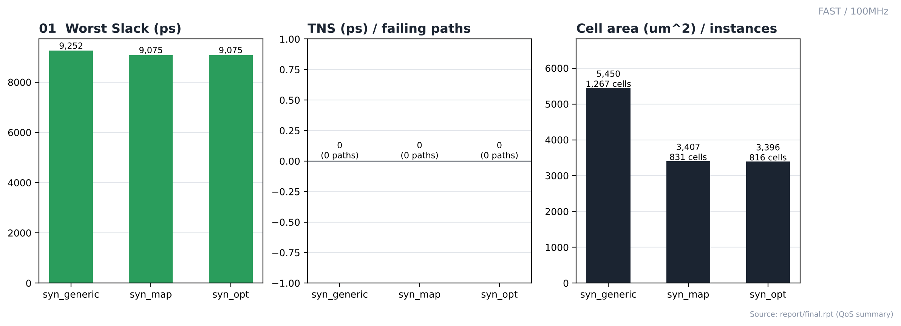
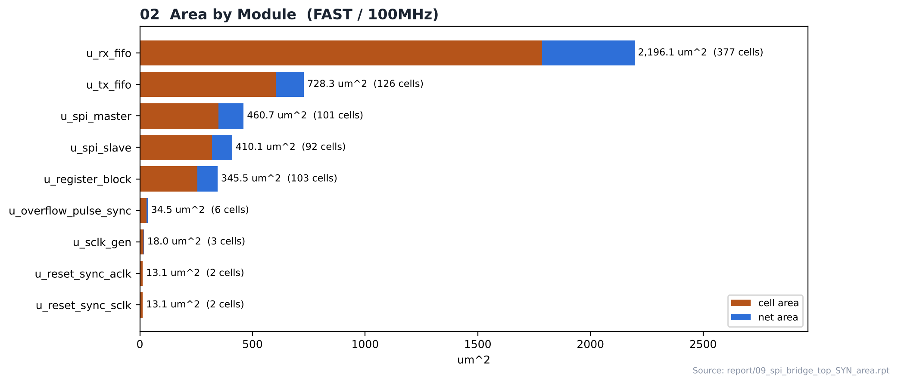
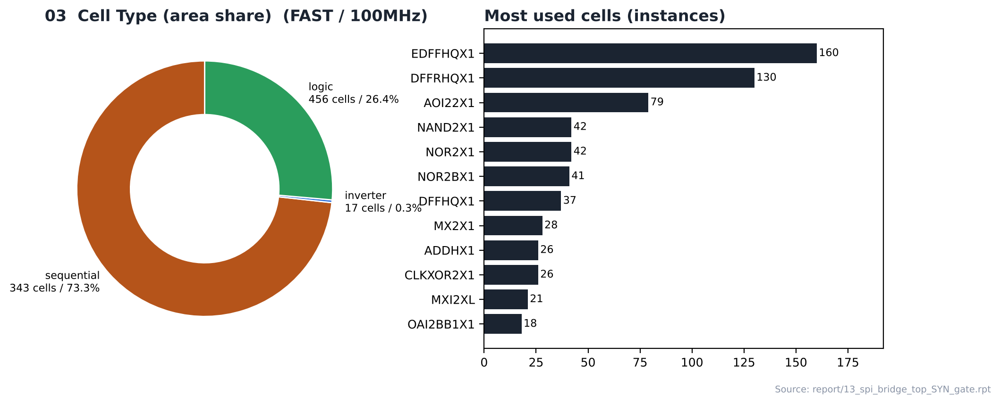
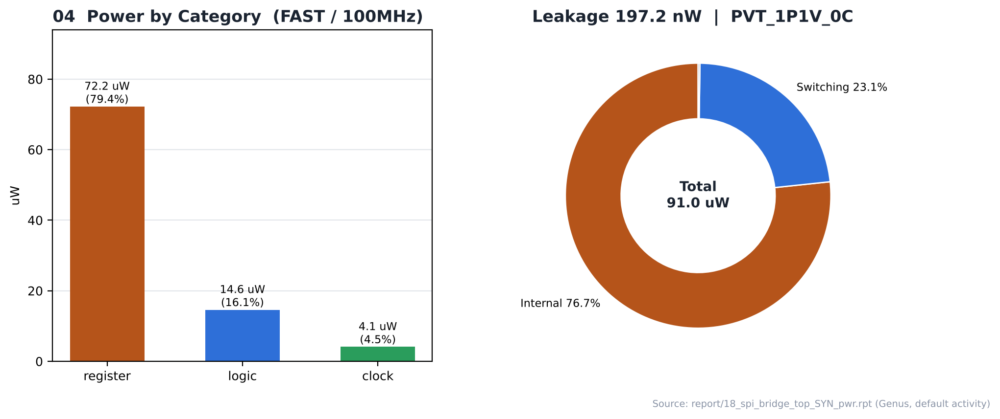

# 04. Logic Synthesis — FAST / 100MHz

| Item | Value |
|---|---|
| Corner (synthesis library) | **FAST** — `fast_vdd1v0 (FF, 1.1 V, 0 °C)` |
| Clock | **ACLK 10 ns (100 MHz)**, SCLK = ACLK ÷ 4 (generated clock) |
| Tool | Cadence Genus 22.17 |
| Operating condition | `PVT_1P1V_0C` |
| Script | [`scripts/spi_bridge_top_45nm_FAST.tcl`](scripts/spi_bridge_top_45nm_FAST.tcl) (run: [`scripts/run_synthesis`](scripts/run_synthesis)) |
| Output | `results/spi_bridge_top_syn_final.v` → PnR 입력 넷리스트 |

---

## 1. Flow

```text
read_libs (fast_vdd1v0_basicCells.lib) / read_physical (LEF) / read_qrc
      ↓
read_hdl (8 RTL files) → elaborate → uniquify → check_design
      ↓
source spi_bridge_top.sdc + dont_use_45nm.tcl → check_timing_intent
      ↓
syn_generic (effort high) → syn_map (high) → syn_opt (high)
      ↓
report_* (area / gates / power / qor / timing) → write_hdl / write_sdc / write_sdf
```

`auto_ungroup none`(계층 유지), `optimize_merge_flops false`. SLOW와 FAST 스크립트의 차이는 `LIB_LIST`의 표준 셀 라이브러리 한 줄뿐입니다.

## 2. Result (syn_opt)

| Item | Value |
|---|---|
| ACLK worst slack / TNS / violating | **9,074.9 ps** / 0.0 ps / 0 |
| SCLK worst slack / TNS / violating | 9,314.4 ps / 0.0 ps / 0 |
| Leaf instances | 816 (sequential 343, combinational 473) |
| Cell area / net area / total | 3,396.402 / 991.480 / **4,387.882 µm²** |
| Max / average fanout | 240 (o_dbg_sclk) / 2.5 |
| Power (Genus, default activity) | 90.96 µW (internal 76.7 %, switching 23.1 %, leakage 197.2 nW) |
| Design rules | Max_transition no violations, Max_capacitance no violations, Max_fanout no constraints |
| Runtime | 46 s (generic 00:00:19 / map 00:00:13 / opt 00:00:04) |

## 3. QoS by Stage (`report/final.rpt`)

| Metric | syn_generic | syn_map | syn_opt |
|---|---|---|---|
| Worst slack (ps) | 9,252 | 9,075 | **9,075** |
| TNS (ps) | 0 | 0 | 0 |
| Failing paths | 0 | 0 | 0 |
| Cell area (µm²) | 5,450 | 3,407 | 3,396 |
| Leaf instances | 1,267 | 831 | 816 |

## 4. Cell Composition

| Type | Instances | Area (µm²) | Area % |
|---|---|---|---|
| sequential | 343 | 2,488.050 | 73.3 |
| inverter | 17 | 11.628 | 0.3 |
| logic | 456 | 896.724 | 26.4 |

| Module | Cells | Cell area | Net area | Total (µm²) |
|---|---|---|---|---|
| `u_rx_fifo` | 377 | 1,784.898 | 411.249 | 2,196.147 |
| `u_tx_fifo` | 126 | 603.288 | 125.040 | 728.328 |
| `u_spi_master` | 101 | 348.840 | 111.907 | 460.747 |
| `u_spi_slave` | 92 | 319.428 | 90.715 | 410.143 |
| `u_register_block` | 103 | 255.132 | 90.411 | 345.543 |
| `u_overflow_pulse_sync` | 6 | 30.096 | 4.428 | 34.524 |
| `u_sclk_gen` | 3 | 15.732 | 2.224 | 17.956 |
| `u_reset_sync_aclk` | 2 | 12.312 | 0.741 | 13.053 |
| `u_reset_sync_sclk` | 2 | 12.312 | 0.741 | 13.053 |

## 5. Checks

| check_design | Count |
|---|---|
| Unloaded Sequential Pin(s) | 9 |
| Unloaded Combinational Pin(s) | 3 |
| Assigns | 2 |
| Constant hierarchical Pin(s) | 64 |
| Libcells with no LEF cell | 4 |
| Physical (LEF) cells with no libcell | 107 |

그 외 unresolved reference, multidriven, undriven 항목은 모두 0입니다 → [`reports/00_check_design.rpt`](reports/00_check_design.rpt)

## 6. Notes

- **FAST는 합성 코너(FF, 1.1 V, 0 °C)가 PnR setup 검사 코너(SS, 0.9 V, 125 °C)와 다른 비교용 실행입니다.** Genus는 FF 조건에서 셀이 빠르다고 보고 더 작은 셀로 타이밍을 맞추므로, 같은 주파수 SLOW보다 셀 면적이 작고(3,396.4 vs 3,506.2 µm²) 합성 slack도 크게 나옵니다(9,074.9 vs 7,101.2 ps). 이 넷리스트를 PnR에서 SS 조건으로 검사했을 때의 결과는 [10_Placement](../../../10_Placement/FAST/100MHz)와 [16_Timing_Closure](../../../16_Timing_Closure/FAST/100MHz)에 있습니다.
- 실무에서는 합성도 setup 검사 코너(SS)로 하거나, Genus에 PnR과 같은 MMMC를 읽혀 여러 코너를 함께 맞추는 것이 일반적입니다.
- 합성 단계에서 setup 위반이 없습니다.
- 전력은 Genus 기본 activity로 계산한 추정값입니다.

## Analysis

### A.1 Generic → Map → Opt



- **What** — 합성 3단계에서 worst slack, TNS, 셀 면적이 어떻게 바뀌는지
- **Observe** — worst slack 9,252 → 9,075 → **9,075 ps**, failing paths 0 → 0 → 0
- **Observe** — cell area 5,450 → 3,407 → 3,396 µm² (generic 단계는 라이브러리 매핑 전 추정 면적)
- **Insight** — syn_opt 후 setup 위반 없이 합성이 끝났습니다.

### A.2 Area by Module



- **What** — 모듈별 cell / net 면적
- **Observe** — `u_rx_fifo`(async_fifo_DATA_WIDTH8_ADDR_WIDTH4)가 2,196.1 µm²로 전체의 52 %
- **Observe** — 그다음 `u_tx_fifo` 728.3 µm², `u_spi_master` 460.7 µm²
- **Insight** — 모듈 이름의 파라미터(`ADDR_WIDTH4` / `ADDR_WIDTH2`)대로 RX FIFO(16 entry)가 TX FIFO(4 entry)보다 저장 플립플롭이 많아 면적 차이가 큽니다.

### A.3 Cell Composition



- **What** — 셀 종류별 면적 비율과 많이 쓰인 셀
- **Observe** — sequential 343개가 면적의 **73.3 %**
- **Observe** — 가장 많이 쓰인 셀: `EDFFHQX1` 160, `DFFRHQX1` 130, `AOI22X1` 79, `NAND2X1` 42
- **Insight** — FIFO 저장 플립플롭이 면적 대부분을 차지하는 레지스터 중심 설계입니다.

### A.4 Power



- **What** — Genus 기본 activity로 계산한 카테고리별 전력
- **Observe** — register 79.4 % / logic 16.1 % / clock 4.5 %, 합계 91.0 µW
- **Observe** — internal 76.7 %, switching 23.1 %, leakage 197.2 nW
- **Insight** — 전력도 플립플롭(register)이 가장 큰 비중을 차지합니다. vectorless 추정값이라 절대값보다 실행 간 비교용으로 보는 것이 맞습니다.


## 7. Images

| | |
|---|---|
|  | **01 QoS by Stage** — generic → map → opt 단계별 slack / TNS / 면적 |
|  | **02 Area by Module** — 모듈별 cell / net 면적 |
|  | **03 Cell Type** — sequential / logic / inverter / buffer 비율, 많이 쓰인 셀 |
|  | **04 Power** — 카테고리별 전력과 구성 |

> 01–04는 `reports/`의 Genus 리포트 수치로 그린 그림입니다. top 계층 schematic(generic / mapped) 캡처는 [SLOW/100MHz](../../SLOW/100MHz/README.md)에 있습니다. 하위 모듈 블록과 IO 연결은 RTL에서 정해지므로 모든 실행이 같고, top 레벨 glue 셀의 종류만 실행마다 다를 수 있습니다.

## Files

```text
04_Synthesis/FAST/100MHz/
├── README.md
│
├── scripts/
│   ├── dont_use_45nm.tcl
│   ├── run_synthesis
│   ├── spi_bridge_top.sdc
│   └── spi_bridge_top_45nm_FAST.tcl
│
├── reports/
│   ├── 00_check_design.rpt
│   ├── 03_report_datapath_generic.rpt
│   ├── 04_report_datapath_map.rpt
│   ├── 09_spi_bridge_top_SYN_area.rpt
│   ├── 12_spi_bridge_top_SYN_design_rules.rpt
│   ├── 13_spi_bridge_top_SYN_gate.rpt
│   ├── 14_spi_bridge_top_SYN_hier.rpt
│   ├── 18_spi_bridge_top_SYN_pwr.rpt
│   ├── 19_spi_bridge_top_SYN_qor.rpt
│   ├── cds_syn_runtime
│   ├── final.rpt
│   ├── genus_all.log
│   ├── syn_generic_qor.rpt
│   ├── syn_map_qor.rpt
│   └── syn_opt_qor.rpt
│
├── images/
│   ├── 01_QoS_by_Stage.png
│   ├── 02_Area_by_Module.png
│   ├── 03_Cell_Type.png
│   └── 04_Power.png
│
└── results/
    ├── spi_bridge_top_delays.sdf
    ├── spi_bridge_top_syn_final.sdc
    └── spi_bridge_top_syn_final.v
```
