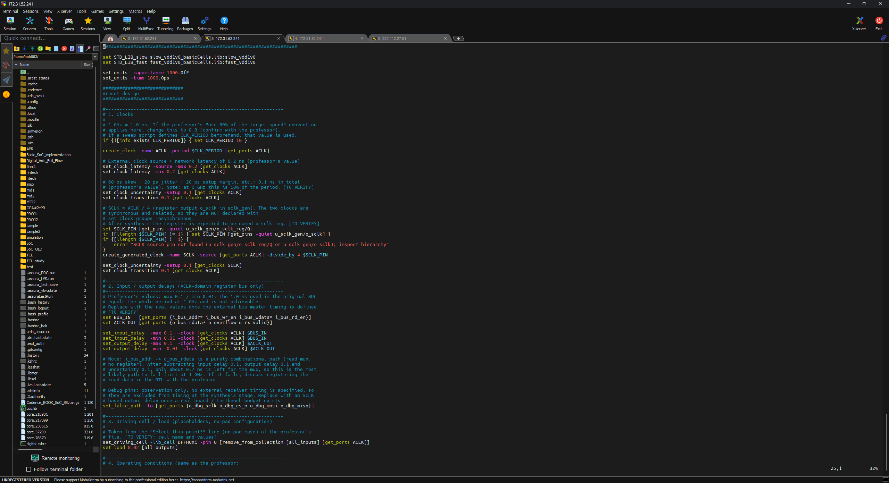
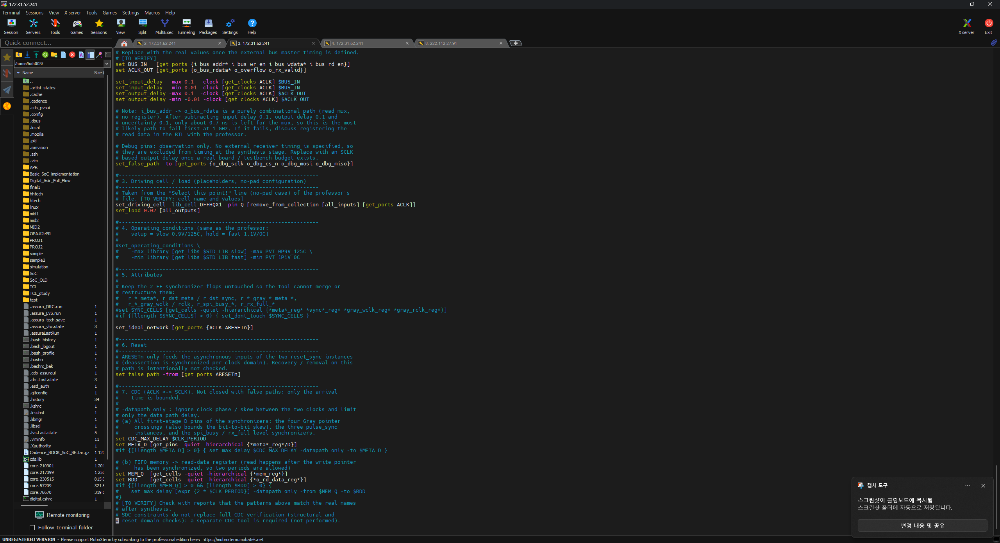
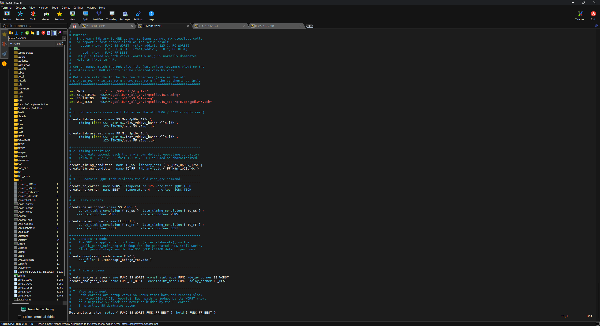
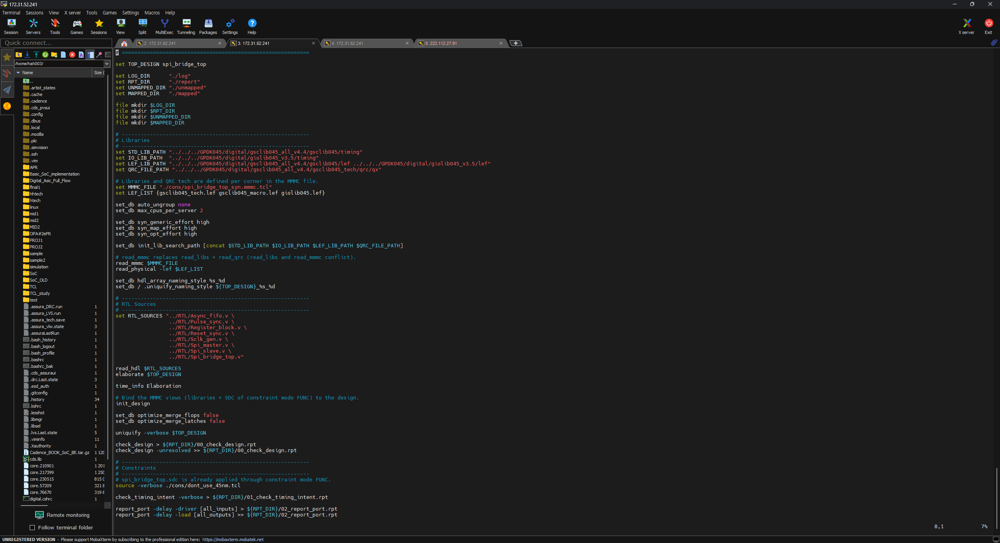
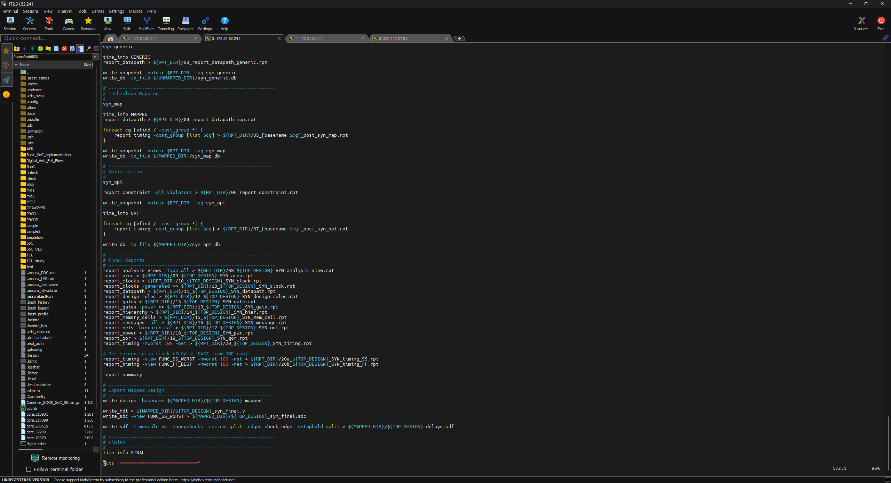
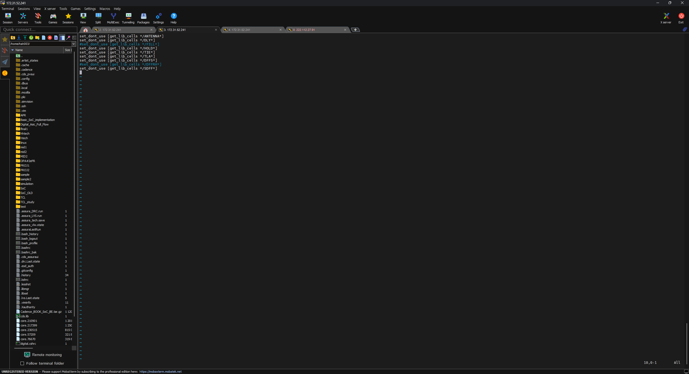
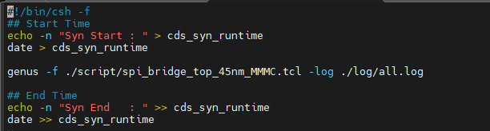

# 04. Logic Synthesis — MMMC / 100MHz

> **프로젝트 기준 run** — 이 넷리스트(`results/spi_bridge_top_syn_final.v`, 85,565 bytes)가 Pre LEC, PnR, Post LEC, Pre/Post GLS에 모두 쓰였습니다. 같은 파일인지는 LEC 로그와 PnR 인스턴스 수로 확인했습니다.

| Item | Value |
|---|---|
| Corner | **MMMC** — setup `FUNC_SS_WORST` (slow_vdd1v0, 125 °C) + `FUNC_FF_BEST` (fast_vdd1v0, 0 °C), hold view `FUNC_FF_BEST` |
| Clock | **ACLK 10 ns (100 MHz)**, SCLK = ACLK ÷ 4 (generated clock) |
| Tool | Cadence Genus 22.17 |
| Script | [`scripts/spi_bridge_top_45nm_MMMC.tcl`](scripts/spi_bridge_top_45nm_MMMC.tcl) + [`scripts/spi_bridge_top_syn.mmmc.tcl`](scripts/spi_bridge_top_syn.mmmc.tcl) (run: [`scripts/run_synthesis2`](scripts/run_synthesis2)) |
| Output | `results/spi_bridge_top_syn_final.v` → PnR 입력 넷리스트 |

> **왜 MMMC로 바꿨나** — SLOW/FAST 비교 실험에서, 합성 코너(FF)가 PnR 검사 코너(SS)와 다르면 합성 slack이 좋아 보여도 PnR에서 깨진다는 것을 확인했습니다 (FAST 1GHz: 합성 +109 ps → PnR setup −481 ps). 그래서 라이브러리를 코너별 library set으로 묶고, setup 판정을 SS 코너로 고정하는 MMMC 합성으로 바꿨습니다.

---

## 1. Flow

```text
read_mmmc (library set SS/FF, rc corner WORST/BEST, constraint mode FUNC) / read_physical (LEF)
      ↓
read_hdl (8 RTL files) → elaborate → init_design (SDC는 constraint mode FUNC로 적용)
      ↓
syn_generic → syn_map → syn_opt
      ↓
report_* + report_timing -view FUNC_SS_WORST / FUNC_FF_BEST → write_hdl / write_sdc -view FUNC_SS_WORST / write_sdf
```

기존 SLOW 스크립트와의 차이: `read_libs` / `read_qrc` → `read_mmmc`, `elaborate` 뒤 `init_design` 추가, SDC는 `source` 대신 constraint mode로 적용, 코너별 타이밍 리포트 20a(SS) / 20b(FF) 추가.

## 2. Result (syn_opt)

| View | Slack (ps) | R2R | I2R | R2O | I2O | Failing paths |
|---|---|---|---|---|---|---|
| `FUNC_SS_WORST` (setup 판정) | **+7,097** | 7,191 | 7,764 | 7,097 | 7,992 | 0 |
| `FUNC_FF_BEST` (참고) | +9,157 | 9,302 | 9,344 | 9,157 | 9,283 | 0 |

| Item | Value |
|---|---|
| Cell area | 3,513 µm² (syn_generic 5,447 → syn_map 3,518 → syn_opt 3,513) |
| Leaf instances | 828 |
| Power (Genus, vectorless) | 56.9 µW (register 77.6 %, logic 19.1 %, clock 3.3 %) |
| Runtime | 21:46:35 → 21:47:50 (약 1분 15초) |

**SLOW(read_libs) 100MHz와 비교:** slack +7,101 → +7,097 ps, area 3,506 → 3,513 µm², leaf 837 → 828. 기존 SLOW 스크립트도 slow 라이브러리 하나만 읽었으므로 SS 결과는 거의 같습니다. MMMC의 차이는 **한 번의 실행으로 SS·FF 두 코너 slack이 함께 나오고, setup 판정이 SS로 고정된다**는 점입니다.

## 3. Worst Path

| Item | `FUNC_SS_WORST` (20a) | `FUNC_FF_BEST` (20b) |
|---|---|---|
| Path | `u_rx_fifo/r_wr_ptr_gray_rclk_reg_4/CK` → `o_bus_rdata[4]` (R2O) | 같은 경로 |
| Slack | +7,097 ps | +9,157 ps |
| Data path delay | 2,703 ps | 643 ps |

같은 경로의 지연이 SS와 FF에서 약 4배 차이 납니다.

## 4. Checks

| Check | Result |
|---|---|
| Analysis view (`08_..._analysis_view.rpt`) | setup `FUNC_SS_WORST`, `FUNC_FF_BEST` / hold `FUNC_FF_BEST` |
| Library of mapped cells (`13_..._gate.rpt`) | 60개 셀 종류 모두 `slow_vdd1v0` (fast 셀 혼입 없음) |
| SDC 적용 | 두 view 모두 `Reading SDC ... for view` 확인 |

## 5. Issues found and fixed

| Issue | Cause | Fix |
|---|---|---|
| 첫 실행 `TUI-61: object_deleted` ([`reports/genus_first_try_TUI-61.log`](reports/genus_first_try_TUI-61.log)) | SDC 맨 위 `reset_design`이 두 번째 view의 SDC를 읽을 때 첫 view에서 만든 객체를 지움 | SDC의 `reset_design` 주석 처리 → 정상 완료 ([`reports/genus_all.log`](reports/genus_all.log)) |
| 출력 SDC에 `set_ideal_network`(ACLK, ARESETn) 없음 | `write_sdc -view` 출력 차이 | PnR은 CTS 전까지 클럭을 ideal로 다루므로 영향 작음. 기록만 함 |

## Scripts (실제 화면)

`scripts/`의 파일을 vim으로 연 화면입니다.

### S.1 SDC — clock / I/O



- `create_clock ACLK -period $CLK_PERIOD` (기본 10 ns), `set_clock_latency -source -max 0.2` + `-max 0.2`, `set_clock_uncertainty -setup 0.1`
- `create_generated_clock SCLK -divide_by 4` (source pin `u_sclk_gen/o_sclk_reg/Q`)
- `set_input_delay` / `set_output_delay` -max 0.1 / -min 0.01
- 맨 위 `#reset_design` — TUI-61 수정 흔적 (5. Issues 참고)

### S.2 SDC — 예외 / attribute



- `set_false_path -to {o_dbg_*}` (debug 출력), `set_false_path -from ARESETn` (비동기 리셋 입력)
- `set_ideal_network {ACLK ARESETn}`
- CDC `set_max_delay -datapath_only`는 주석 상태 (미적용)

### S.3 MMMC 정의 — spi_bridge_top_syn.mmmc.tcl



- library set `SS_Max_0p90v_125c` / `FF_Min_1p10v_0c` → timing condition `TC_SS` / `TC_FF`
- rc corner `WORST` (125 °C) / `BEST` (0 °C) → delay corner `SS_WORST` / `FF_BEST`
- constraint mode `FUNC` = `spi_bridge_top.sdc`
- `set_analysis_view -setup {FUNC_SS_WORST FUNC_FF_BEST} -hold {FUNC_FF_BEST}`

### S.4 Genus 메인 스크립트 — 설정 · 읽기



- `syn_generic/map/opt_effort high`, `read_mmmc` + `read_physical -lef`
- `read_hdl` (RTL 8개) → `elaborate` → `init_design` (이 시점에 SDC 적용)
- `source dont_use_45nm.tcl` → `check_timing_intent`

### S.5 Genus 메인 스크립트 — 합성 · 출력



- `syn_generic` → `syn_map` → `syn_opt`, 단계별 `write_db` / `report_*`
- `report_timing -view FUNC_SS_WORST` / `FUNC_FF_BEST` (20a / 20b)
- `write_hdl`, `write_sdc -view FUNC_SS_WORST`, `write_sdf` → PnR · LEC · GLS 입력

### S.6 dont_use_45nm.tcl



- `set_dont_use` ANTENNA*, DLY*, HOLD*, TIE*, TLA*, DFFS*, SDFF* (FILL*, DFFRH*는 주석)
- 지연 셀(DLY*, HOLD*)은 합성에서 쓰지 않고 hold 보정은 PnR에서 수행, scan FF(SDFF*)는 DFT 미적용이라 제외

### S.7 실행 스크립트



- `genus -f ./script/spi_bridge_top_45nm_MMMC.tcl -log ./log/all.log`
- 실행 파일: [`scripts/run_synthesis2`](scripts/run_synthesis2). 같은 폴더의 [`scripts/run_synthesis`](scripts/run_synthesis)는 `spi_bridge_top_45nm_SLOW.tcl`을 호출하는 SLOW용 파일입니다.

## 6. Files

```text
04_Synthesis/MMMC/100MHz/
├── README.md
│
├── images/
│   ├── 01_SDC_clock_io.png
│   ├── 02_SDC_exceptions.png
│   ├── 03_MMMC_tcl.png
│   ├── 04_Genus_setup.png
│   ├── 05_Genus_syn_flow.png
│   ├── 06_dont_use.png
│   └── 07_run_synthesis2.png
│
├── reports/
│   ├── 00_check_design.rpt
│   ├── 01_check_timing_intent.rpt
│   ├── 08_spi_bridge_top_SYN_analysis_view.rpt
│   ├── 09_spi_bridge_top_SYN_area.rpt
│   ├── 12_spi_bridge_top_SYN_design_rules.rpt
│   ├── 13_spi_bridge_top_SYN_gate.rpt
│   ├── 14_spi_bridge_top_SYN_hier.rpt
│   ├── 18_spi_bridge_top_SYN_pwr.rpt
│   ├── 19_spi_bridge_top_SYN_qor.rpt
│   ├── 20a_spi_bridge_top_SYN_timing_SS.rpt
│   ├── 20b_spi_bridge_top_SYN_timing_FF.rpt
│   ├── cds_syn_runtime
│   ├── final.rpt
│   ├── genus_all.log
│   ├── genus_first_try_TUI-61.log
│   └── syn_opt_qor.rpt
│
├── results/
│   ├── spi_bridge_top_delays.sdf
│   ├── spi_bridge_top_syn_final.sdc
│   └── spi_bridge_top_syn_final.v
│
└── scripts/
    ├── dont_use_45nm.tcl
    ├── run_synthesis
    ├── run_synthesis2
    ├── spi_bridge_top.sdc
    ├── spi_bridge_top_45nm_MMMC.tcl
    └── spi_bridge_top_syn.mmmc.tcl
```

## Files

```text
04_Synthesis/MMMC/100MHz/
├── README.md
│
├── images/
│   ├── 01_SDC_clock_io.png
│   ├── 02_SDC_exceptions.png
│   ├── 03_MMMC_tcl.png
│   ├── 04_Genus_setup.png
│   ├── 05_Genus_syn_flow.png
│   ├── 06_dont_use.png
│   └── 07_run_synthesis2.png
│
├── reports/
│   ├── 00_check_design.rpt
│   ├── 01_check_timing_intent.rpt
│   ├── 08_spi_bridge_top_SYN_analysis_view.rpt
│   ├── 09_spi_bridge_top_SYN_area.rpt
│   ├── 12_spi_bridge_top_SYN_design_rules.rpt
│   ├── 13_spi_bridge_top_SYN_gate.rpt
│   ├── 14_spi_bridge_top_SYN_hier.rpt
│   ├── 18_spi_bridge_top_SYN_pwr.rpt
│   ├── 19_spi_bridge_top_SYN_qor.rpt
│   ├── 20a_spi_bridge_top_SYN_timing_SS.rpt
│   ├── 20b_spi_bridge_top_SYN_timing_FF.rpt
│   ├── cds_syn_runtime
│   ├── final.rpt
│   ├── genus_all.log
│   ├── genus_first_try_TUI-61.log
│   ├── syn_generic_qor.rpt
│   ├── syn_map_qor.rpt
│   └── syn_opt_qor.rpt
│
├── results/
│   ├── spi_bridge_top_delays.sdf
│   ├── spi_bridge_top_syn_final.sdc
│   └── spi_bridge_top_syn_final.v
│
└── scripts/
    ├── dont_use_45nm.tcl
    ├── run_synthesis
    ├── run_synthesis2
    ├── spi_bridge_top.sdc
    ├── spi_bridge_top_45nm_MMMC.tcl
    └── spi_bridge_top_syn.mmmc.tcl
```
