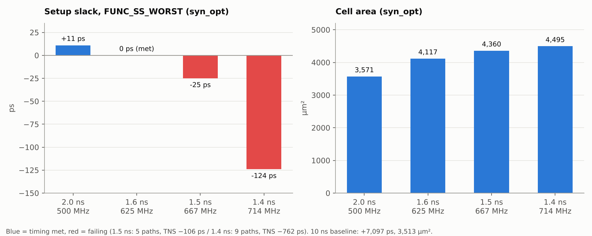

# 04. Logic Synthesis — MMMC

SLOW/FAST 비교 실험 다음에 바꾼 **최종 합성 방식**입니다. 하나의 Genus 실행에서 SS·FF 두 코너를 함께 보고, setup 판정은 SS 코너로 고정합니다.

> **MMMC 조건** — setup view `FUNC_SS_WORST` (slow_vdd1v0, RC WORST, 125 °C), hold view `FUNC_FF_BEST` (fast_vdd1v0, RC BEST, 0 °C). 합성과 PnR 모두 같은 두 view를 쓰며, PnR은 합성에서 넷리스트와 SDC만 받습니다.

## Runs

| Run | ACLK | SS slack | FF slack | TNS (SS) | Area | Leaf | Power (Genus) | 다음 단계 |
|---|---|---|---|---|---|---|---|---|
| [100MHz](100MHz) | 10 ns | **+7,097 ps** | +9,157 ps | 0 | 3,513 µm² | 828 | 56.9 µW | **기준 run** → LEC · PnR · GLS 전체 |
| [500MHz](500MHz) | 2.0 ns | +11 ps | +1,297 ps | 0 | 3,571 µm² | 850 | 290.7 µW | PnR |
| [625MHz](625MHz) | 1.6 ns | **0 ps** | +914 ps | 0 | 4,117 µm² | 959 | 413.8 µW | PnR (Fmax) |
| [667MHz](667MHz) | 1.5 ns | −25 ps | +813 ps | −106 ps | 4,360 µm² | 1,014 | 468.2 µW | 중단 |
| [714MHz](714MHz) | 1.4 ns | −124 ps | +725 ps | −762 ps | 4,495 µm² | 1,033 | 508.2 µW | 중단 |

- 사양 주파수는 **100 MHz**이며, 이후 모든 단계의 기준은 10 ns run입니다.
- 2.0 ~ 1.4 ns는 이 설계가 어디까지 빨라질 수 있는지 보는 **Fmax 실험**입니다. 합성에서는 1.6 ns가 slack 0 ps로 한계였고, 1.5 ns부터 위반이 생겼습니다.
- 주기를 줄일수록 Genus가 셀을 키우고 버퍼를 넣어 면적이 3,513 → 4,495 µm²(+28 %)로 늘었습니다.
- worst path는 주기에 따라 바뀝니다. 10 ns · 1.5 ns · 1.4 ns는 RX FIFO 포인터 → `o_bus_rdata` 출력 경로(R2O), 2.0 ns · 1.6 ns는 내부 레지스터 간 경로(R2R)입니다.
