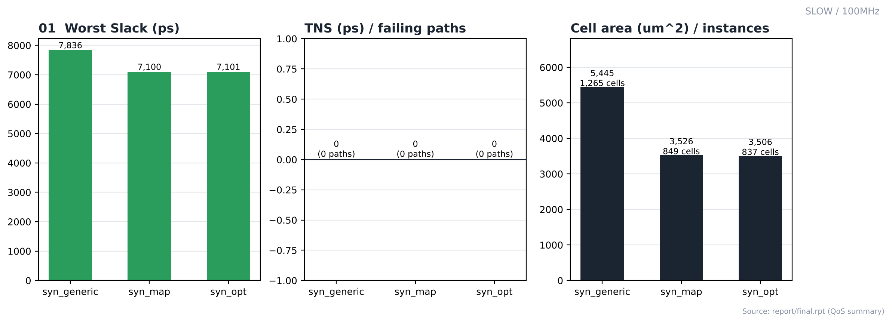
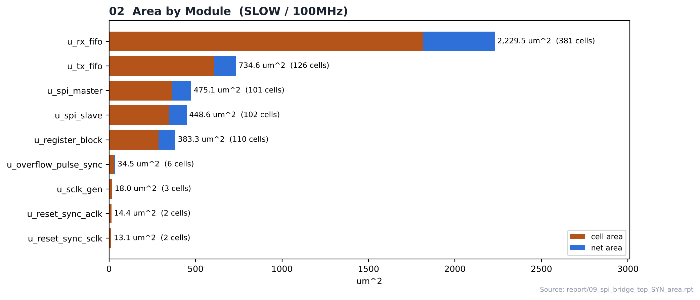
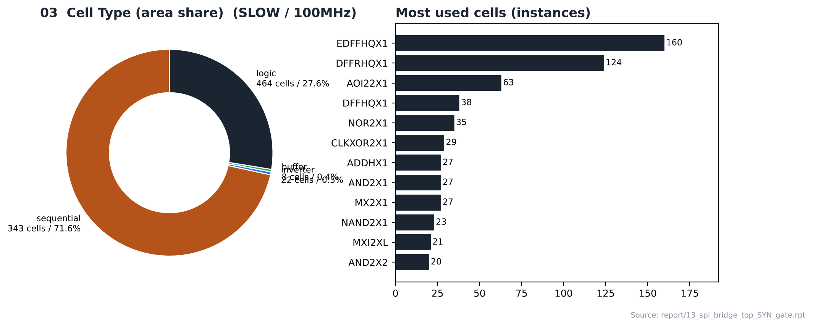
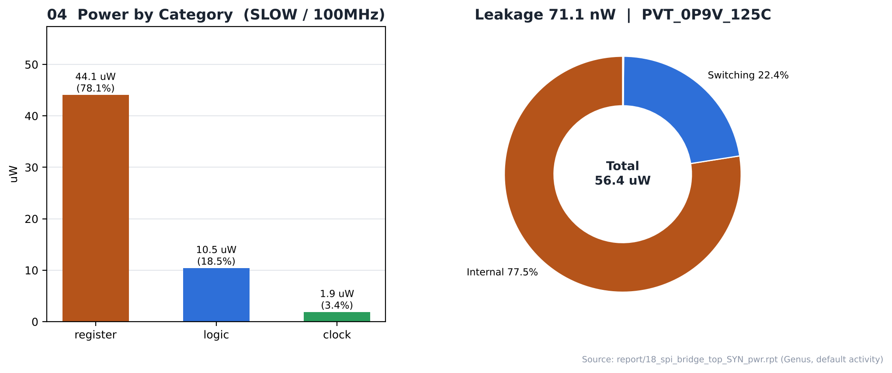
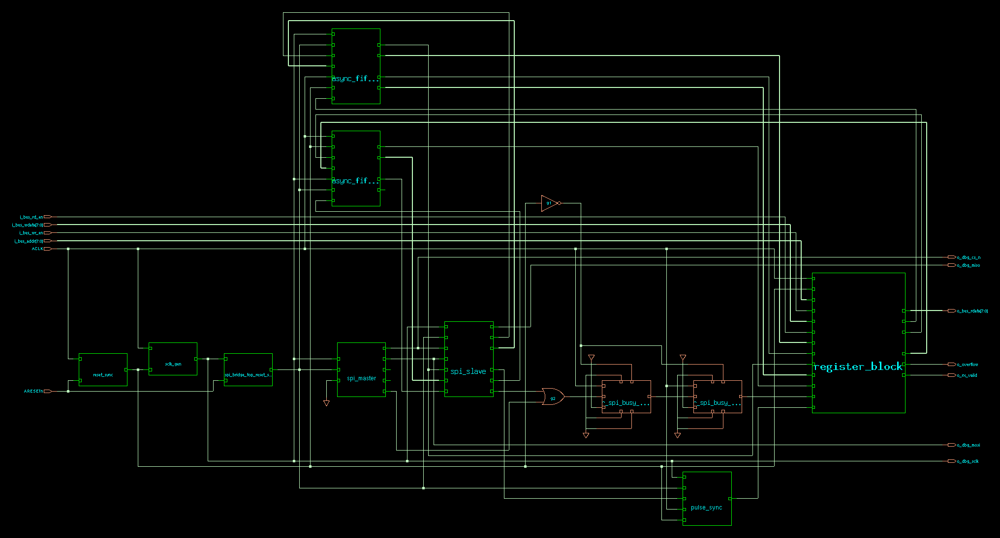
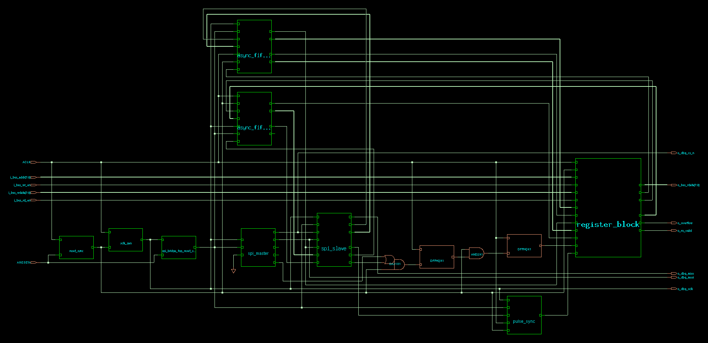

# 04. Logic Synthesis — SLOW / 100MHz

| Item | Value |
|---|---|
| Corner (synthesis library) | **SLOW** — `slow_vdd1v0 (SS, 0.9 V, 125 °C)` |
| Clock | **ACLK 10 ns (100 MHz)**, SCLK = ACLK ÷ 4 (generated clock) |
| Tool | Cadence Genus 22.17 |
| Operating condition | `PVT_0P9V_125C` |
| Script | [`scripts/spi_bridge_top_45nm_SLOW.tcl`](scripts/spi_bridge_top_45nm_SLOW.tcl) (run: [`scripts/run_synthesis`](scripts/run_synthesis)) |
| Output | `results/spi_bridge_top_syn_final.v` → PnR 입력 넷리스트 |

---

## 1. Flow

```text
read_libs (slow_vdd1v0_basicCells.lib) / read_physical (LEF) / read_qrc
      ↓
read_hdl (8 RTL files) → elaborate → uniquify → check_design
      ↓
source spi_bridge_top.sdc + dont_use_45nm.tcl → check_timing_intent
      ↓
syn_generic (effort high) → syn_map (high) → syn_opt (high)
      ↓
report_* (area / gates / power / qor / timing) → write_hdl / write_sdc / write_sdf
```

`auto_ungroup none`(계층 유지), `optimize_merge_flops false`. SLOW와 FAST 스크립트의 차이는 `LIB_LIST`의 표준 셀 라이브러리 한 줄뿐입니다.

## 2. Result (syn_opt)

| Item | Value |
|---|---|
| ACLK worst slack / TNS / violating | **7,101.2 ps** / 0.0 ps / 0 |
| SCLK worst slack / TNS / violating | 8,673.7 ps / 0.0 ps / 0 |
| Leaf instances | 837 (sequential 343, combinational 494) |
| Cell area / net area / total | 3,506.184 / 1,006.399 / **4,512.583 µm²** |
| Max / average fanout | 240 (o_dbg_sclk) / 2.4 |
| Power (Genus, default activity) | 56.45 µW (internal 77.5 %, switching 22.4 %, leakage 71.1 nW) |
| Design rules | Max_transition no violations, Max_capacitance no violations, Max_fanout no constraints |
| Runtime | 47 s (generic 00:00:20 / map 00:00:12 / opt 00:00:05) |

## 3. QoS by Stage (`report/final.rpt`)

| Metric | syn_generic | syn_map | syn_opt |
|---|---|---|---|
| Worst slack (ps) | 7,836 | 7,100 | **7,101** |
| TNS (ps) | 0 | 0 | 0 |
| Failing paths | 0 | 0 | 0 |
| Cell area (µm²) | 5,445 | 3,526 | 3,506 |
| Leaf instances | 1,265 | 849 | 837 |

## 4. Cell Composition

| Type | Instances | Area (µm²) | Area % |
|---|---|---|---|
| sequential | 343 | 2,509.254 | 71.6 |
| inverter | 22 | 16.074 | 0.5 |
| buffer | 8 | 13.680 | 0.4 |
| logic | 464 | 967.176 | 27.6 |

| Module | Cells | Cell area | Net area | Total (µm²) |
|---|---|---|---|---|
| `u_rx_fifo` | 381 | 1,815.678 | 413.834 | 2,229.512 |
| `u_tx_fifo` | 126 | 608.418 | 126.180 | 734.598 |
| `u_spi_master` | 101 | 363.204 | 111.926 | 475.130 |
| `u_spi_slave` | 102 | 345.762 | 102.841 | 448.603 |
| `u_register_block` | 110 | 286.938 | 96.322 | 383.260 |
| `u_overflow_pulse_sync` | 6 | 30.096 | 4.428 | 34.524 |
| `u_sclk_gen` | 3 | 15.732 | 2.224 | 17.956 |
| `u_reset_sync_aclk` | 2 | 13.680 | 0.741 | 14.421 |
| `u_reset_sync_sclk` | 2 | 12.312 | 0.741 | 13.053 |

## 5. Checks

| check_design | Count |
|---|---|
| Unloaded Sequential Pin(s) | 9 |
| Unloaded Combinational Pin(s) | 3 |
| Assigns | 2 |
| Constant hierarchical Pin(s) | 64 |
| Libcells with no LEF cell | 4 |
| Physical (LEF) cells with no libcell | 107 |

그 외 unresolved reference, multidriven, undriven 항목은 모두 0입니다 → [`reports/00_check_design.rpt`](reports/00_check_design.rpt)

## 6. Notes

- **SLOW는 합성 코너와 PnR setup 검사 코너가 같은(SS, 0.9 V, 125 °C) 기준 실행입니다.** 합성에서 맞춘 타이밍이 PnR 검사 조건과 같은 기준이라, 비교 대상인 FAST의 기준점이 됩니다.
- 합성 단계에서 setup 위반이 없습니다.
- 전력은 Genus 기본 activity로 계산한 추정값입니다.

## Analysis

### A.1 Generic → Map → Opt



- **What** — 합성 3단계에서 worst slack, TNS, 셀 면적이 어떻게 바뀌는지
- **Observe** — worst slack 7,836 → 7,100 → **7,101 ps**, failing paths 0 → 0 → 0
- **Observe** — cell area 5,445 → 3,526 → 3,506 µm² (generic 단계는 라이브러리 매핑 전 추정 면적)
- **Insight** — syn_opt 후 setup 위반 없이 합성이 끝났습니다.

### A.2 Area by Module



- **What** — 모듈별 cell / net 면적
- **Observe** — `u_rx_fifo`(async_fifo_DATA_WIDTH8_ADDR_WIDTH4)가 2,229.5 µm²로 전체의 51 %
- **Observe** — 그다음 `u_tx_fifo` 734.6 µm², `u_spi_master` 475.1 µm²
- **Insight** — 모듈 이름의 파라미터(`ADDR_WIDTH4` / `ADDR_WIDTH2`)대로 RX FIFO(16 entry)가 TX FIFO(4 entry)보다 저장 플립플롭이 많아 면적 차이가 큽니다.

### A.3 Cell Composition



- **What** — 셀 종류별 면적 비율과 많이 쓰인 셀
- **Observe** — sequential 343개가 면적의 **71.6 %**
- **Observe** — 가장 많이 쓰인 셀: `EDFFHQX1` 160, `DFFRHQX1` 124, `AOI22X1` 63, `DFFHQX1` 38
- **Insight** — FIFO 저장 플립플롭이 면적 대부분을 차지하는 레지스터 중심 설계입니다.

### A.4 Power



- **What** — Genus 기본 activity로 계산한 카테고리별 전력
- **Observe** — register 78.1 % / logic 18.5 % / clock 3.4 %, 합계 56.4 µW
- **Observe** — internal 77.5 %, switching 22.4 %, leakage 71.1 nW
- **Insight** — 전력도 플립플롭(register)이 가장 큰 비중을 차지합니다. vectorless 추정값이라 절대값보다 실행 간 비교용으로 보는 것이 맞습니다.

### A.5 Top Schematic — Generic



- **What** — syn_generic 단계 top 계층 (1,265 leaf cells)
- **Observe** — 하위 모듈 9개가 블록으로, top 레벨 glue 로직은 일반 게이트와 동기화 플립플롭 블록으로 표시됨

### A.6 Top Schematic — Mapped



- **What** — syn_map 단계 top 계층 (849 leaf cells)
- **Observe** — 같은 glue 로직이 `DFFHQX1`, `AND2X1`, `OR2X1` 라이브러리 셀로 바뀜
- **Observe** — 왼쪽 입력(`ACLK`, `ARESETn`, `i_bus_*`) → FIFO / SPI / register_block → 오른쪽 출력(`o_*`) 흐름
- **Insight** — generic → map에서 leaf cell이 1,265 → 849개로 줄었습니다. 일반 게이트 여러 개가 라이브러리의 복합 게이트(AOI, OAI 등) 하나로 묶이면서 개수가 줄어든 것으로 보입니다.


## 7. Images

| | |
|---|---|
|  | **01 QoS by Stage** — generic → map → opt 단계별 slack / TNS / 면적 |
|  | **02 Area by Module** — 모듈별 cell / net 면적 |
|  | **03 Cell Type** — sequential / logic / inverter / buffer 비율, 많이 쓰인 셀 |
|  | **04 Power** — 카테고리별 전력과 구성 |
|  | **05 Top schematic — syn_generic** (Genus GUI, 1,265 leaf cells). top 레벨 glue 로직이 아직 일반 게이트(inverter, OR)와 동기화 플립플롭 블록(`spi_busy…`)으로 표시됩니다. |
|  | **06 Top schematic — syn_map** (849 leaf cells). 같은 위치의 glue 로직이 `DFFHQX1`, `AND2X1`, `OR2X1` 등 라이브러리 셀로 매핑되었습니다. 9개 하위 모듈(`async_fifo` ×2, `spi_master`, `spi_slave`, `register_block`, `sclk_gen`, `reset_sync` ×2, `pulse_sync`)과 34개 IO 핀의 연결을 보여줍니다. |

> 01–04는 `reports/`의 Genus 리포트 수치로 그린 그림, 05–06은 Genus GUI schematic 캡처입니다(`read_db unmapped/syn_generic.db`, `mapped/syn_map.db` 단계).

## Files

```text
04_Synthesis/SLOW/100MHz/
├── README.md
│
├── scripts/
│   ├── dont_use_45nm.tcl
│   ├── run_synthesis
│   ├── spi_bridge_top.sdc
│   └── spi_bridge_top_45nm_SLOW.tcl
│
├── reports/
│   ├── 00_check_design.rpt
│   ├── 03_report_datapath_generic.rpt
│   ├── 04_report_datapath_map.rpt
│   ├── 09_spi_bridge_top_SYN_area.rpt
│   ├── 12_spi_bridge_top_SYN_design_rules.rpt
│   ├── 13_spi_bridge_top_SYN_gate.rpt
│   ├── 14_spi_bridge_top_SYN_hier.rpt
│   ├── 18_spi_bridge_top_SYN_pwr.rpt
│   ├── 19_spi_bridge_top_SYN_qor.rpt
│   ├── cds_syn_runtime
│   ├── final.rpt
│   ├── genus_all.log
│   ├── syn_generic_qor.rpt
│   ├── syn_map_qor.rpt
│   └── syn_opt_qor.rpt
│
├── images/
│   ├── 01_QoS_by_Stage.png
│   ├── 02_Area_by_Module.png
│   ├── 03_Cell_Type.png
│   ├── 04_Power.png
│   ├── 05_Schematic_Top_Generic.png
│   └── 06_Schematic_Top_Mapped.png
│
└── results/
    ├── spi_bridge_top_delays.sdf
    ├── spi_bridge_top_syn_final.sdc
    └── spi_bridge_top_syn_final.v
```
