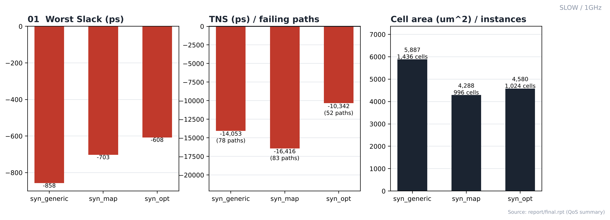
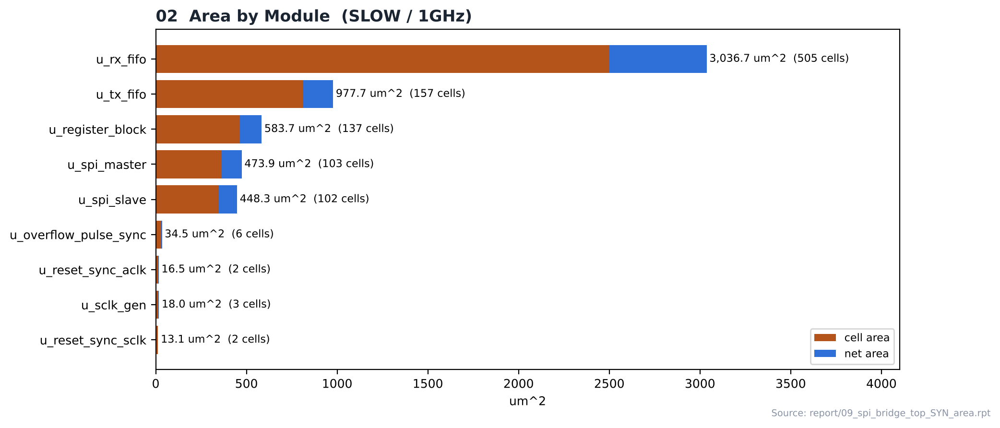
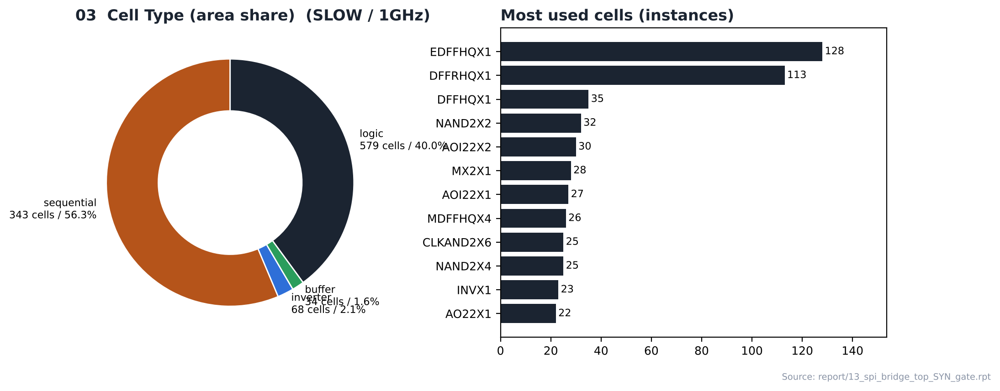
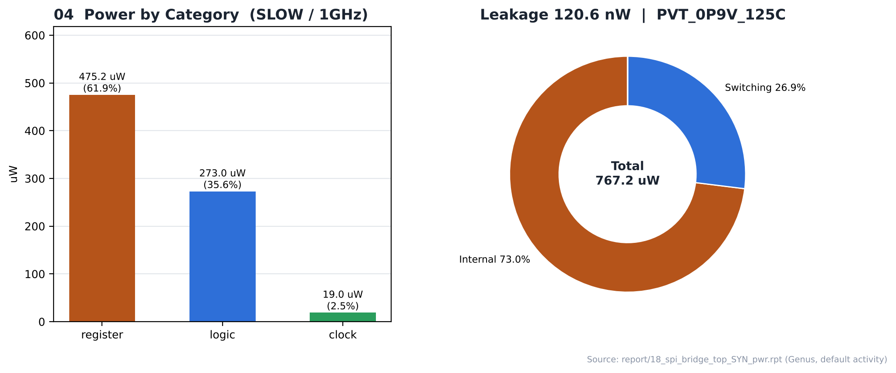

# 04. Logic Synthesis — SLOW / 1GHz

| Item | Value |
|---|---|
| Corner (synthesis library) | **SLOW** — `slow_vdd1v0 (SS, 0.9 V, 125 °C)` |
| Clock | **ACLK 1 ns (1 GHz)**, SCLK = ACLK ÷ 4 (generated clock) |
| Tool | Cadence Genus 22.17 |
| Operating condition | `PVT_0P9V_125C` |
| Script | [`scripts/spi_bridge_top_45nm_SLOW.tcl`](scripts/spi_bridge_top_45nm_SLOW.tcl) (run: [`scripts/run_synthesis`](scripts/run_synthesis)) |
| Output | `results/spi_bridge_top_syn_final.v` → PnR 입력 넷리스트 |

---

## 1. Flow

```text
read_libs (slow_vdd1v0_basicCells.lib) / read_physical (LEF) / read_qrc
      ↓
read_hdl (8 RTL files) → elaborate → uniquify → check_design
      ↓
source spi_bridge_top.sdc + dont_use_45nm.tcl → check_timing_intent
      ↓
syn_generic (effort high) → syn_map (high) → syn_opt (high)
      ↓
report_* (area / gates / power / qor / timing) → write_hdl / write_sdc / write_sdf
```

`auto_ungroup none`(계층 유지), `optimize_merge_flops false`. SLOW와 FAST 스크립트의 차이는 `LIB_LIST`의 표준 셀 라이브러리 한 줄뿐입니다.

## 2. Result (syn_opt)

| Item | Value |
|---|---|
| ACLK worst slack / TNS / violating | **-608.2 ps** / -9,663.5 ps / 44 |
| SCLK worst slack / TNS / violating | -90.7 ps / -678.8 ps / 8 |
| Leaf instances | 1,024 (sequential 343, combinational 681) |
| Cell area / net area / total | 4,579.722 / 1,198.739 / **5,778.461 µm²** |
| Max / average fanout | 240 (o_dbg_sclk) / 2.3 |
| Power (Genus, default activity) | 767.20 µW (internal 73.0 %, switching 26.9 %, leakage 120.6 nW) |
| Design rules | Max_transition no violations, Max_capacitance no violations, Max_fanout no constraints |
| Runtime | 86 s (generic 00:00:20 / map 00:00:19 / opt 00:00:37) |

## 3. QoS by Stage (`report/final.rpt`)

| Metric | syn_generic | syn_map | syn_opt |
|---|---|---|---|
| Worst slack (ps) | -858 | -703 | **-608** |
| TNS (ps) | -14,053 | -16,416 | -10,342 |
| Failing paths | 78 | 83 | 52 |
| Cell area (µm²) | 5,887 | 4,288 | 4,580 |
| Leaf instances | 1,436 | 996 | 1,024 |

## 4. Cell Composition

| Type | Instances | Area (µm²) | Area % |
|---|---|---|---|
| sequential | 343 | 2,580.390 | 56.3 |
| inverter | 68 | 96.786 | 2.1 |
| buffer | 34 | 72.504 | 1.6 |
| logic | 579 | 1,830.042 | 40.0 |

| Module | Cells | Cell area | Net area | Total (µm²) |
|---|---|---|---|---|
| `u_rx_fifo` | 505 | 2,500.704 | 536.004 | 3,036.708 |
| `u_tx_fifo` | 157 | 810.882 | 166.834 | 977.716 |
| `u_register_block` | 137 | 463.410 | 120.307 | 583.717 |
| `u_spi_master` | 103 | 359.784 | 114.130 | 473.914 |
| `u_spi_slave` | 102 | 344.736 | 103.582 | 448.318 |
| `u_overflow_pulse_sync` | 6 | 30.096 | 4.428 | 34.524 |
| `u_sclk_gen` | 3 | 15.732 | 2.224 | 17.956 |
| `u_reset_sync_aclk` | 2 | 15.732 | 0.741 | 16.473 |
| `u_reset_sync_sclk` | 2 | 12.312 | 0.741 | 13.053 |

## 5. Checks

| check_design | Count |
|---|---|
| Unloaded Sequential Pin(s) | 9 |
| Unloaded Combinational Pin(s) | 3 |
| Assigns | 2 |
| Constant hierarchical Pin(s) | 64 |
| Libcells with no LEF cell | 4 |
| Physical (LEF) cells with no libcell | 107 |

그 외 unresolved reference, multidriven, undriven 항목은 모두 0입니다 → [`reports/00_check_design.rpt`](reports/00_check_design.rpt)

## 6. Notes

- **SLOW는 합성 코너와 PnR setup signoff 코너가 같은(SS, 0.9 V, 125 °C) 기준 실행입니다.** 합성에서 맞춘 타이밍이 PnR 검사 조건과 같은 기준이라, 비교 대상인 FAST의 기준점이 됩니다.
- 합성 단계에서 setup 위반 52개 경로가 남았습니다 (TNS -10,342.3 ps). 세부 경로는 [07_Pre_STA](../../../07_Pre_STA/SLOW/1GHz)에 있습니다.
- 전력은 Genus 기본 activity로 계산한 추정값입니다.

## Analysis

### A.1 Generic → Map → Opt



- **What** — 합성 3단계에서 worst slack, TNS, 셀 면적이 어떻게 바뀌는지
- **Observe** — worst slack -858 → -703 → **-608 ps**, failing paths 78 → 83 → 52
- **Observe** — cell area 5,887 → 4,288 → 4,580 µm² (generic 단계는 라이브러리 매핑 전 추정 면적)
- **Insight** — syn_opt 후에도 52개 경로가 위반으로 남았습니다. 이 클럭 주기는 합성 단계에서 이미 빠듯합니다.

### A.2 Area by Module



- **What** — 모듈별 cell / net 면적
- **Observe** — `u_rx_fifo`(async_fifo_DATA_WIDTH8_ADDR_WIDTH4)가 3,036.7 µm²로 전체의 54 %
- **Observe** — 그다음 `u_tx_fifo` 977.7 µm², `u_register_block` 583.7 µm²
- **Insight** — 모듈 이름의 파라미터(`ADDR_WIDTH4` / `ADDR_WIDTH2`)대로 RX FIFO(16 entry)가 TX FIFO(4 entry)보다 저장 플립플롭이 많아 면적 차이가 큽니다.

### A.3 Cell Composition



- **What** — 셀 종류별 면적 비율과 많이 쓰인 셀
- **Observe** — sequential 343개가 면적의 **56.3 %**
- **Observe** — 가장 많이 쓰인 셀: `EDFFHQX1` 128, `DFFRHQX1` 113, `DFFHQX1` 35, `NAND2X2` 32
- **Insight** — FIFO 저장 플립플롭이 면적 대부분을 차지하는 레지스터 중심 설계입니다.

### A.4 Power



- **What** — Genus 기본 activity로 계산한 카테고리별 전력
- **Observe** — register 61.9 % / logic 35.6 % / clock 2.5 %, 합계 767.2 µW
- **Observe** — internal 73.0 %, switching 26.9 %, leakage 120.6 nW
- **Insight** — 전력도 플립플롭(register)이 가장 큰 비중을 차지합니다. vectorless 추정값이라 절대값보다 실행 간 비교용으로 보는 것이 맞습니다.


## 7. Images

| | |
|---|---|
|  | **01 QoS by Stage** — generic → map → opt 단계별 slack / TNS / 면적 |
|  | **02 Area by Module** — 모듈별 cell / net 면적 |
|  | **03 Cell Type** — sequential / logic / inverter / buffer 비율, 많이 쓰인 셀 |
|  | **04 Power** — 카테고리별 전력과 구성 |

> 01–04는 `reports/`의 Genus 리포트 수치로 그린 그림입니다. top 계층 schematic(generic / mapped) 캡처는 [SLOW/100MHz](../../SLOW/100MHz/README.md)에 있습니다. 하위 모듈 블록과 IO 연결은 RTL에서 정해지므로 모든 실행이 같고, top 레벨 glue 셀의 종류만 실행마다 다를 수 있습니다.

## Files

```text
04_Synthesis/SLOW/1GHz/
├── README.md
│
├── scripts/
│   ├── dont_use_45nm.tcl
│   ├── run_synthesis
│   ├── spi_bridge_top.sdc
│   └── spi_bridge_top_45nm_SLOW.tcl
│
├── reports/
│   ├── 00_check_design.rpt
│   ├── 03_report_datapath_generic.rpt
│   ├── 04_report_datapath_map.rpt
│   ├── 09_spi_bridge_top_SYN_area.rpt
│   ├── 12_spi_bridge_top_SYN_design_rules.rpt
│   ├── 13_spi_bridge_top_SYN_gate.rpt
│   ├── 14_spi_bridge_top_SYN_hier.rpt
│   ├── 18_spi_bridge_top_SYN_pwr.rpt
│   ├── 19_spi_bridge_top_SYN_qor.rpt
│   ├── cds_syn_runtime
│   ├── final.rpt
│   ├── genus_all.log
│   ├── syn_generic_qor.rpt
│   ├── syn_map_qor.rpt
│   └── syn_opt_qor.rpt
│
├── images/
│   ├── 01_QoS_by_Stage.png
│   ├── 02_Area_by_Module.png
│   ├── 03_Cell_Type.png
│   └── 04_Power.png
│
└── results/
    ├── spi_bridge_top_delays.sdf
    ├── spi_bridge_top_syn_final.sdc
    └── spi_bridge_top_syn_final.v
```
