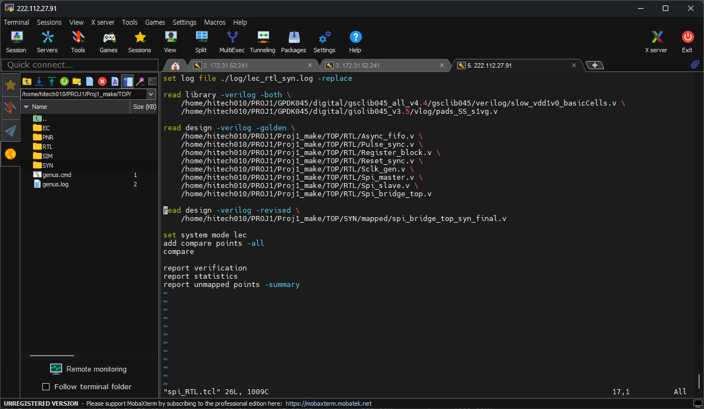

# 06. Pre LEC — RTL ↔ Synthesized Netlist

합성 넷리스트가 RTL과 논리적으로 같은지 Conformal LEC로 확인했습니다.

| Item | Value |
|---|---|
| Tool | Cadence Conformal LEC 22.10 (batch dofile) |
| Golden | RTL 8개 파일 (`02_RTL/RTL/*.v`) |
| Revised | `04_Synthesis/MMMC/100MHz/results/spi_bridge_top_syn_final.v` (기준 10 ns run) |
| Library | `slow_vdd1v0_basicCells.v` (셀 Verilog 모델) |
| Dofile | [`scripts/spi_RTL.tcl`](scripts/spi_RTL.tcl) |
| Log | [`logs/lec_rtl_syn.log`](logs/lec_rtl_syn.log) |
| **결과** | **PASS — Equivalent 357 / 357, Non-equivalent 0, Abort 0** |

## Result

| Mapping | PI | PO | DFF | Total |
|---|---|---|---|---|
| Golden (RTL) | 20 | 14 | 343 | 377 |
| Revised (netlist) | 20 | 14 | 343 | 377 |

| Compare | PO | DFF | Total |
|---|---|---|---|
| **Equivalent** | 14 | 343 | **357** |

| Unmapped | Golden | Revised |
|---|---|---|
| Unreachable DFF | 17 | 0 |

- Golden key point는 394개, Revised는 377개입니다. 차이 17개는 RTL에는 있지만 출력에 영향을 주지 않아 합성 중 제거된 FF로, LEC는 이를 **Unreachable**로 분류하고 비교 대상에서 뺍니다. 동등성 실패가 아닙니다.
- 비교 대상은 PO 14 + DFF 343 = 357개이며, 모두 Equivalent입니다.

## How to run

```text
$ lec -XL -nogui -dofile spi_RTL.tcl          # batch
SETUP> dofile ./script/script.tcl             # 또는 lec 실행 후 콘솔에서
```

dofile 순서: `read library` → `read design -golden` (RTL) → `read design -revised` (netlist) → `set system mode lec` → `add compare points -all` → `compare` → `report verification / statistics / unmapped points`.



> Genus가 만드는 `fv/.../rtl_to_fv_map.do`는 RTL ↔ Genus 중간 넷리스트 비교라서, 최종 넷리스트까지 확인하려면 위처럼 넷리스트를 직접 Revised로 읽습니다. Genus `write_do_lec`으로 dofile을 만드는 방법은 [`scripts/write_lec_dofile.tcl`](scripts/write_lec_dofile.tcl)에 있습니다.

## Files

```text
06_Pre_LEC/
├── README.md
│
├── images/
│   └── 01_LEC_Dofile.png
│
├── logs/
│   └── lec_rtl_syn.log
│
└── scripts/
    ├── README_HowtoRun
    ├── script.tcl
    ├── spi_RTL.tcl
    └── write_lec_dofile.tcl
```
