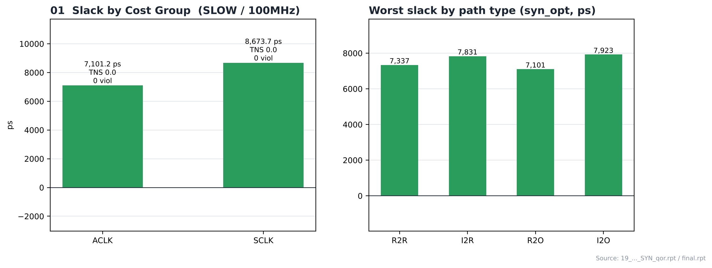
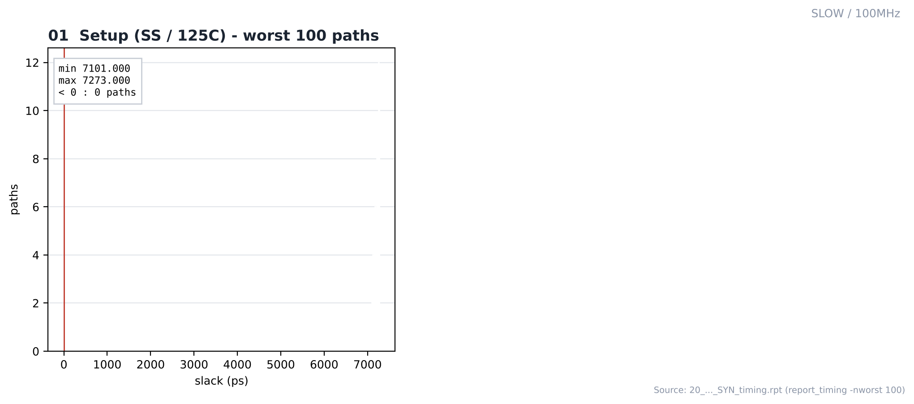
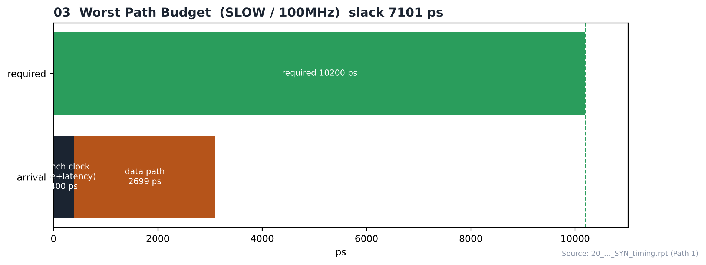

# 07. Pre-Layout STA (post-synthesis) — SLOW / 100MHz

| Item | Value |
|---|---|
| Corner (synthesis library) | **SLOW** — `slow_vdd1v0 (SS, 0.9 V, 125 °C)` |
| Clock | **ACLK 10 ns (100 MHz)**, SCLK = ACLK ÷ 4 (generated clock) |
| Tool | Cadence Genus 22.17 (`report_timing`, ideal clock) |
| Operating condition | `PVT_0P9V_125C` |
| Constraint | [`constraints/spi_bridge_top.sdc`](constraints/spi_bridge_top.sdc) → Genus 출력 [`spi_bridge_top_syn_final.sdc`](constraints/spi_bridge_top_syn_final.sdc) |

합성 직후 넷리스트를 배치 전(ideal clock, wire-load 없이 physical library 기준) 상태로 분석한 결과입니다. 배치 후 STA는 [15_Post_STA](../../../15_Post_STA/SLOW/100MHz)에 있습니다.

---

## 1. Constraint Summary

| Item | Value |
|---|---|
| ACLK period | 10,000 ps |
| SCLK (generated, ÷4) | 40,000 ps |
| Clock uncertainty (report 기준) | 100 ps |
| Output delay (worst path 기준) | 100 ps |

변수 값과 I/O delay, generated clock 정의는 [`constraints/spi_bridge_top.sdc`](constraints/spi_bridge_top.sdc)에 있습니다.

## 2. Timing by Cost Group (syn_opt)

| Cost group | Worst slack (ps) | TNS (ps) | Violating paths |
|---|---|---|---|
| ACLK | **7,101.2** | 0.0 | 0 |
| SCLK | 8,673.7 | 0.0 | 0 |

| Path type | Worst slack (ps) | TNS (ps) |
|---|---|---|
| R2R | 7,337 | 0 |
| I2R | 7,831 | 0 |
| R2O | 7,101 | 0 |
| I2O | 7,923 | 0 |

R2R = reg→reg, I2R = input→reg, R2O = reg→output, I2O = input→output (`report/final.rpt`)

## 3. Worst Path (Path 1, `20_spi_bridge_top_SYN_timing.rpt`)

| Item | Value |
|---|---|
| Status / slack | **MET (7101 ps)** |
| Check | Late External Delay Assertion at pin o_bus_rdata[4] |
| Start → End | `u_rx_fifo/r_wr_ptr_gray_rclk_reg_4/CK` → `o_bus_rdata[4]` |
| Required / launch / data path | 10200 / 400 / 2699 ps |
| Cells on path | 12 (`DFFRHQX1` → … → `OR3X4`) |

## 4. Top 100 Paths

| Item | Value |
|---|---|
| Slack range | 7101 ~ 7273 ps |
| Violating (of 100) | 0 |
| Check type | Late External Delay Assertion 100 |
| Cost group | ACLK 100 |

## 5. Timing Intent Check (`01_check_timing_intent.rpt`)

| Lint item | Count |
|---|---|
| Sequential data pins driven by a clock signal | 1 |
| Timing exceptions with no effect | 2 |
| Inputs without clocked external delays | 1 |
| Outputs without clocked external delays | 4 |

총 8건이며 나머지 항목은 0입니다.

## Analysis

합성 단계 STA는 ideal clock 기준이라 클럭 트리 지연과 실제 배선이 반영되지 않습니다. 배치·배선 후 결과는 15_Post_STA와 비교해 보세요.

### A.1 Slack by Cost Group / Path Type



- **What** — 클럭 그룹별, 경로 종류별 worst slack
- **Observe** — ACLK 7,101.2 ps / SCLK 8,673.7 ps
- **Observe** — path type: R2R 7,337, I2R 7,831, R2O 7,101, I2O 7,923 ps
- **Insight** — 가장 빠듯한 경로 종류는 **R2O**(7,101 ps)입니다. SCLK는 ACLK의 1/4 주파수라 여유가 더 큽니다.

### A.2 Slack Distribution (top 100)



- **What** — `report_timing -nworst 100` 경로의 slack 분포
- **Observe** — slack 7101 ~ 7273 ps, 위반 0개
- **Insight** — 상위 100개 경로가 모두 여유를 가집니다.

### A.3 Worst Path Budget



- **What** — 1번 경로의 launch / data path / required 구성
- **Observe** — `u_rx_fifo/r_wr_ptr_gray_rclk_reg_4/CK` → `o_bus_rdata[4]`
- **Observe** — data path 2699 ps, 사용 가능 시간(required − launch) 9800 ps → slack 7101 ps
- **Insight** — data path가 사용 가능 시간 안에 들어갑니다.


## 6. Images

| | |
|---|---|
|  | **01 Slack by Group** — cost group별, path type별 worst slack |
|  | **02 Slack Histogram** — `report_timing -nworst 100` 경로의 slack 분포 |
|  | **03 Worst Path Budget** — 1번 경로의 launch / data path / required 구성 |

## Files

```text
07_Pre_STA/SLOW/100MHz/
├── README.md
│
├── constraints/
│   ├── spi_bridge_top.sdc
│   └── spi_bridge_top_syn_final.sdc
│
├── reports/
│   ├── 01_check_timing_intent.rpt
│   ├── 02_report_port.rpt
│   ├── 05_ACLK_post_syn_map.rpt
│   ├── 05_SCLK_post_syn_map.rpt
│   ├── 05_default_post_syn_map.rpt
│   ├── 06_report_constraint.rpt
│   ├── 07_ACLK_post_syn_opt.rpt
│   ├── 07_SCLK_post_syn_opt.rpt
│   ├── 07_default_post_syn_opt.rpt
│   ├── 08_spi_bridge_top_SYN_analysis_view.rpt
│   ├── 10_spi_bridge_top_SYN_clock.rpt
│   ├── 20_spi_bridge_top_SYN_timing.rpt
│   └── syn_opt_time.rpt
│
└── images/
    ├── 01_Slack_by_Group.png
    ├── 02_Slack_Histogram.png
    └── 03_Worst_Path_Budget.png
```
