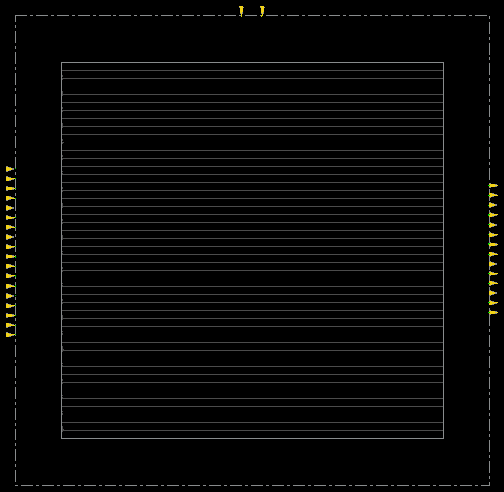
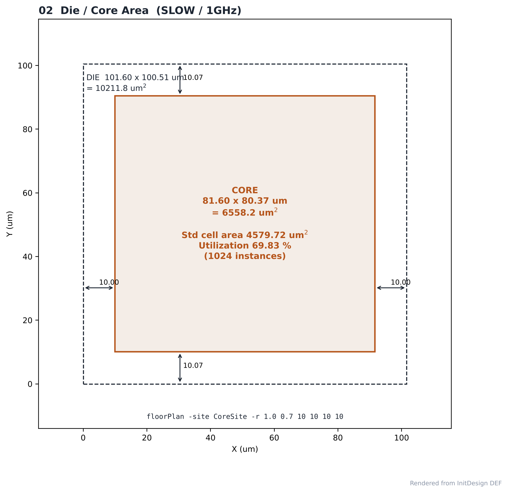
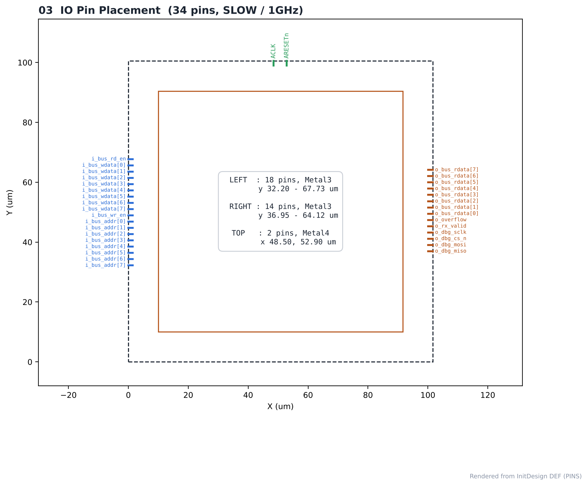
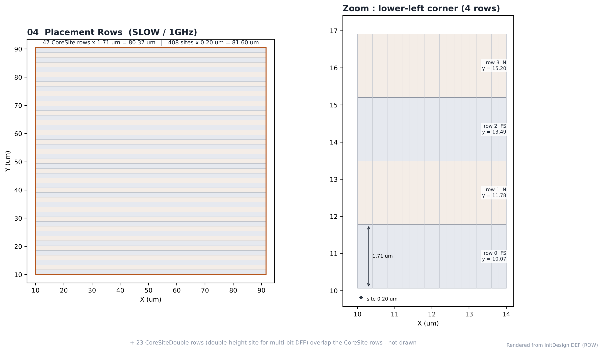
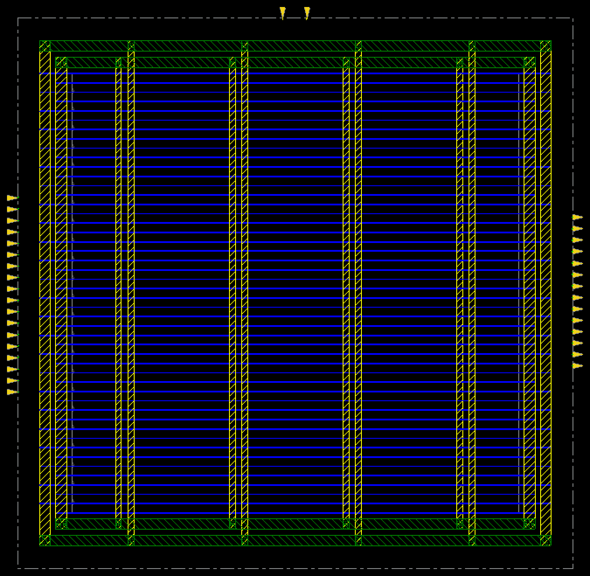
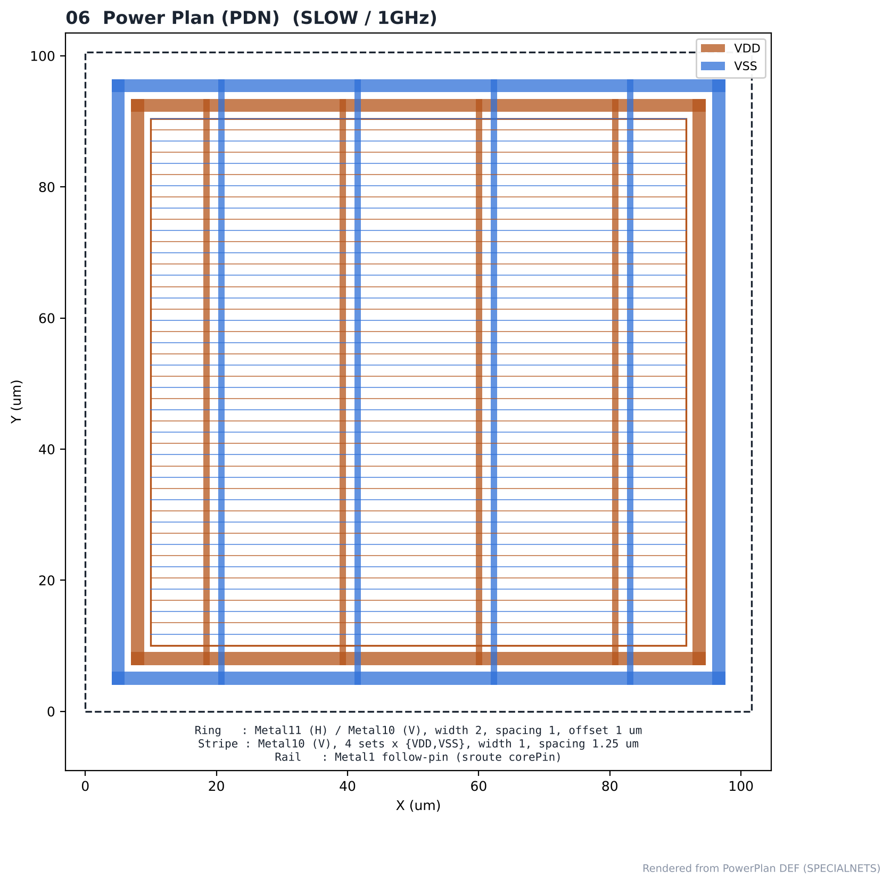

# 08. Floorplan & Power Plan — SLOW / 1GHz

| Item | Value |
|---|---|
| Corner (synthesis library) | **SLOW** — `slow_vdd1v0 (SS, 0.9 V, 125 °C)` |
| Clock | **ACLK 1 ns (1 GHz)**, SCLK = ACLK ÷ 4 (generated clock) |
| Tool | Cadence Innovus 22.17 |
| Library | GPDK045 `gsclib045` (45 nm) |
| Input netlist | [04_Synthesis](../../../04_Synthesis/SLOW/1GHz) `spi_bridge_top_syn_final.v` |
| Scripts | [`0_InitDesign.tcl`](scripts/0_InitDesign.tcl), [`1_PowerPlan.tcl`](scripts/1_PowerPlan.tcl) (원본: [`all.tcl`](scripts/all.tcl)) |

> **비교 실험 설계** — 같은 RTL을 SLOW(`slow_vdd1v0`, SS) / FAST(`fast_vdd1v0`, FF) 라이브러리로 각각 합성하고, PnR은 6개 실행 모두 같은 조건(MMMC setup `FUNC_SS_WORST` SS/125 °C, hold `FUNC_FF_BEST` FF/0 °C, 같은 스크립트)으로 구현했습니다. 차이는 입력 넷리스트의 **합성 코너**뿐이며, 합성 코너가 setup signoff 코너(SS)와 같을 때(SLOW)와 다를 때(FAST)를 비교합니다.

---

## 1. Flow

```text
init_design (LEF + netlist + MMMC) → globalNetConnect → setDontUse BUFX2
      ↓
checkDesign → floorPlan -site CoreSite -r 1.0 0.7 10 10 10 10
      ↓
editPin (Left: i_* / Right: o_* / Top: ACLK, ARESETn) → saveDesign InitDesign
      ↓
addRing → sroute (Metal1 follow-pin) → addStripe (Metal10) → verifyConnectivity → saveDesign PowerPlan
```

`BUFX2`는 LEF상 `CoreSiteDouble` 셀이라 CoreSite row에 놓이면 site 위반이 나므로 `setDontUse`로 최적화에서 제외했습니다. 최종 넷리스트의 BUFX2 인스턴스는 0개입니다.

## 2. Floorplan Result

| Item | Value |
|---|---|
| Die | 101.60 × 100.51 µm = 10,211.82 µm² |
| Core | 81.60 × 80.37 µm = 6,558.19 µm² |
| Core-to-die margin | L/R 10.00 µm, T/B 10.07 µm |
| Std cell area | 4,579.72 µm² (1024 instances) |
| **Core utilization** | **69.83 %** (target 0.70) |
| CoreSite rows | 47 rows × 1.71 µm, 408 sites × 0.20 µm |
| CoreSiteDouble rows | 23 |

다이 크기는 합성 넷리스트의 셀 면적에 따라 정해집니다(utilization 0.7 고정).

## 3. IO Pins (34)

| Side | Pins | Layer | Range |
|---|---|---|---|
| Left | 18 inputs (`i_bus_*`) | Metal3 | y 32.20 – 67.73 µm |
| Right | 14 outputs (`o_*`) | Metal3 | y 36.95 – 64.12 µm |
| Top | 2 inputs (`ACLK`, `ARESETn`) | Metal4 | x 48.50, 52.90 µm |

## 4. Power Plan

| Item | Layer | Setting |
|---|---|---|
| Core ring | Metal11 (H) / Metal10 (V) | width 2, spacing 1, offset 1 µm |
| Follow-pin rail | Metal1 | `sroute -connect corePin` |
| Vertical stripe | Metal10 | 4 sets × {VDD, VSS} = 8 stripes, width 1, spacing 1.25 µm |

PG `verifyConnectivity` — **0 violation / 0 warning** → [`reports/powerplan.log`](reports/powerplan.log)

## Analysis

### A.1 Floorplan Overview



- **What** — floorPlan · editPin 직후 Innovus 화면
- **Observe** — 다이 바깥의 회색 박스는 아직 배치되지 않은 모듈의 면적 가이드 (placement 단계에서 core 안으로 들어감)
- **Observe** — 노란 삼각형이 IO 핀

### A.2 Die / Core



- **What** — 다이·코어 크기와 margin
- **Observe** — core 81.60 × 80.37 µm, utilization **69.83 %**
- **Observe** — margin L/R 10.00, T/B 10.07 µm
- **Insight** — utilization 0.7 고정이라 다이 크기는 합성 넷리스트 면적을 따라갑니다. 면적이 큰 넷리스트일수록 다이도 커집니다.

### A.3 IO Pins



- **What** — 34개 IO 핀 위치
- **Observe** — 입력 18개 왼쪽(Metal3), 출력 14개 오른쪽(Metal3), 클럭·리셋 위쪽(Metal4)
- **Insight** — 버스 입력 → 코어 → 출력이 한 방향으로 흐르도록 배치해 배선 교차를 줄였습니다.

### A.4 Placement Rows



- **What** — 표준 셀 row 구조
- **Observe** — CoreSite 47 rows × 1.71 µm, site 0.20 µm
- **Observe** — row가 N / FS로 번갈아 뒤집혀 인접 row가 전원 rail 공유

### A.5 Power Plan (Innovus)



- **What** — ring · stripe · rail 생성 후 화면
- **Observe** — core 바깥 ring, 세로 stripe, row별 Metal1 rail

### A.6 PDN Structure



- **What** — DEF로 그린 VDD/VSS 구조
- **Observe** — Metal10 stripe 8개(4 sets), ring Metal10/11
- **Observe** — PG verifyConnectivity 0 violation
- **Insight** — core가 70 µm 안팎으로 작아 ring 폭 2 µm, stripe 4세트로도 모든 row에 전원이 연결됩니다.


## 5. Images

| | |
|---|---|
|  | **01 Floorplan** — Innovus 캡처 (`fplan` view). 다이 바깥의 박스는 아직 배치되지 않은 모듈의 면적 가이드입니다. |
|  | **02 Die / Core** — 크기, margin, utilization |
|  | **03 IO Pins** — 34개 핀 위치·레이어 |
|  | **04 Rows** — 47 rows, N/FS 교대 |
|  | **05 Power Plan** — Innovus 캡처 |
|  | **06 PDN** — ring / stripe / follow-pin |

> 01, 05는 Innovus 캡처, 나머지는 `results/*.def`로 그린 그림입니다.

## Files

```text
08_Floorplan/SLOW/1GHz/
├── README.md
│
├── scripts/
│   ├── 0_InitDesign.tcl
│   ├── 1_PowerPlan.tcl
│   ├── all.tcl
│   ├── capture.tcl
│   └── spi_bridge_top.mmmc.tcl
│
├── reports/
│   ├── floorplan_check.log
│   ├── init_design.log
│   └── powerplan.log
│
├── images/
│   ├── 01_Floorplan_Overview.png
│   ├── 02_Die_Core.png
│   ├── 03_IO_Pin_Placement.png
│   ├── 04_Placement_Rows.png
│   ├── 05_PowerPlan_Innovus.png
│   └── 06_PowerPlan_PDN.png
│
└── results/
    ├── initial_floorplan.def
    └── powerplan.def
```
