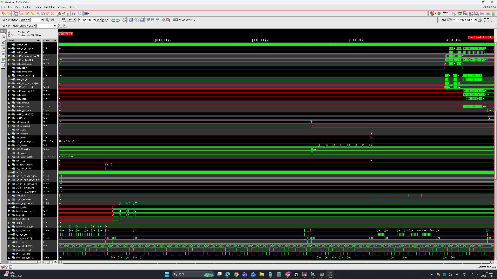
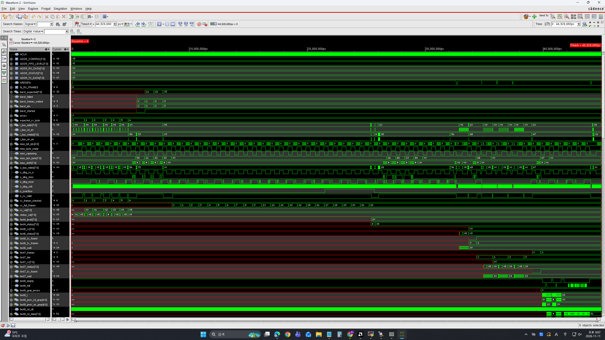
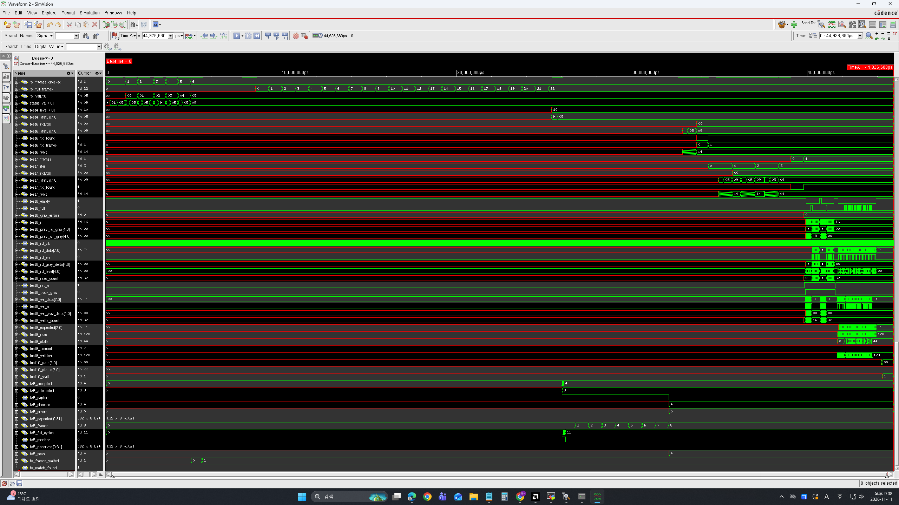
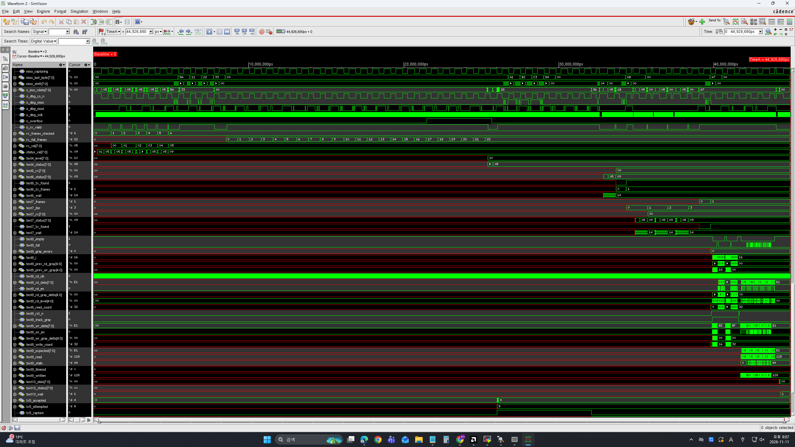
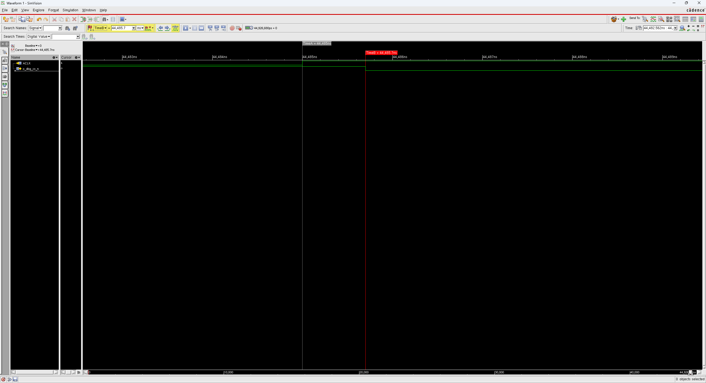

# 08. Pre-Layout Simulation — Synthesized Netlist + SDF

합성 넷리스트에 Genus SDF(셀 지연 + 배선 추정)를 붙여 기능 testbench를 다시 돌렸습니다.

| Item | Value |
|---|---|
| Tool | Cadence Xcelium 22.03 |
| Netlist | `04_Synthesis/MMMC/100MHz/results/spi_bridge_top_syn_final.v` |
| SDF | 같은 run의 `spi_bridge_top_delays.sdf` (`MAXIMUM`) |
| Cell model | `slow_vdd1v0_basicCells.v` |
| Testbench | [`TESTBENCH/tb_spi_bridge_top.v`](TESTBENCH/tb_spi_bridge_top.v) — 03의 TB에 `$sdf_annotate` 블록 추가 |
| Script | [`scripts/run_pre.tcl`](scripts/run_pre.tcl) (`+define+sdf_gate`) |
| **결과** | **ALL TESTS PASSED** (TEST 1 ~ 10, 종료 44,926,680 ps) |

## Testbench 변경

기능 검증용 원본은 [03_Functional_Verification/TESTBENCH/tb_spi_bridge_top.v](../03_Functional_Verification/TESTBENCH/tb_spi_bridge_top.v)에 그대로 두고, 이 폴더의 TB에는 DUT 인스턴스 바로 뒤에 아래 16줄만 추가했습니다. 같은 TB를 Post GLS(17)에서도 씁니다.

```verilog
`ifdef sdf_gate
initial $sdf_annotate("spi_bridge_top_delays.sdf",   dut, , "sdf_annotate_pre.log",      "MAXIMUM");
`endif
`ifdef sdf_post_wst
initial $sdf_annotate("spi_bridge_top_post_wst.sdf", dut, , "sdf_annotate_post_max.log", "MAXIMUM");
`endif
`ifdef sdf_post_bst
initial $sdf_annotate("spi_bridge_top_post_bst.sdf", dut, , "sdf_annotate_post_min.log", "MINIMUM");
`endif
```

TB가 `dut.u_spi_master.state` 같은 내부 신호 16개를 참조하므로, 계층이 남아 있는 넷리스트가 필요합니다. TEST 8/9는 TB 안의 RTL `async_fifo`를 쓰므로 `RTL/Async_fifo.v`도 함께 컴파일합니다.

## Result

| Item | Result |
|---|---|
| Tests | TEST 1 ~ 10 모두 PASS, `errors = 0` |
| SDF annotation | **0 Errors**, 143 Warnings ([`logs/sdf_annotate_pre.log`](logs/sdf_annotate_pre.log)) |
| Timing check 위반 | 10건 — 모두 CDC 동기화기 첫 단 FF의 hold |
| ACLK 엣지 → `o_dbg_cs_n` 지연 | **700 ps** (RTL은 0 ps) |

### SDFNET 경고 143건

모두 `Unable to annotate to non-existent timing check (REMOVAL ...)`입니다. SDF에는 FF마다 removal(리셋 해제) 체크 값이 있지만, gsclib045 셀 Verilog 모델에는 removal 체크가 정의되어 있지 않아 붙일 자리가 없습니다. 셀 지연과 setup/hold 체크는 정상적으로 annotate되었습니다(Errors 0, 아래 700 ps 지연). removal은 STA에서 확인했습니다 — Tempus removal +0.038 ns MET ([15_Post_STA](../15_Post_STA/MMMC/100MHz)).

### Timing violation 10건

| FF | 횟수 |
|---|---|
| `u_rx_fifo/r_rd_ptr_gray_meta_w_reg_0~2` | 7 |
| `u_tx_fifo/r_wr_ptr_gray_meta_r_reg_0~2` | 3 |

전부 이름에 `_meta_`가 붙은 **2-FF 동기화기 첫 번째 FF**입니다. 다른 클럭 도메인에서 오는 Gray 포인터를 처음 받는 자리라, 두 비동기 클럭의 엣지가 겹치는 순간에는 위반이 생길 수밖에 없습니다 (로그에서 CK와 D가 같은 시각, 예: 2,495,280 ps). 두 번째 FF가 값을 안정시키므로 데이터는 깨지지 않았고, TEST 8의 Gray 포인터 검사(`test8_gray_errors = 0`)와 전체 PASS가 이를 보여줍니다. STA에서는 이 경로가 CDC로 제외됩니다.

## Waveform

| | |
|---|---|
|  | **01** 전체 구간 — TEST 8/9 FIFO 신호, TX5 burst 검사 |
|  | **02** 전체 구간 — bus 접근, SPI 디버그 신호, TEST 4~7 |
|  | **03** 전체 구간 — RX full 프레임, TEST 6~9 |
|  | **04** 전체 구간 — MISO 캡처, `o_overflow`, TX5 결과 |
|  | **05** ACLK 44,485.0 ns → `o_dbg_cs_n` 44,485.7 ns = **700 ps** |

05가 SDF가 실제로 붙었다는 증거입니다. RTL 시뮬레이션에서는 이 간격이 0입니다. 같은 지점을 Post GLS에서 재서 비교했습니다 → [17_Post_Layout_Sim](../17_Post_Layout_Sim).

## Files

```text
08_Pre_Layout_Sim/
├── README.md
│
├── TESTBENCH/
│   └── tb_spi_bridge_top.v
│
├── images/
│   ├── 01_Wave_Full_1.png
│   ├── 02_Wave_Full_2.png
│   ├── 03_Wave_Full_3.png
│   ├── 04_Wave_Full_4.png
│   └── 05_ClkToQ_700ps.png
│
├── logs/
│   ├── pre_sim.log
│   └── sdf_annotate_pre.log
│
└── scripts/
    └── run_pre.tcl
```
