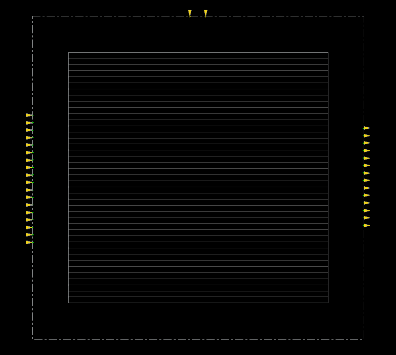
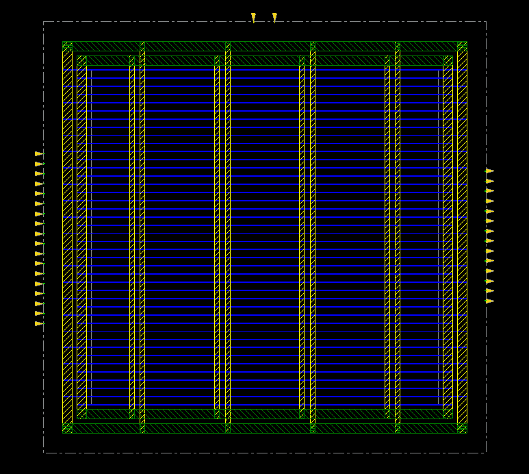

# 09. Floorplan & Power Plan — MMMC / 500MHz

| Item | Value |
|---|---|
| Clock | **ACLK 2.0 ns (500 MHz)**, SCLK = ACLK ÷ 4 |
| Tool | Cadence Innovus 22.17 |
| Script | [`scripts/0_InitDesign.tcl`](scripts/0_InitDesign.tcl), [`scripts/1_PowerPlan.tcl`](scripts/1_PowerPlan.tcl) (실행: [`scripts/all.tcl`](scripts/all.tcl)) |
| MMMC | [`scripts/spi_bridge_top.mmmc.tcl`](scripts/spi_bridge_top.mmmc.tcl) |

> **MMMC PnR** — setup view `FUNC_SS_WORST` (slow_vdd1v0, RC WORST, 125 °C), hold view `FUNC_FF_BEST` (fast_vdd1v0, RC BEST, 0 °C). 입력은 [04_Synthesis/MMMC](../../../04_Synthesis/MMMC)의 같은 주파수 넷리스트와 SDC입니다. 전체 흐름은 `all.tcl` 한 번 실행 (BUFX2 사용 금지 가드 포함).

## Result

| Item | Value |
|---|---|
| Floorplan | `floorPlan -site CoreSite -r 1.0 0.7 10 10 10 10` (aspect 1.0, core util 0.7, margin 10 µm) |
| Die | 92.8 × 90.25 µm |
| Core (placeable) | 5,104 µm² |
| 초기 배치 밀도 | 69.92 % |
| Power | VDD/VSS ring + stripe (Metal10/11) + follow-pin rail |

합성 +11 ps에서 PnR +83 ps로 닫혔습니다. place_opt 초기 −0.695 ns를 최적화가 회복했습니다.

| | |
|---|---|
|  | **01** floorplan — core row와 IO 핀 |
|  | **02** power plan — ring, stripe, rail |

## Files

```text
09_Floorplan/MMMC/500MHz/
├── README.md
│
├── images/
│   ├── 01_Floorplan_Innovus.png
│   └── 02_PowerPlan_Innovus.png
│
├── results/
│   ├── initial_floorplan.def
│   └── powerplan.def
│
└── scripts/
    ├── 0_InitDesign.tcl
    ├── 1_PowerPlan.tcl
    ├── all.tcl
    ├── capture.tcl
    └── spi_bridge_top.mmmc.tcl
```
