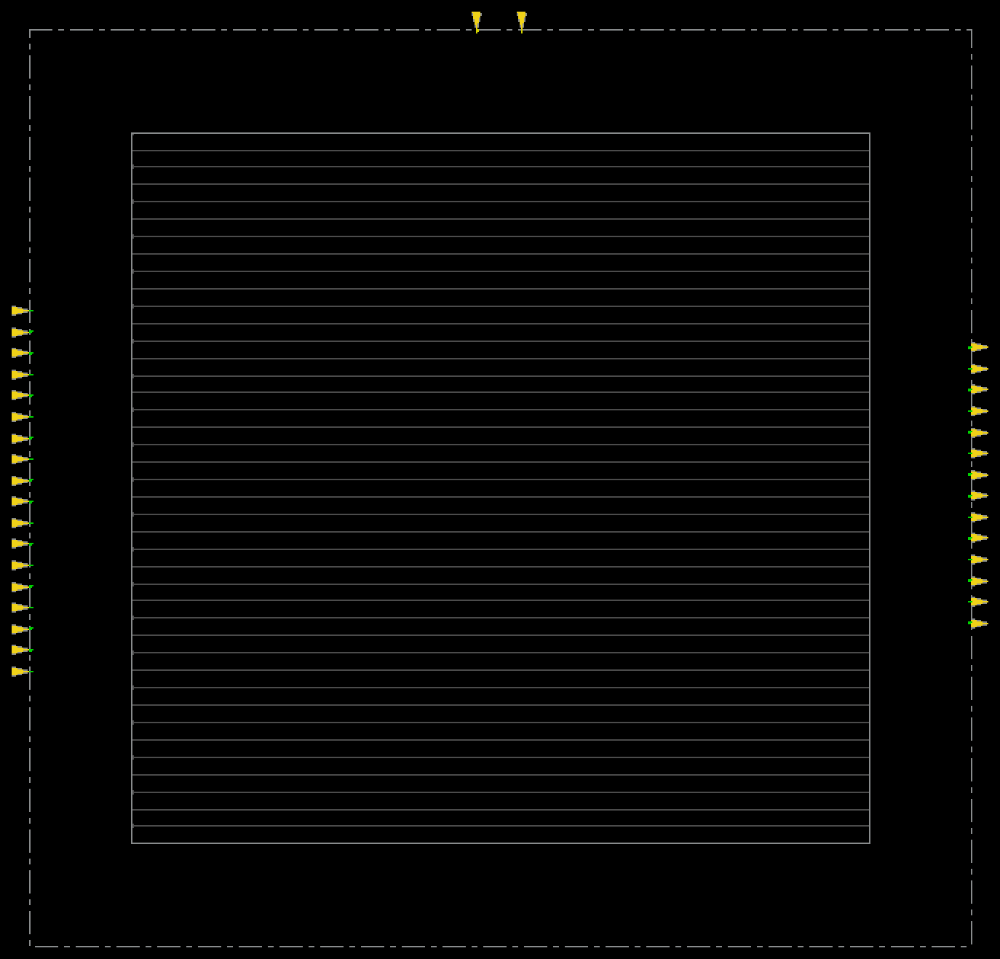
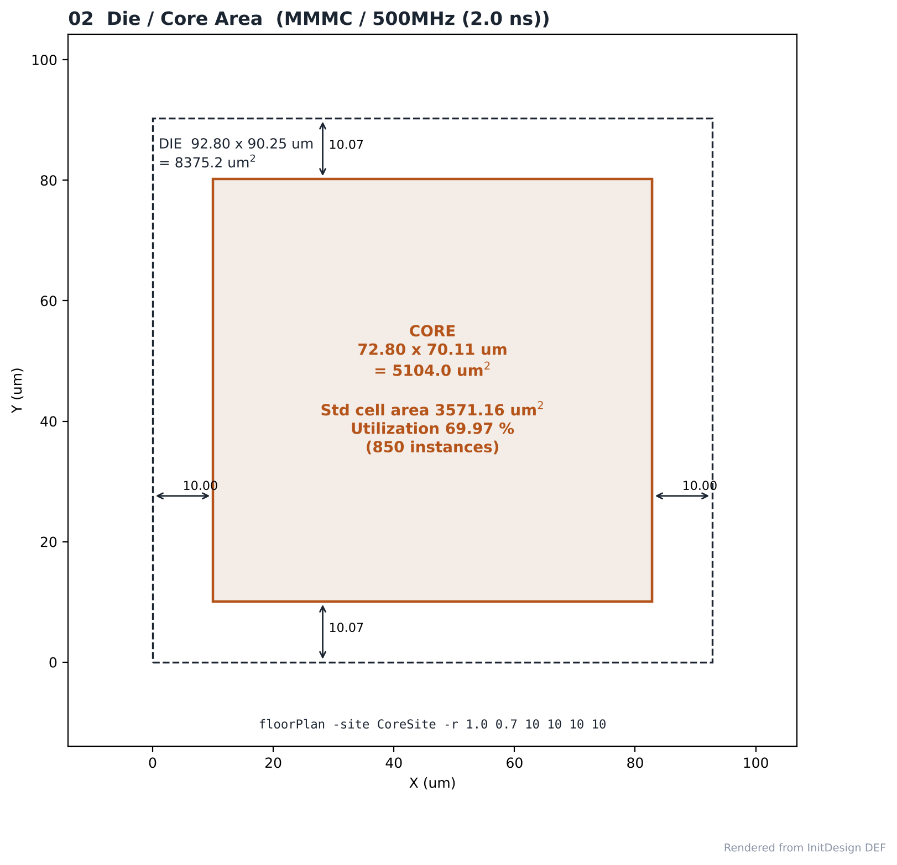
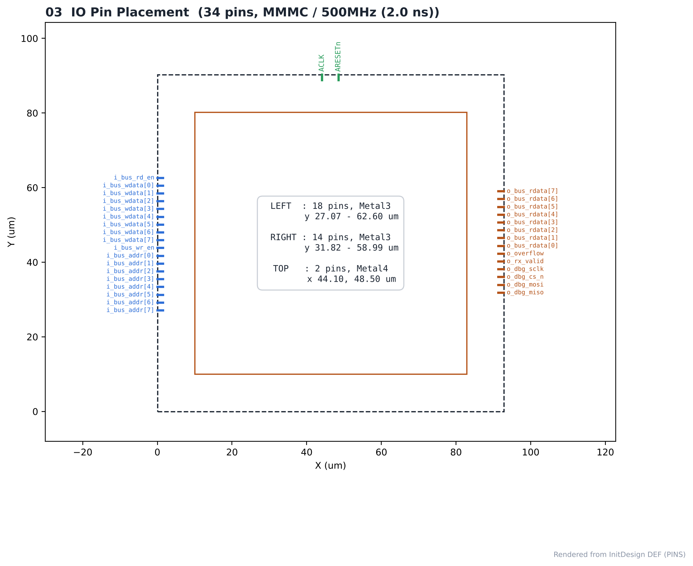
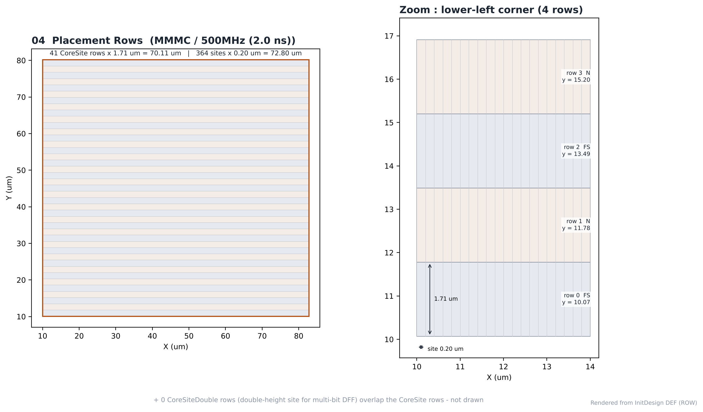
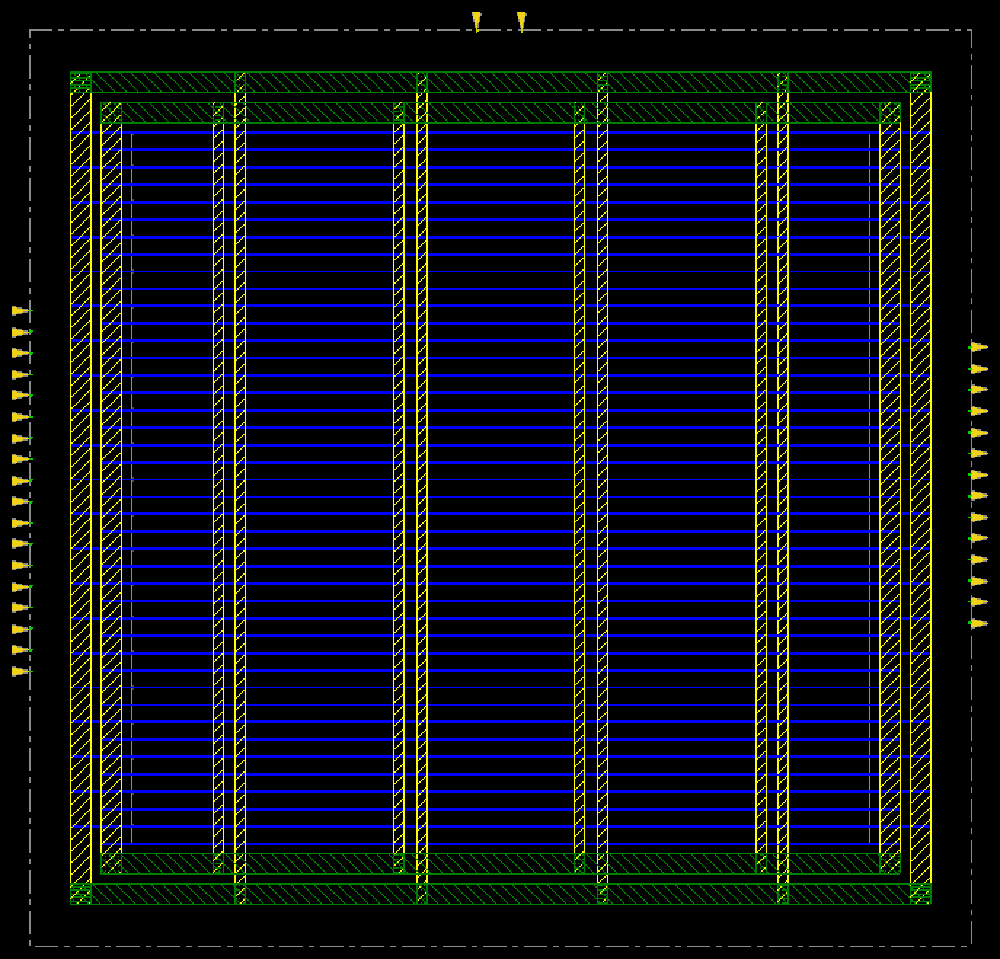
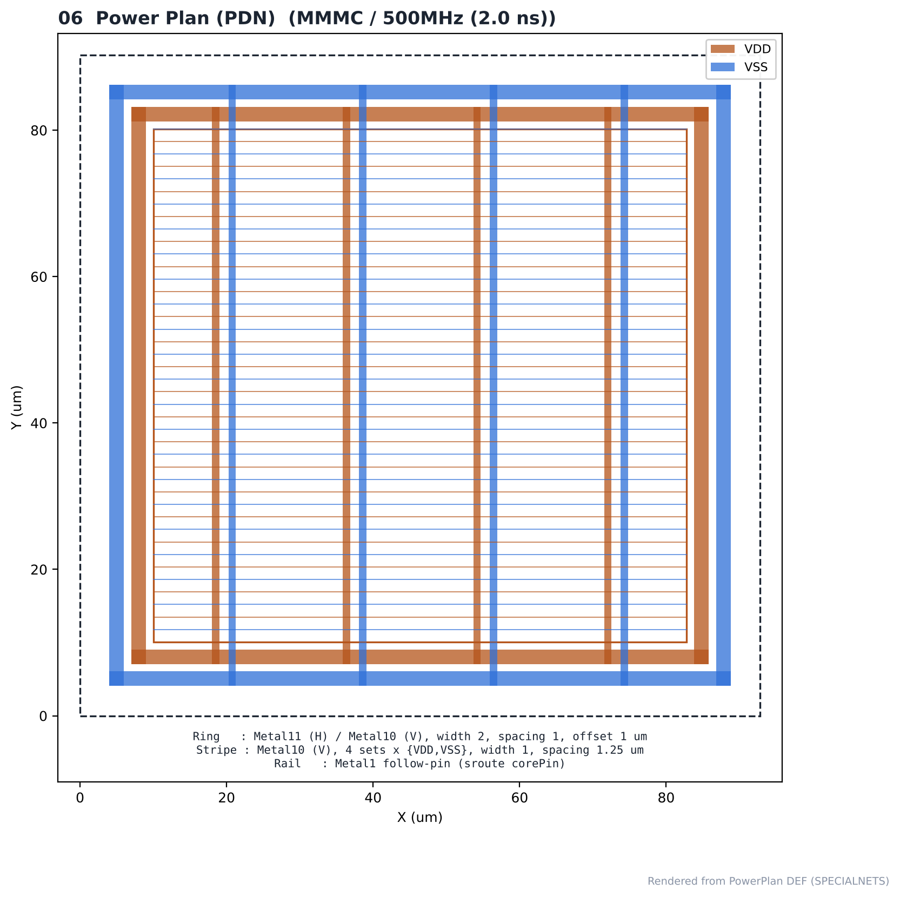

# 09. Floorplan & Power Plan — MMMC / 500MHz

| Item | Value |
|---|---|
| Clock | **ACLK 2.0 ns (500 MHz)**, SCLK = ACLK ÷ 4 (generated clock) |
| Run | Fmax 실험 (2.0 ns) |
| Tool | Cadence Innovus 22.17 |
| Script | [`scripts/0_InitDesign.tcl`](scripts/0_InitDesign.tcl), [`scripts/1_PowerPlan.tcl`](scripts/1_PowerPlan.tcl) (실행: [`scripts/all.tcl`](scripts/all.tcl)) |
| MMMC | [`scripts/spi_bridge_top.mmmc.tcl`](scripts/spi_bridge_top.mmmc.tcl) |

> **MMMC PnR** — setup view `FUNC_SS_WORST` (slow_vdd1v0, RC WORST, 125 °C), hold view `FUNC_FF_BEST` (fast_vdd1v0, RC BEST, 0 °C). 입력은 [04_Synthesis/MMMC](../../../04_Synthesis/MMMC)의 같은 주파수 넷리스트와 SDC입니다. 전체 흐름은 `all.tcl` 한 번 실행 (BUFX2 사용 금지 가드 포함).

---

## 1. Result

| Item | Value |
|---|---|
| Floorplan | `floorPlan -site CoreSite -r 1.0 0.7 10 10 10 10` (aspect 1.0, core util 0.7, margin 10 µm) |
| Die | **92.80 × 90.25 µm** = 8,375.2 µm² |
| Core | **72.80 × 70.11 µm** = 5,104.0 µm² |
| Std cell area (합성 넷리스트) | 3,571.16 µm², 850 instances |
| 초기 utilization | 69.97 % |
| Rows | 41 CoreSite rows × 1.71 µm, 364 sites × 0.20 µm (+ 0 CoreSiteDouble rows) |
| IO pins | 34 — left 18 (bus 입력), right 14 (bus 출력·디버그), top 2 (ACLK, ARESETn) |
| Power | ring Metal11/10, stripe Metal10 × 8 위치, Metal1 follow-pin rail |

## Analysis

### A.1 Floorplan



- **What** — floorPlan 직후 die·core·row와 IO 핀
- **Observe** — die 92.80 × 90.25 µm, core 둘레 10 µm 여백

### A.2 Die / Core



- **What** — InitDesign DEF로 그린 die·core 치수
- **Observe** — core 5,104.0 µm²에 셀 3,571.2 µm² → utilization 69.97 %

### A.3 IO Pin Placement



- **What** — DEF PINS 섹션의 핀 위치
- **Observe** — 입력 버스는 왼쪽 18개, 출력은 오른쪽 14개, 클럭·리셋은 위쪽 2개

### A.4 Placement Rows



- **What** — 표준셀이 놓일 row 구조
- **Observe** — 41개 row, row 높이 1.71 µm, site 폭 0.20 µm, N/FS 방향 교대

### A.5 Power Plan (Innovus)



- **What** — addRing / addStripe / sroute 후
- **Observe** — VDD/VSS ring과 세로 stripe, row마다 follow-pin rail

### A.6 PDN



- **What** — PowerPlan DEF SPECIALNETS로 그린 전원망
- **Observe** — VDD(구리색) / VSS(파랑) ring과 stripe 8위치, PG verifyConnectivity 0 viols

## Files

```text
09_Floorplan/MMMC/500MHz/
├── README.md
│
├── images/
│   ├── 01_Floorplan_Overview.png
│   ├── 02_Die_Core.png
│   ├── 03_IO_Pin_Placement.png
│   ├── 04_Placement_Rows.png
│   ├── 05_PowerPlan_Innovus.png
│   └── 06_PowerPlan_PDN.png
│
├── results/
│   ├── initial_floorplan.def
│   └── powerplan.def
│
└── scripts/
    ├── 0_InitDesign.tcl
    ├── 1_PowerPlan.tcl
    ├── all.tcl
    ├── capture.tcl
    └── spi_bridge_top.mmmc.tcl
```
