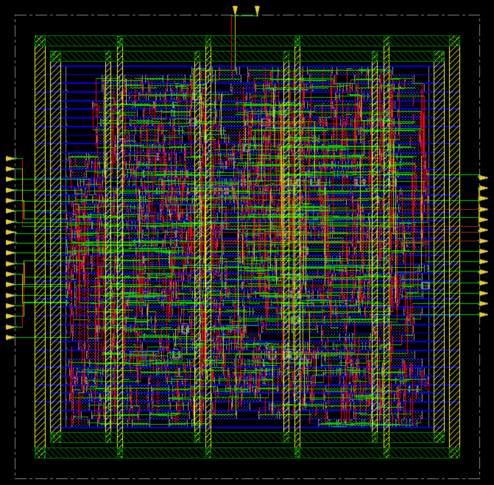
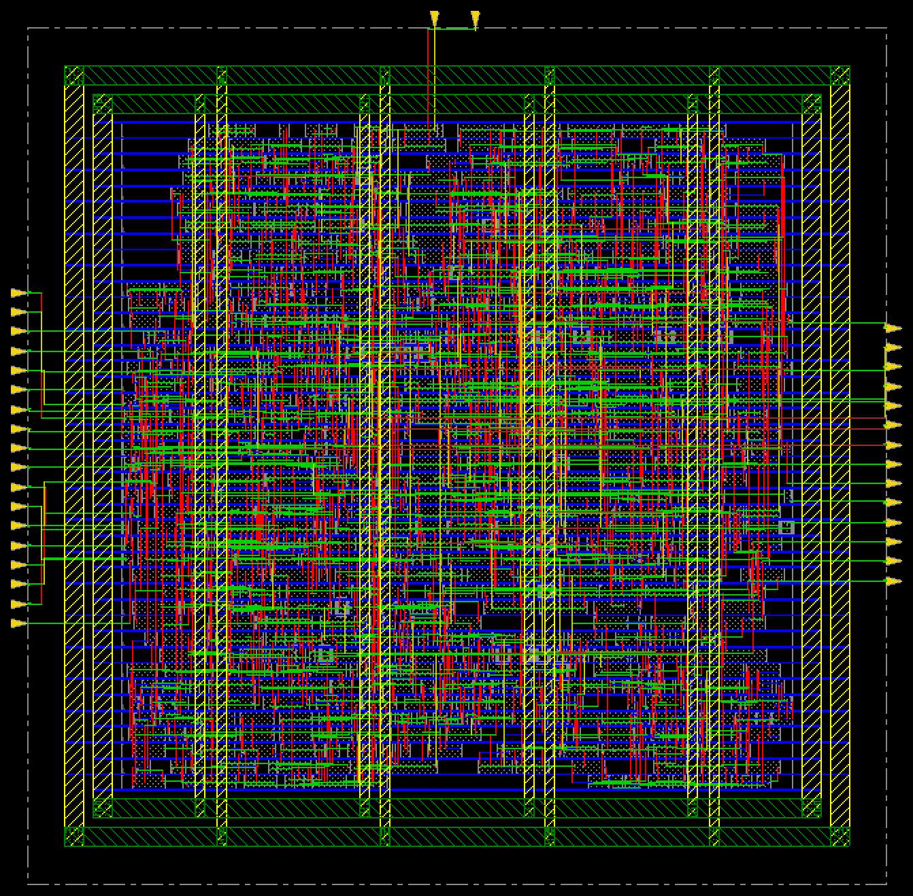
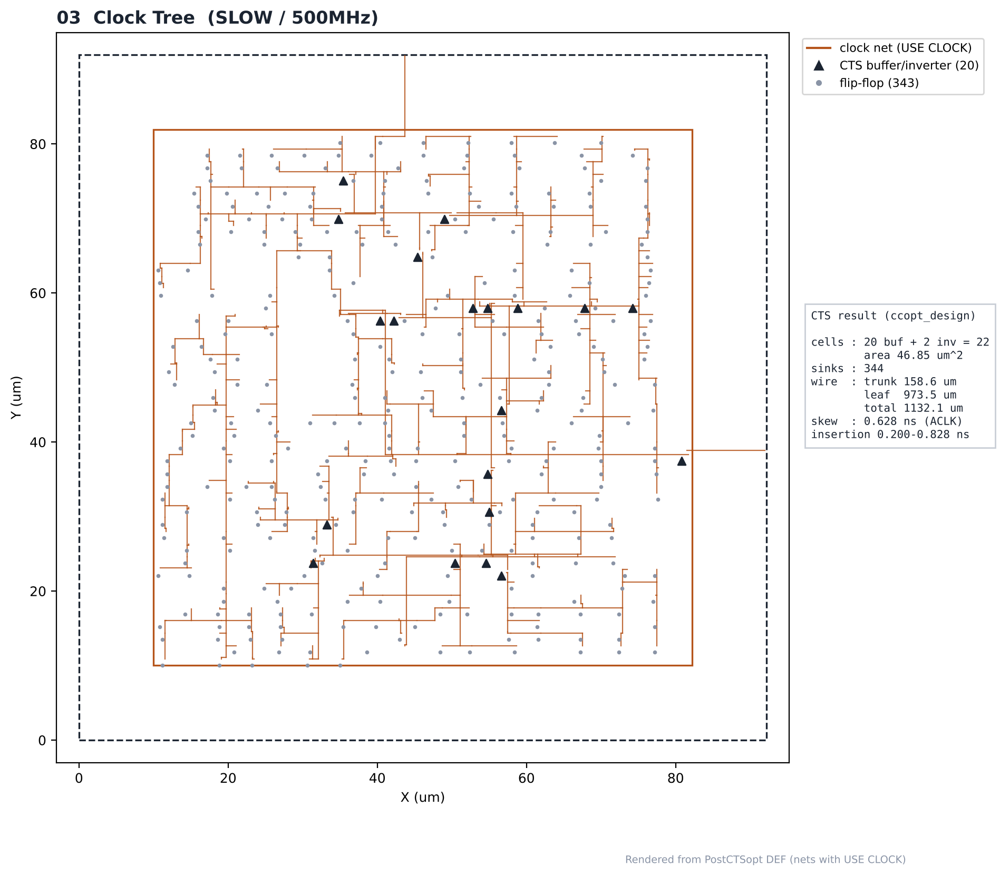
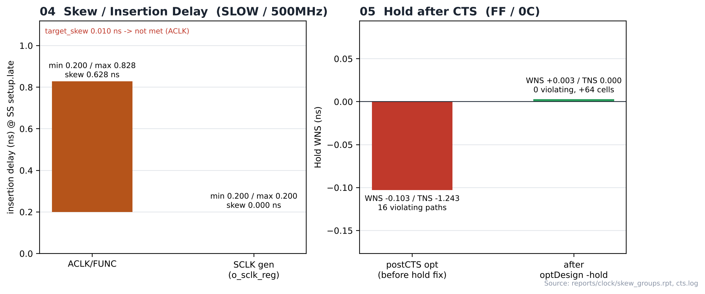

# 10. Clock Tree Synthesis — SLOW / 500MHz

| Item | Value |
|---|---|
| Corner (synthesis library) | **SLOW** — `slow_vdd1v0 (SS, 0.9 V, 125 °C)` |
| Clock | **ACLK 2 ns (500 MHz)**, SCLK = ACLK ÷ 4 (generated clock) |
| Tool | Cadence Innovus 22.17 (CCOpt) |
| Script | [`scripts/3_PostCTSopt.tcl`](scripts/3_PostCTSopt.tcl) |
| DB | `PlaceOpt` → `PostCTSopt` |
| CTS target | `target_skew 0.01 ns`, transition 0.100 ns |

> **비교 실험 설계** — 같은 RTL을 SLOW(`slow_vdd1v0`, SS) / FAST(`fast_vdd1v0`, FF) 라이브러리로 각각 합성하고, PnR은 6개 실행 모두 같은 조건(MMMC setup `FUNC_SS_WORST` SS/125 °C, hold `FUNC_FF_BEST` FF/0 °C, 같은 스크립트)으로 구현했습니다. 차이는 입력 넷리스트의 **합성 코너**뿐이며, 합성 코너가 setup signoff 코너(SS)와 같을 때(SLOW)와 다를 때(FAST)를 비교합니다.

---

## 1. Flow

```text
set_ccopt_property target_skew 0.01 → create_ccopt_clock_tree_spec → ccopt_design
      ↓
set_propagated_clock → timeDesign -postCTS + clock reports
      ↓
optDesign -postCTS → optDesign -postCTS -hold → fix_bufx2 → timeDesign -postCTS → saveDesign PostCTSopt
```

## 2. Clock Tree

| Item | Value |
|---|---|
| CTS cells | 20 buffers + 2 inverters = **22** (46.85 µm²) |
| Cell types | CLKBUFX4 13, CLKBUFX3 6, CLKBUFX2 1, INVX2 1, INVXL 1 |
| Clock sinks | 344 |
| Clock wire length | trunk 158.6 + leaf 973.5 = **1132.1 µm** |
| Clock wire cap | trunk 0.021 + leaf 0.134 = 0.155 pF |
| ACLK insertion delay (SS setup.late) | min 0.200 / max 0.828 / avg 0.630 ns |
| **ACLK skew (SS setup.late)** | **0.628 ns** (target 0.010 → not met) |
| ACLK skew (FF hold.late) | 0.164 ns |
| Min / max sink | `r_spi_busy_meta_reg/CK` 0.200 ns / `u_rx_fifo/mem_reg_5_1/CK` 0.828 ns |
| CCOpt constraint warnings | transition 6 (worst 0.055 ns over), fanout 1 |

최소 지연 sink의 지연(0.200 ns)이 source latency와 같아 루트 가까이에서 바로 구동되는 반면, 최대 지연 sink는 버퍼 단을 여러 개 거칩니다. timing DRV 리포트의 max_tran / max_cap은 0이며, 위 CCOpt 경고는 CTS 자체 목표 대비 값입니다.

## 3. Timing after CTS

| Step | Setup WNS | Setup TNS | Setup viol | Hold WNS | Hold TNS | Hold viol |
|---|---|---|---|---|---|---|
| postCTS (propagated) | +0.058 | 0.000 | 0 | — | — | — |
| optDesign -postCTS -hold (before fix) | +0.057 | 0.000 | 0 | **-0.103** | -1.243 | 16 |
| **postCTS opt (final)** | **+0.057** | 0.000 | 0 | **+0.003** | 0.000 | 0 |

- hold 수정으로 추가된 셀: **64개**
- Density: 70.13 % (postCTS) → 72.32 % (postCTS opt)

## Analysis

### A.1 After ccopt_design



- **What** — 클럭 트리 생성 직후
- **Observe** — CTS 셀 22개 삽입 (CLKBUFX4 13, CLKBUFX3 6, CLKBUFX2 1, INVX2 1, INVXL 1)

### A.2 After postCTS Optimization



- **What** — setup·hold 최적화 후
- **Observe** — hold 수정 셀 +64, density 72.32 %

### A.3 Clock Tree



- **What** — clock net 라우팅과 CTS 셀 위치 (DEF)
- **Observe** — sink 344개, clock wire 1132.1 µm (trunk 158.6 / leaf 973.5)
- **Insight** — leaf 배선이 대부분입니다. 플립플롭(sink)이 코어 전체에 퍼져 있어 마지막 버퍼에서 각 플립플롭까지의 배선이 길어지는 것으로 보입니다.

### A.4 Skew / Hold



- **What** — ACLK insertion delay 범위와 CTS 후 hold 변화
- **Observe** — ACLK skew 0.628 ns (min `r_spi_busy_meta_reg/CK` 0.200 / max `u_rx_fifo/mem_reg_5_1/CK` 0.828 ns)
- **Observe** — hold WNS -0.103 → +0.003 ns
- **Insight** — hold는 버퍼 추가로 해결되었습니다. target_skew 0.01 ns는 이 구조에서 맞추지 못했습니다.


## 4. Images

| | |
|---|---|
|  | **01 ccopt_design** 직후 |
|  | **02 postCTS optimization** 후 |
|  | **03 Clock Tree** — clock net, CTS 셀(▲), flip-flop(·) |
|  | **04 Skew / Hold** — insertion delay 범위, hold WNS 변화 |

> 01–02는 Innovus 캡처, 03은 `results/postcts.def`, 04는 `reports/clock/skew_groups.rpt`와 로그 수치로 그린 그림입니다.

## Files

```text
10_CTS/SLOW/500MHz/
├── README.md
│
├── scripts/
│   └── 3_PostCTSopt.tcl
│
├── reports/
│   ├── clock/
│   │   ├── clock_trees.rpt
│   │   ├── skew.rpt
│   │   └── skew_groups.rpt
│   ├── timing/
│   │   ├── postCTS_opt_hold.summary
│   │   ├── postCTS_opt_setup.summary
│   │   └── postCTS_setup.summary
│   └── cts.log
│
├── images/
│   ├── 01_CTS_Innovus.png
│   ├── 02_PostCTS_Opt_Innovus.png
│   ├── 03_Clock_Tree.png
│   └── 04_Skew_HoldFix.png
│
└── results/
    └── postcts.def
```
