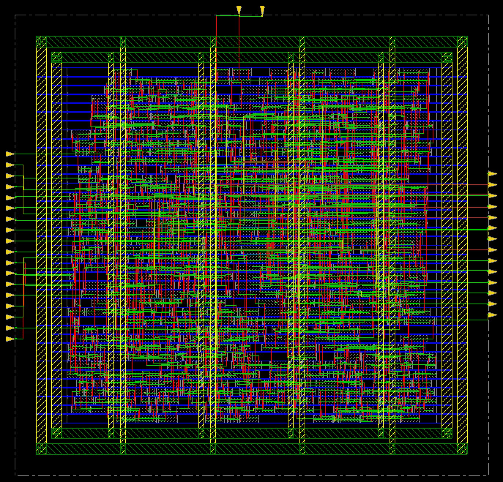
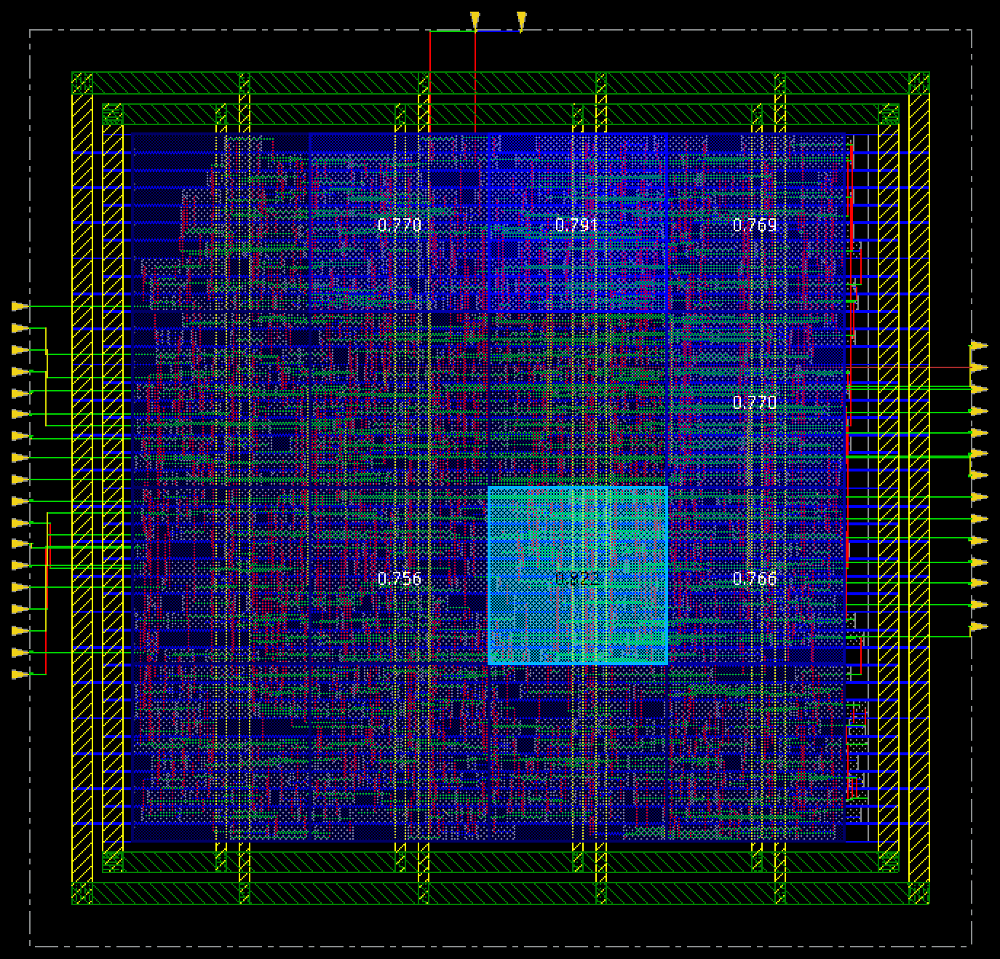
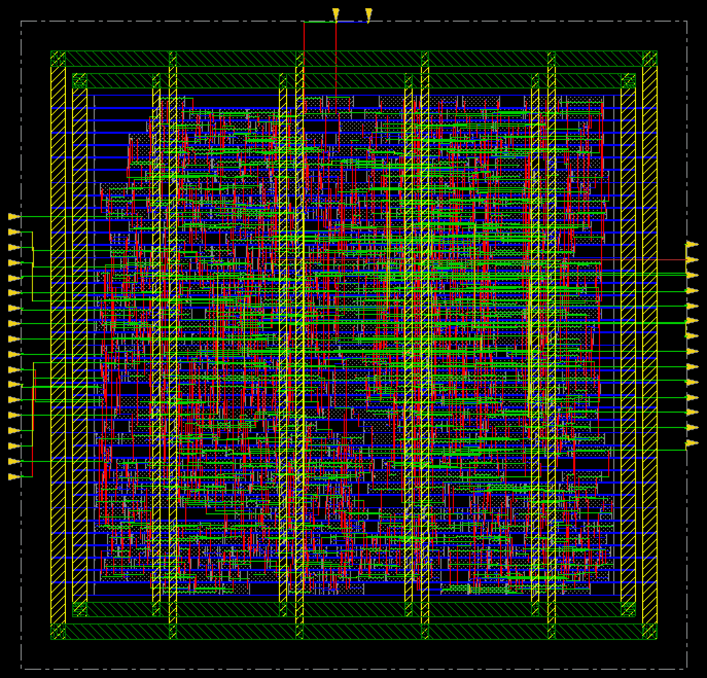
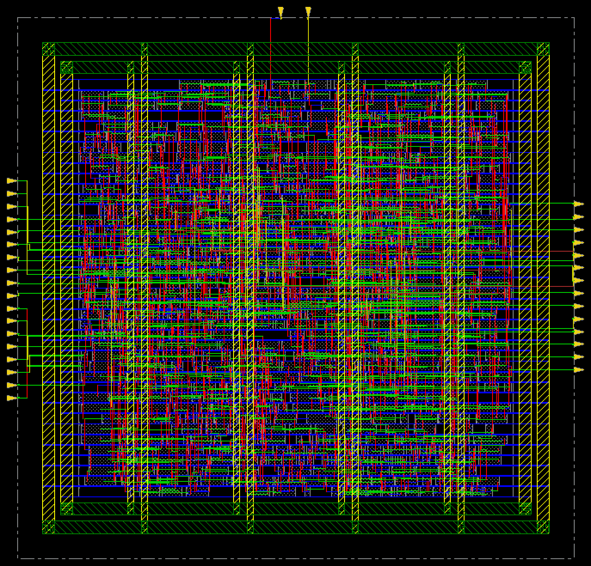
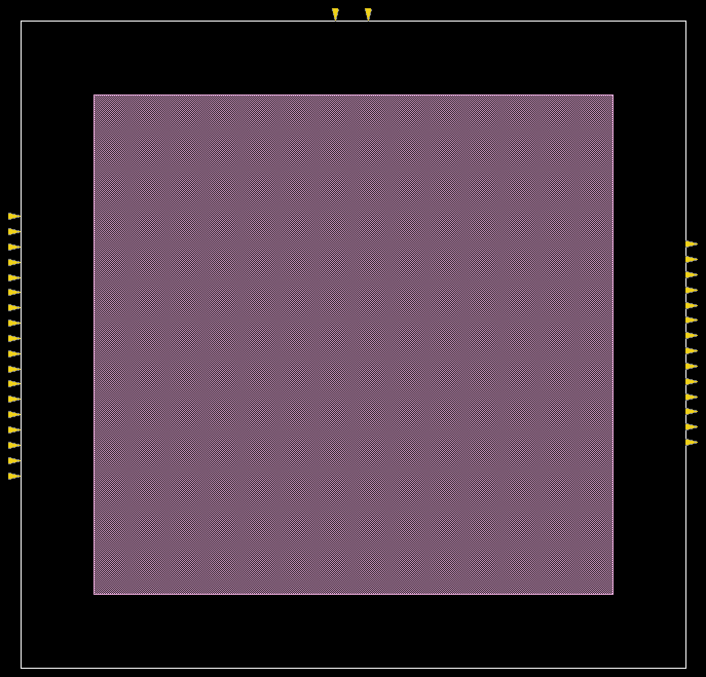
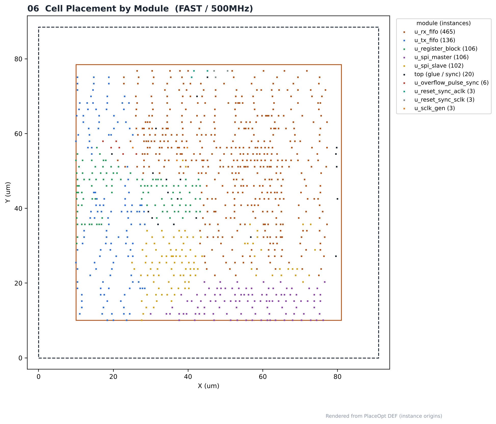
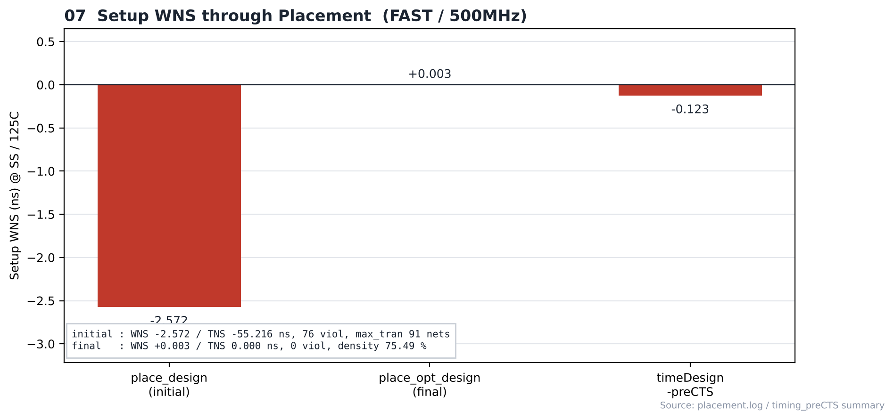

# 10. Placement — FAST / 500MHz

| Item | Value |
|---|---|
| Corner (synthesis library) | **FAST** — `fast_vdd1v0 (FF, 1.1 V, 0 °C)` |
| Clock | **ACLK 2 ns (500 MHz)**, SCLK = ACLK ÷ 4 (generated clock) |
| Tool | Cadence Innovus 22.17 |
| Script | [`scripts/2_PlaceOpt.tcl`](scripts/2_PlaceOpt.tcl) |
| DB | `PowerPlan` → `PlaceOpt` |

> **비교 실험 설계** — 같은 RTL을 SLOW(`slow_vdd1v0`, SS) / FAST(`fast_vdd1v0`, FF) 라이브러리로 각각 합성하고, PnR은 6개 실행 모두 같은 조건(MMMC setup `FUNC_SS_WORST` SS/125 °C, hold `FUNC_FF_BEST` FF/0 °C, 같은 스크립트)으로 구현했습니다. 차이는 입력 넷리스트의 **합성 코너**뿐이며, 합성 코너가 setup 검사 코너(SS)와 같을 때(SLOW)와 다를 때(FAST)를 비교합니다.

---

## 1. Flow

```text
place_design (cong effort high) → checkPlace → earlyGlobalRoute → reportCongestion
      ↓
density map / pin density map
      ↓
place_opt_design → fix_bufx2 (swap guard) → addTieHiLo → earlyGlobalRoute → timeDesign -preCTS
      ↓
checkDesign -place → saveDesign PlaceOpt
```

## 2. Placement

| Item | Value |
|---|---|
| place_design | 804 placed / 0 unplaced, density 69.97 % (3,398 / 4,856) |
| checkPlace | No violations |
| eGR overflow (first / last) | 0.00 % H, 0.00 % V / 0.00 % H, 0.00 % V |
| eGR estimated wire length (first / last) | 11,454 µm / 10,941 µm |
| Congestion hotspot (max / total) | 0.00 / 0.00 |
| Instances after place_opt | 950 (InitDesign 804, **+146**) |

## 3. Timing through Placement (setup, SS / 125 °C)

| Step | WNS (ns) | TNS (ns) | Violating / All | DRV max_tran | Density |
|---|---|---|---|---|---|
| place_design (initial) | **-2.572** | -55.216 | 76 / 650 | 91 nets (780 terms) | 69.98 % |
| place_opt_design (final) | +0.003 | 0.000 | 0 / 650 | 0 nets | 75.49 % |
| **timeDesign -preCTS** | **-0.123** | -0.321 | 7 / 650 | 1 nets | 75.61 % |

| preCTS group | WNS (ns) | TNS (ns) | Violating |
|---|---|---|---|
| reg2reg | -0.034 | -0.082 | 4 |
| default | -0.123 | -0.239 | 3 |

preCTS(ideal clock) 기준 setup 위반 7개 경로가 남았습니다. 이후 단계는 [16_Timing_Closure](../../../16_Timing_Closure/FAST/500MHz)에 정리했습니다.


## 4. Module Placement

| Module | Instances |
|---|---|
| `u_rx_fifo` | 465 |
| `u_tx_fifo` | 136 |
| `u_register_block` | 106 |
| `u_spi_master` | 106 |
| `u_spi_slave` | 102 |
| `top (glue / sync)` | 20 |
| `u_overflow_pulse_sync` | 6 |
| `u_reset_sync_aclk` | 3 |
| `u_reset_sync_sclk` | 3 |
| `u_sclk_gen` | 3 |

## Analysis

### A.1 Initial Placement



- **What** — place_design 직후
- **Observe** — 804개 셀 모두 배치, density 69.97 %
- **Observe** — setup WNS -2.572 ns (76개 위반)

### A.2 Density Map



- **What** — bin별 셀 밀도
- **Observe** — eGR overflow 0.00 % H / 0.00 % V, hotspot 0.00
- **Insight** — overflow와 hotspot이 0이라 배선 혼잡 문제는 없습니다.

### A.3 Pin Density Map



- **What** — bin별 셀 핀 밀도
- **Observe** — 핀이 몰린 영역이 배선 혼잡 후보

### A.4 After place_opt_design



- **What** — 타이밍·DRV 최적화 후
- **Observe** — 인스턴스 804 → 950 (+146)
- **Observe** — density 75.49 %, setup WNS +0.003 ns

### A.5 Module Regions (Amoeba)



- **What** — 모듈별 배치 영역
- **Observe** — 계층별로 셀이 모여 배치된 모습

### A.6 Placement by Module



- **What** — 인스턴스 위치를 모듈별 색으로 표시 (DEF)
- **Observe** — 인스턴스가 많은 모듈: `u_rx_fifo` 465, `u_tx_fifo` 136, `u_register_block` 106

### A.7 Setup WNS through Placement



- **What** — 배치 단계별 setup WNS
- **Observe** — initial -2.572 → place_opt +0.003 → preCTS -0.123 ns
- **Insight** — preCTS에서도 7개 위반이 남았습니다.


## 5. Images

| | |
|---|---|
|  | **01 place_design** |
|  | **02 Density map** |
|  | **03 Pin density map** |
|  | **04 place_opt_design** 후 |
|  | **05 Amoeba view** — 모듈별 배치 영역 |
|  | **06 Placement by module** |
|  | **07 Setup WNS** — 배치 단계별 |

> 01–05는 Innovus 캡처, 06은 `results/placeopt.def`, 07은 로그·summary 수치로 그린 그림입니다.

## Files

```text
10_Placement/FAST/500MHz/
├── README.md
│
├── scripts/
│   └── 2_PlaceOpt.tcl
│
├── reports/
│   ├── timing_preCTS/
│   │   ├── spi_bridge_top_preCTS.summary
│   │   ├── spi_bridge_top_preCTS_default.tarpt
│   │   ├── spi_bridge_top_preCTS_reg2reg.tarpt
│   │   └── spi_bridge_top_preCTS_tdgp_reg2reg_default.tarpt
│   ├── checkDesign_place.rpt
│   ├── checkPlace.rpt
│   └── placement.log
│
├── images/
│   ├── 01_Place_Initial_Innovus.png
│   ├── 02_Density_Map_Innovus.png
│   ├── 03_Pin_Density_Map_Innovus.png
│   ├── 04_Place_Opt_Innovus.png
│   ├── 05_Module_Amoeba_Innovus.png
│   ├── 06_Placement_By_Module.png
│   └── 07_PlaceOpt_WNS.png
│
└── results/
    └── placeopt.def
```
