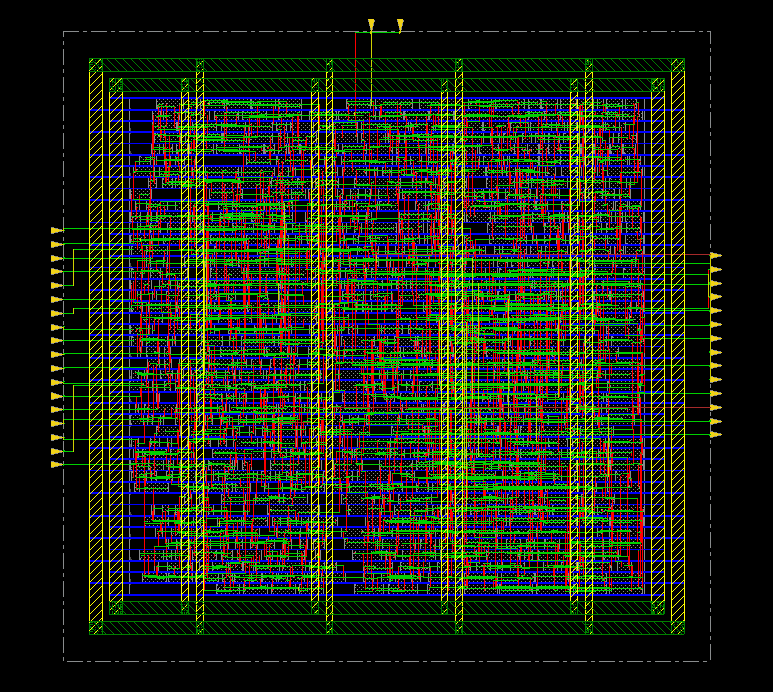
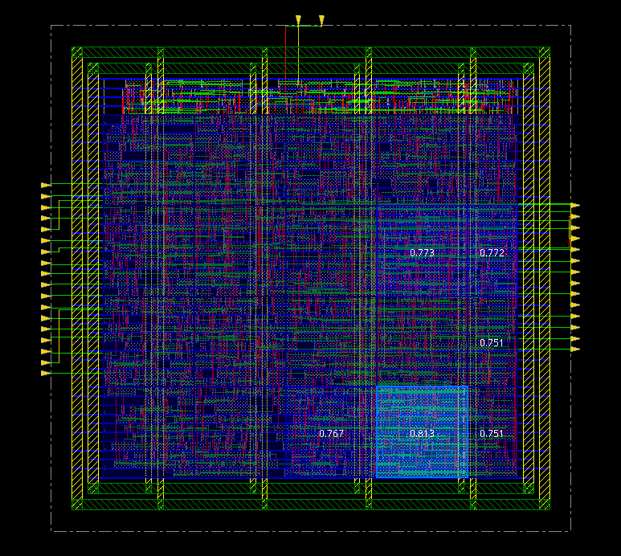
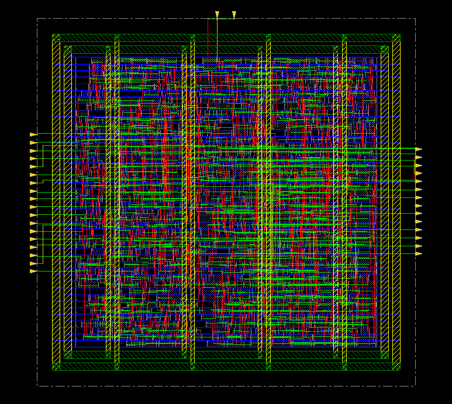
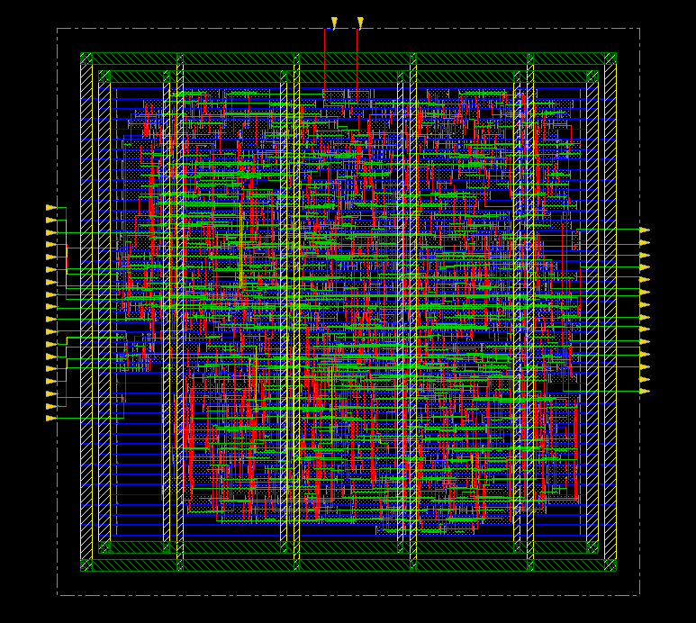
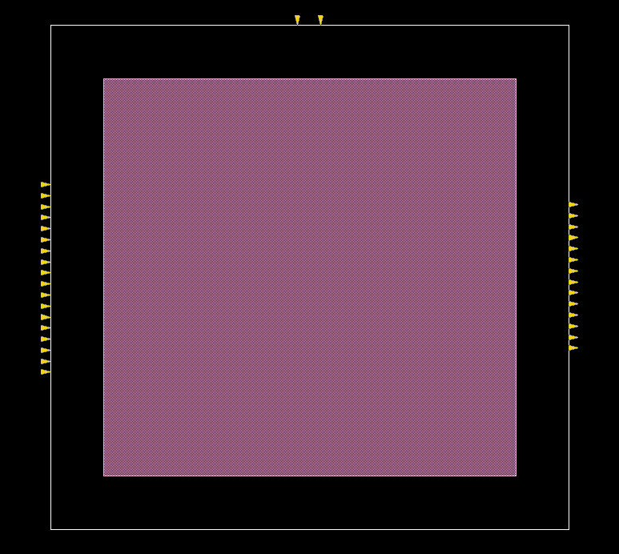

# 10. Placement — MMMC / 625MHz

| Item | Value |
|---|---|
| Clock | **ACLK 1.6 ns (625 MHz)**, SCLK = ACLK ÷ 4 |
| Tool | Cadence Innovus 22.17 |
| Script | [`scripts/2_PlaceOpt.tcl`](scripts/2_PlaceOpt.tcl) |

> **MMMC PnR** — setup view `FUNC_SS_WORST` (slow_vdd1v0, RC WORST, 125 °C), hold view `FUNC_FF_BEST` (fast_vdd1v0, RC BEST, 0 °C). 입력은 [04_Synthesis/MMMC](../../../04_Synthesis/MMMC)의 같은 주파수 넷리스트와 SDC입니다. 전체 흐름은 `all.tcl` 한 번 실행 (BUFX2 사용 금지 가드 포함).

## Result

| Step | Setup WNS (SS) |
|---|---|
| `place_opt_design` 시작 | −0.448 (9) ns |
| `place_opt_design` 끝 | −0.001 (1) ns |
| `timeDesign -preCTS` | **−0.010 (4) ns** |

괄호는 위반 경로 수입니다. preCTS 단계는 클럭이 ideal이라 hold는 보지 않습니다. 리포트: [`reports/timing_preCTS`](reports/timing_preCTS), [`reports/checkPlace.rpt`](reports/checkPlace.rpt).

| | |
|---|---|
|  | **01** 초기 배치 |
|  | **02** density map |
|  | **03** pin density map |
|  | **04** place_opt 후 |
|  | **05** 모듈별 영역 (amoeba view) |

## Files

```text
10_Placement/MMMC/625MHz/
├── README.md
│
├── images/
│   ├── 01_Place_Initial_Innovus.png
│   ├── 02_Density_Map_Innovus.png
│   ├── 03_Pin_Density_Map_Innovus.png
│   ├── 04_Place_Opt_Innovus.png
│   └── 05_Module_Amoeba_Innovus.png
│
├── reports/
│   ├── checkPlace.rpt
│   └── timing_preCTS/
│       ├── spi_bridge_top_preCTS.summary
│       └── spi_bridge_top_preCTS_all.tarpt
│
├── results/
│   └── placeopt.def
│
└── scripts/
    └── 2_PlaceOpt.tcl
```
