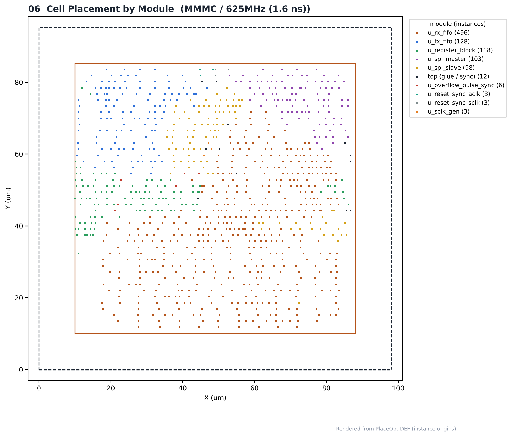
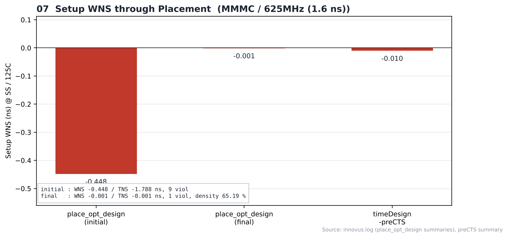

# 10. Placement — MMMC / 625MHz

| Item | Value |
|---|---|
| Clock | **ACLK 1.6 ns (625 MHz)**, SCLK = ACLK ÷ 4 (generated clock) |
| Run | Fmax 실험 — 합성·PnR 모두 닫힌 최고 주파수 (1.6 ns) |
| Tool | Cadence Innovus 22.17 |
| Script | [`scripts/2_PlaceOpt.tcl`](scripts/2_PlaceOpt.tcl) |
| DB | `PowerPlan` → `PlaceOpt` |

> **MMMC PnR** — setup view `FUNC_SS_WORST` (slow_vdd1v0, RC WORST, 125 °C), hold view `FUNC_FF_BEST` (fast_vdd1v0, RC BEST, 0 °C). 입력은 [04_Synthesis/MMMC](../../../04_Synthesis/MMMC)의 같은 주파수 넷리스트와 SDC입니다. 전체 흐름은 `all.tcl` 한 번 실행 (BUFX2 사용 금지 가드 포함).

---

## 1. Result

| Step | Setup WNS (SS) | TNS | 위반 |
|---|---|---|---|
| `place_opt_design` 시작 | -0.448 ns | -1.788 | 9 |
| `place_opt_design` 끝 | -0.001 ns | -0.001 | 1 |
| `timeDesign -preCTS` | **-0.010 ns** | -0.016 | 4 |

| Item | Value |
|---|---|
| Instances | 959 → 970 (+11, 버퍼·tie 셀) |
| place_opt 후 density | 65.19 % |
| 모듈별 인스턴스 (상위) | `u_rx_fifo` 496, `u_tx_fifo` 128, `u_register_block` 118, `u_spi_master` 103, `u_spi_slave` 98, `top (glue / sync)` 12 |

preCTS는 클럭이 ideal이라 hold는 보지 않습니다. 리포트: [`reports/timing_preCTS`](reports/timing_preCTS), [`reports/checkPlace.rpt`](reports/checkPlace.rpt).

## Analysis

### A.1 Initial Placement


- **What** — place_design 직후
- **Observe** — timing-driven 최적화 전 초기 배치

### A.2 Density Map


- **What** — 배치 밀도 분포
- **Observe** — 색이 진할수록 배치 밀도가 높은 영역 (최종 utilization은 1. Result 참고)

### A.3 Pin Density Map


- **What** — 셀 핀 밀도 분포
- **Observe** — 셀 핀이 몰린 영역은 배선 혼잡의 후보 (이 run의 verify_drc는 0)

### A.4 After place_opt


- **What** — place_opt_design 후
- **Observe** — setup -0.001 ns, density 65.19 %

### A.5 Module Amoeba


- **What** — 모듈별 영역 (amoeba view)
- **Observe** — 같은 모듈 셀이 묶여 놓인 영역 (A.6과 같은 정보를 Innovus에서 표시)

### A.6 Placement by Module



- **What** — PlaceOpt DEF 인스턴스 좌표를 모듈별 색으로
- **Observe** — 가장 큰 모듈은 `u_rx_fifo` (496개)
- **Insight** — RX FIFO(8-bit × 16)가 전체 셀의 절반 가까이를 차지해 배치 면적 대부분을 씁니다.

### A.7 Setup WNS through Placement



- **What** — place_opt 시작·끝·preCTS의 setup WNS
- **Observe** — -0.448 → -0.001 → -0.010 ns
- **Insight** — preCTS에서 −10 ps 위반이 남았지만 CTS 이후 실제 클럭 트리로 다시 최적화되며 해소됩니다 (11·16장).

## Files

```text
10_Placement/MMMC/625MHz/
├── README.md
│
├── images/
│   ├── 01_Place_Initial_Innovus.png
│   ├── 02_Density_Map_Innovus.png
│   ├── 03_Pin_Density_Map_Innovus.png
│   ├── 04_Place_Opt_Innovus.png
│   ├── 05_Module_Amoeba_Innovus.png
│   ├── 06_Placement_By_Module.png
│   └── 07_PlaceOpt_WNS.png
│
├── reports/
│   ├── checkPlace.rpt
│   └── timing_preCTS/
│       ├── spi_bridge_top_preCTS.summary
│       └── spi_bridge_top_preCTS_all.tarpt
│
├── results/
│   └── placeopt.def
│
└── scripts/
    └── 2_PlaceOpt.tcl
```
