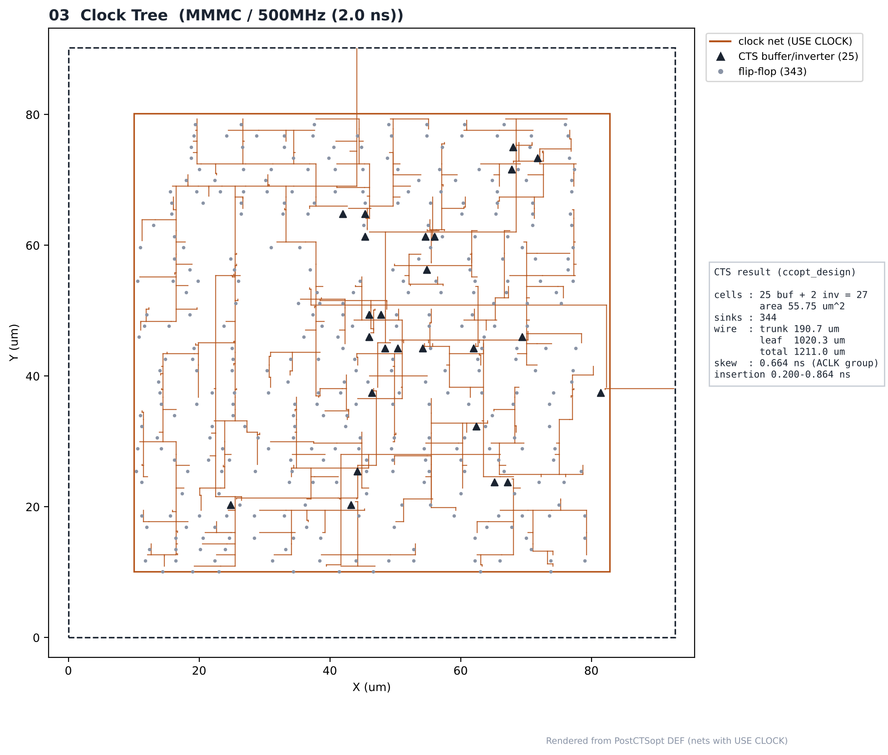
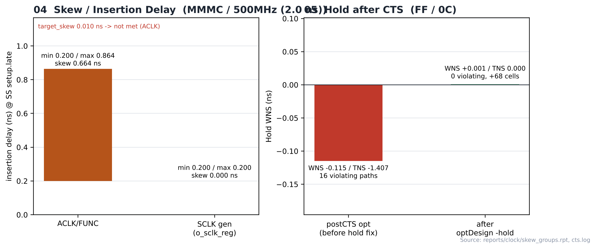

# 11. Clock Tree Synthesis — MMMC / 500MHz

| Item | Value |
|---|---|
| Clock | **ACLK 2.0 ns (500 MHz)**, SCLK = ACLK ÷ 4 (generated clock) |
| Run | Fmax 실험 (2.0 ns) |
| Tool | Cadence Innovus 22.17 (CCOpt) |
| Script | [`scripts/3_PostCTSopt.tcl`](scripts/3_PostCTSopt.tcl) — `ccopt_design` → `optDesign -postCTS` → `optDesign -postCTS -hold` |
| DB | `PlaceOpt` → `PostCTSopt` |
| CTS target | `target_skew 0.01 ns` |

> **MMMC PnR** — setup view `FUNC_SS_WORST` (slow_vdd1v0, RC WORST, 125 °C), hold view `FUNC_FF_BEST` (fast_vdd1v0, RC BEST, 0 °C). 입력은 [04_Synthesis/MMMC](../../../04_Synthesis/MMMC)의 같은 주파수 넷리스트와 SDC입니다. 전체 흐름은 `all.tcl` 한 번 실행 (BUFX2 사용 금지 가드 포함).

---

## 1. Result

| Clock tree | Value |
|---|---|
| Clock cells | **25 buffer + 2 inverter = 27** (55.75 µm²) |
| Sinks | 344 flip-flop clock pins |
| Clock wire | trunk 190.7 + leaf 1020.3 = 1211.0 µm |
| Insertion delay (SS setup.late, ACLK group) | 0.200 ~ 0.864 ns → group skew 0.664 ns |

| Step | Setup WNS (SS) | Hold WNS (FF) |
|---|---|---|
| `timeDesign -postCTS` | +0.003 ns | — |
| `optDesign -postCTS` | +0.002 ns | **-0.115 ns** (TNS -1.407, 16 위반) |
| `optDesign -postCTS -hold` | +0.002 ns | **+0.001 ns** (+68 cells) |

> CCOpt skew group의 0.2 ns 하한은 SDC source latency, 최대값은 SCLK 생성 FF(`u_sclk_gen/o_sclk_reg`) 뒤에 매달린 SCLK 도메인 sink까지 포함한 값이라 target 0.01 ns를 "not met"으로 표시합니다. 실제 클럭별 skew는 기준 run(100 MHz)의 Tempus 결과로 ACLK 0.000 / SCLK 0.066 ns입니다 ([15_Post_STA/MMMC/100MHz](../../../15_Post_STA/MMMC/100MHz)).

## Analysis

### A.1 After ccopt_design


- **What** — 클럭 트리 생성 직후
- **Observe** — 버퍼 25개 + 인버터 2개

### A.2 After postCTS optimization


- **What** — postCTS setup·hold 최적화 후
- **Observe** — hold fix로 68개 셀 추가

### A.3 Clock Tree



- **What** — PostCTSopt DEF의 `USE CLOCK` net과 CTS 셀 위치
- **Observe** — clock wire 1211 µm, sink 344개

### A.4 Skew / Hold after CTS



- **What** — insertion delay 범위와 hold fix 전후
- **Observe** — hold -0.115 ns (16 위반) → +0.001 ns
- **Insight** — 합성 단계에서는 ideal clock이라 hold 위반이 보이지 않았습니다. 실제 클럭 트리가 생기자 같은 FIFO 경로 16개가 깨졌고, FF 코너 기준 hold fix가 지연 버퍼로 모두 해소했습니다. hold를 CTS 이후에 고치는 이유입니다.

## Files

```text
11_CTS/MMMC/500MHz/
├── README.md
│
├── images/
│   ├── 01_CTS_Innovus.png
│   ├── 02_PostCTS_Opt_Innovus.png
│   ├── 03_Clock_Tree.png
│   └── 04_Skew_HoldFix.png
│
├── reports/
│   ├── clock/
│   │   ├── clock_trees.rpt
│   │   ├── skew.rpt
│   │   └── skew_groups.rpt
│   ├── timing_postCTS/
│   │   ├── spi_bridge_top_postCTS.summary
│   │   └── spi_bridge_top_postCTS_all.tarpt
│   └── timing_postCTS_opt/
│       ├── spi_bridge_top_postCTS.summary
│       └── spi_bridge_top_postCTS_all.tarpt
│
├── results/
│   └── postcts.def
│
└── scripts/
    └── 3_PostCTSopt.tcl
```
