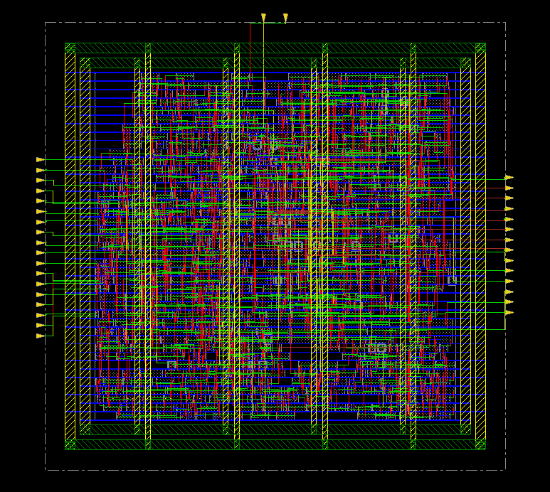
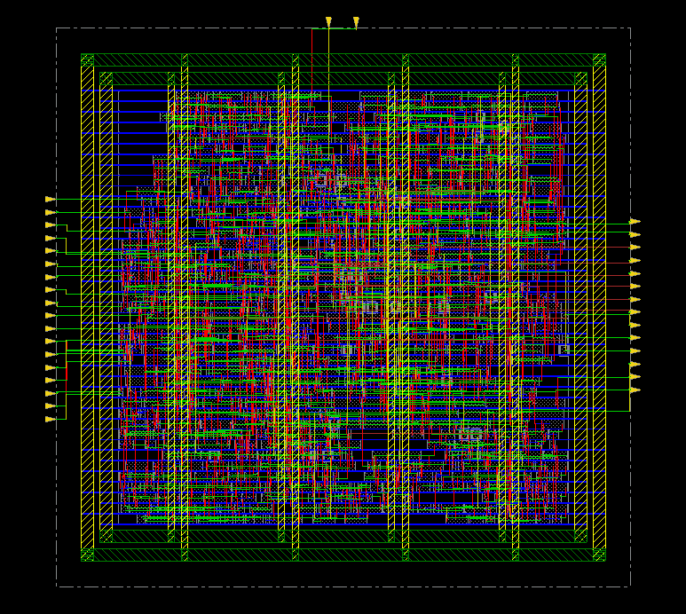

# 11. Clock Tree Synthesis — MMMC / 500MHz

| Item | Value |
|---|---|
| Clock | **ACLK 2.0 ns (500 MHz)**, SCLK = ACLK ÷ 4 |
| Tool | Cadence Innovus 22.17 |
| Script | [`scripts/3_PostCTSopt.tcl`](scripts/3_PostCTSopt.tcl) — `ccopt_design` (target skew 0.01 ns) → `optDesign -postCTS` → `optDesign -postCTS -hold` |

> **MMMC PnR** — setup view `FUNC_SS_WORST` (slow_vdd1v0, RC WORST, 125 °C), hold view `FUNC_FF_BEST` (fast_vdd1v0, RC BEST, 0 °C). 입력은 [04_Synthesis/MMMC](../../../04_Synthesis/MMMC)의 같은 주파수 넷리스트와 SDC입니다. 전체 흐름은 `all.tcl` 한 번 실행 (BUFX2 사용 금지 가드 포함).

## Result

| Step | Setup WNS (SS) | Hold WNS (FF) |
|---|---|---|
| `ccopt_design` 중간 | −0.114 (5) ns | — |
| `timeDesign -postCTS` | +0.003 ns | — |
| `optDesign -postCTS` | +0.002 ns | **−0.115 (16) ns** ← 클럭 트리가 생기며 hold 위반 발생 |
| `optDesign -postCTS -hold` | +0.002 ns | **+0.001 ns** |

| Clock tree | Value |
|---|---|
| Clock cells | 25 + 2 inv |
| Sinks | 344 |
| CCOpt skew group `ACLK/FUNC` max insertion | 0.662 ns (SCLK 생성 FF 뒤 sink 포함, skew target ignored) |

- 합성까지는 ideal clock이라 hold 위반이 보이지 않았습니다. CTS로 실제 클럭 트리가 생기자 hold 위반 16개가 나타났고, FF 코너 기준 hold fix가 이를 모두 없앴습니다.
- Tempus로 본 최종 skew는 ACLK 0 / SCLK 0.066 ns (100 MHz run, [15_Post_STA](../../../15_Post_STA/MMMC/100MHz)).

| | |
|---|---|
|  | **01** ccopt_design 후 |
|  | **02** postCTS setup·hold 최적화 후 |

## Files

```text
11_CTS/MMMC/500MHz/
├── README.md
│
├── images/
│   ├── 01_CTS_Innovus.png
│   └── 02_PostCTS_Opt_Innovus.png
│
├── reports/
│   ├── clock/
│   │   ├── clock_trees.rpt
│   │   ├── skew.rpt
│   │   └── skew_groups.rpt
│   ├── timing_postCTS/
│   │   ├── spi_bridge_top_postCTS.summary
│   │   └── spi_bridge_top_postCTS_all.tarpt
│   └── timing_postCTS_opt/
│       ├── spi_bridge_top_postCTS.summary
│       └── spi_bridge_top_postCTS_all.tarpt
│
├── results/
│   └── postcts.def
│
└── scripts/
    └── 3_PostCTSopt.tcl
```
