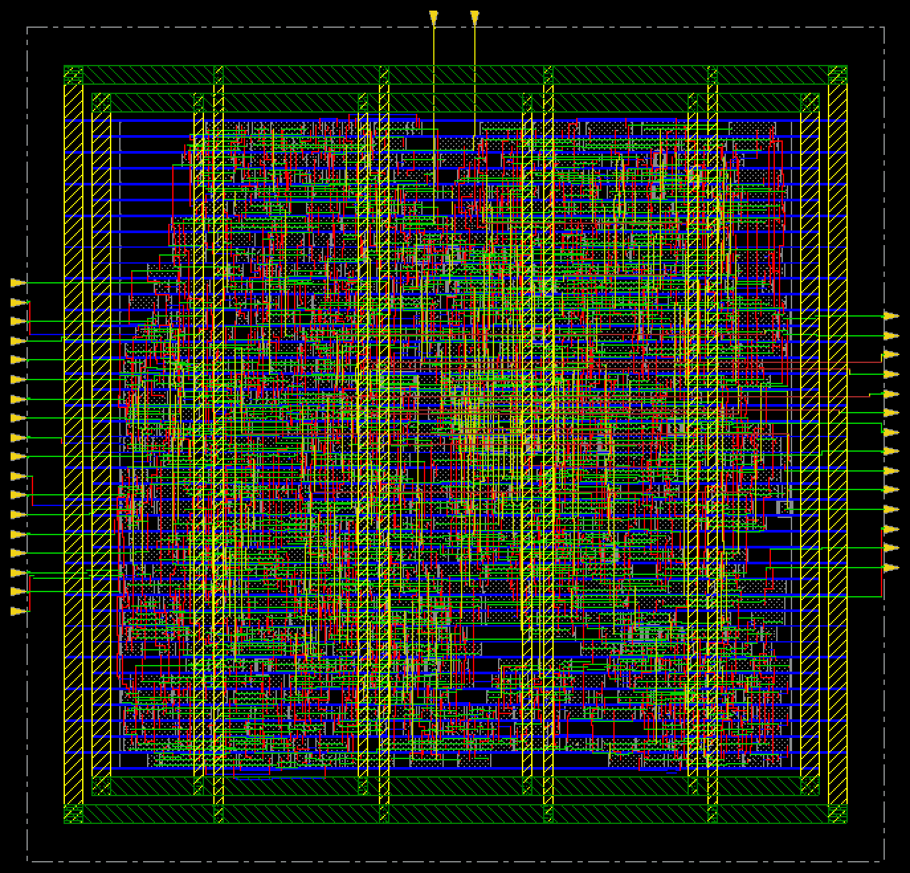
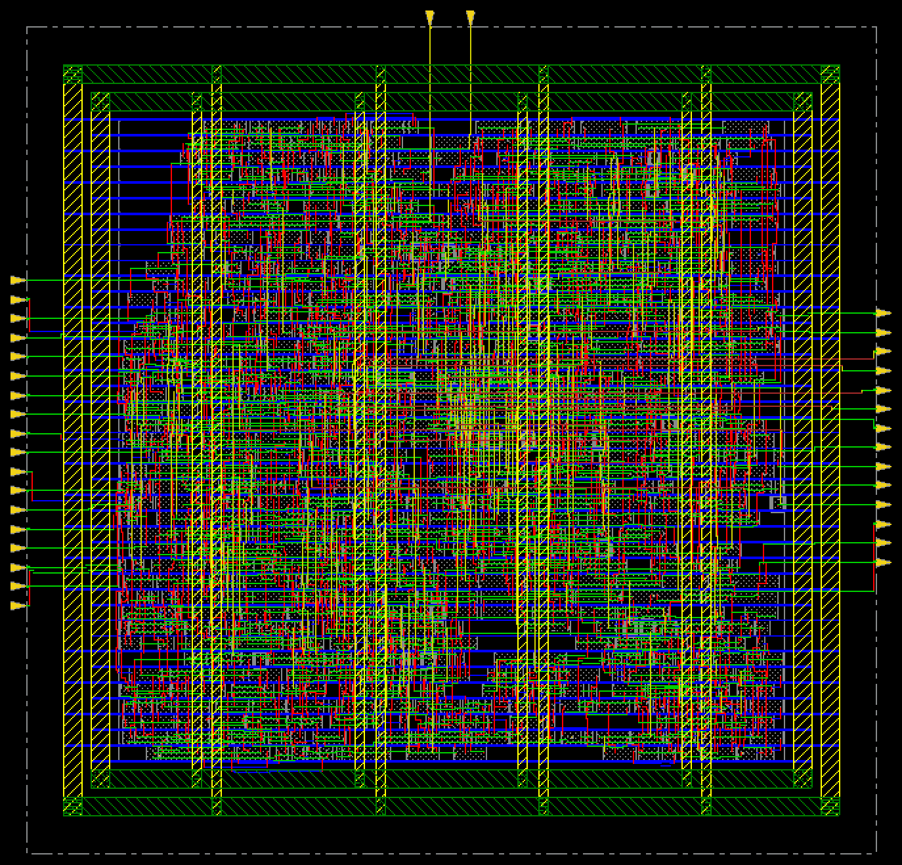
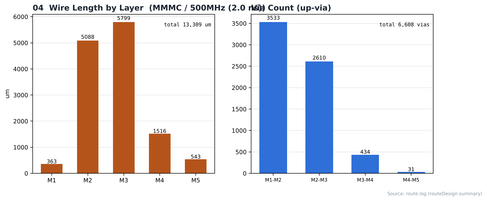
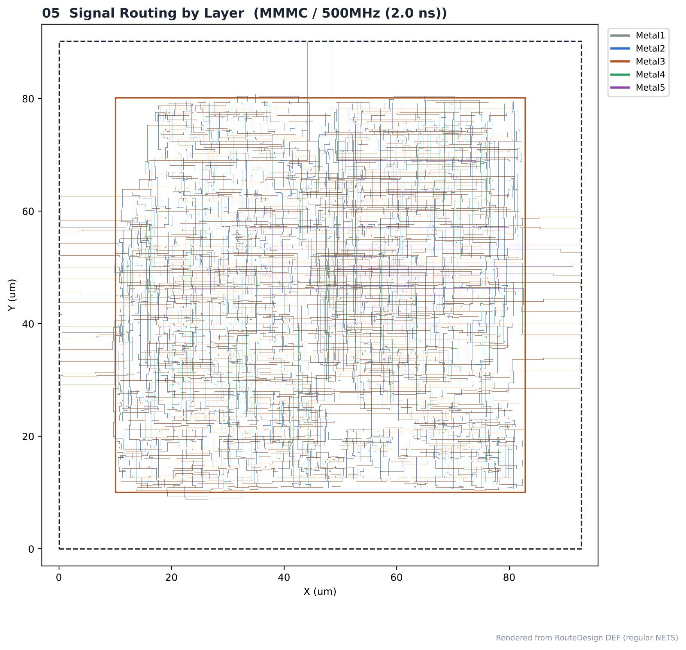

# 12. Routing — MMMC / 500MHz

| Item | Value |
|---|---|
| Clock | **ACLK 2.0 ns (500 MHz)**, SCLK = ACLK ÷ 4 (generated clock) |
| Run | Fmax 실험 (2.0 ns) |
| Tool | Cadence Innovus 22.17 (NanoRoute) |
| Script | [`scripts/4_RouteDesign_PowerAnalysis.tcl`](scripts/4_RouteDesign_PowerAnalysis.tcl) |
| DB | `PostCTSopt` → `RouteDesign` |

> **MMMC PnR** — setup view `FUNC_SS_WORST` (slow_vdd1v0, RC WORST, 125 °C), hold view `FUNC_FF_BEST` (fast_vdd1v0, RC BEST, 0 °C). 입력은 [04_Synthesis/MMMC](../../../04_Synthesis/MMMC)의 같은 주파수 넷리스트와 SDC입니다. 전체 흐름은 `all.tcl` 한 번 실행 (BUFX2 사용 금지 가드 포함).

---

## 1. Result

| Item | Value |
|---|---|
| Total wire length (routeDesign) | **13,309 µm** |
| By layer | M1 363 · M2 5,088 · M3 5,799 · M4 1,516 · M5 543 µm |
| M2 + M3 share | 82 % |
| Total vias | **6,608** (M1-M2 3,533 · M2-M3 2,610 · M3-M4 434 · M4-M5 31) |
| `optDesign -postRoute -drv` (OCV, RC 추출 전) | +0.269 ns |
| `optDesign -postRoute -setup` → final | **+0.083 ns** |
| `optDesign -postRoute -hold` → final | **+0.006 ns** |
| **verify_drc** | **0 violations** → [`reports/route_drc.rpt`](reports/route_drc.rpt) |

## Analysis

### A.1 After routeDesign



- **What** — global + detail 라우팅 직후
- **Observe** — wire 13,309 µm, via 6,608

### A.2 DRC Check


- **What** — verify_drc 후 violation browser
- **Observe** — verify_drc 0 violations

### A.3 After post-route optimization



- **What** — RC 추출 후 setup·hold 최적화까지 끝난 상태
- **Observe** — setup +0.083 / hold +0.006 ns

### A.4 Wire Length / Via



- **What** — 레이어별 배선 길이와 via 수
- **Observe** — M2+M3가 82 %, M6 이상은 사용하지 않음
- **Insight** — 작은 블록이라 하위 레이어만으로 배선이 끝났습니다. Metal10/11은 PDN 전용입니다.

### A.5 Routing by Layer



- **What** — RouteDesign DEF 신호 net을 레이어 색으로
- **Observe** — 레이어별 색으로 신호 배선이 어느 층에 몰렸는지 확인 (A.4의 수치와 대응)

## Files

```text
12_Routing/MMMC/500MHz/
├── README.md
│
├── images/
│   ├── 01_Route_Innovus.png
│   ├── 02_DRC_Check_Innovus.png
│   ├── 03_PostRoute_Opt_Innovus.png
│   ├── 04_WireLength_Via.png
│   └── 05_Routing_By_Layer.png
│
├── reports/
│   └── route_drc.rpt
│
├── results/
│   └── route.def
│
└── scripts/
    └── 4_RouteDesign_PowerAnalysis.tcl
```
