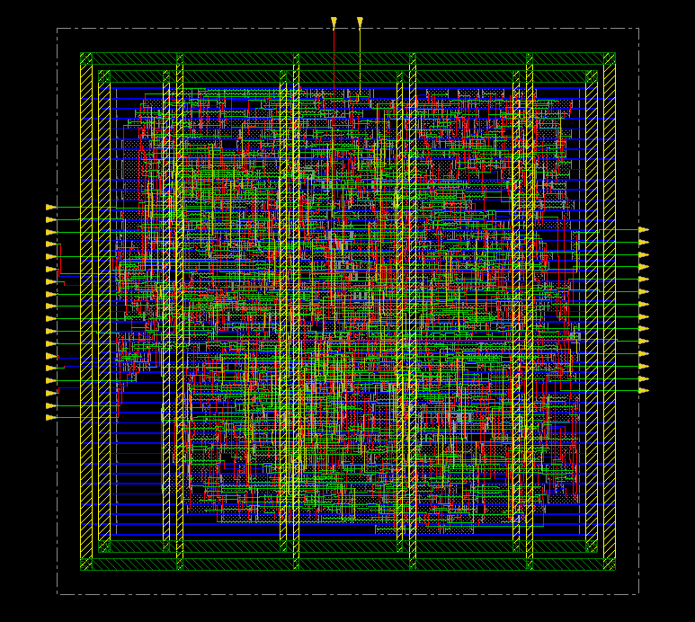
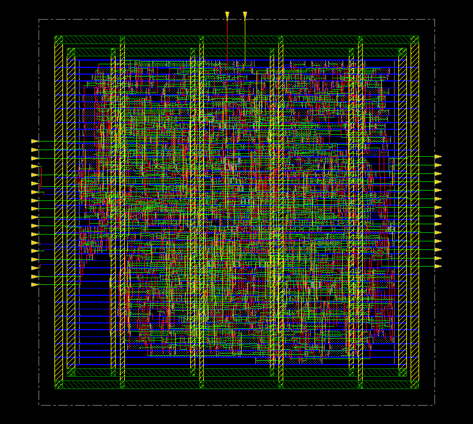

# 12. Routing — MMMC / 625MHz

| Item | Value |
|---|---|
| Clock | **ACLK 1.6 ns (625 MHz)**, SCLK = ACLK ÷ 4 |
| Tool | Cadence Innovus 22.17 |
| Script | [`scripts/4_RouteDesign_PowerAnalysis.tcl`](scripts/4_RouteDesign_PowerAnalysis.tcl) |

> **MMMC PnR** — setup view `FUNC_SS_WORST` (slow_vdd1v0, RC WORST, 125 °C), hold view `FUNC_FF_BEST` (fast_vdd1v0, RC BEST, 0 °C). 입력은 [04_Synthesis/MMMC](../../../04_Synthesis/MMMC)의 같은 주파수 넷리스트와 SDC입니다. 전체 흐름은 `all.tcl` 한 번 실행 (BUFX2 사용 금지 가드 포함).

## Result

| Item | Value |
|---|---|
| Total wire length | 13,988 µm |
| Total vias | 6,908 |
| `optDesign -postRoute -drv` 후 setup (OCV, RC 추출 전) | −0.072 (7) ns |
| `optDesign -postRoute -setup` 후 | **+0.035 ns** |
| `optDesign -postRoute -hold` 후 | **+0.002 ns** |
| **verify_drc** | **0 violations** → [`reports/route_drc.rpt`](reports/route_drc.rpt) |
| verifyConnectivity | no problems / no warnings |

| | |
|---|---|
|  | **01** routeDesign 후 |
|  | **02** DRC check (violation browser) |
|  | **03** post-route 최적화 후 |

## Files

```text
12_Routing/MMMC/625MHz/
├── README.md
│
├── images/
│   ├── 01_Route_Innovus.png
│   ├── 02_DRC_Check_Innovus.png
│   └── 03_PostRoute_Opt_Innovus.png
│
├── reports/
│   └── route_drc.rpt
│
├── results/
│   └── route.def
│
└── scripts/
    └── 4_RouteDesign_PowerAnalysis.tcl
```
