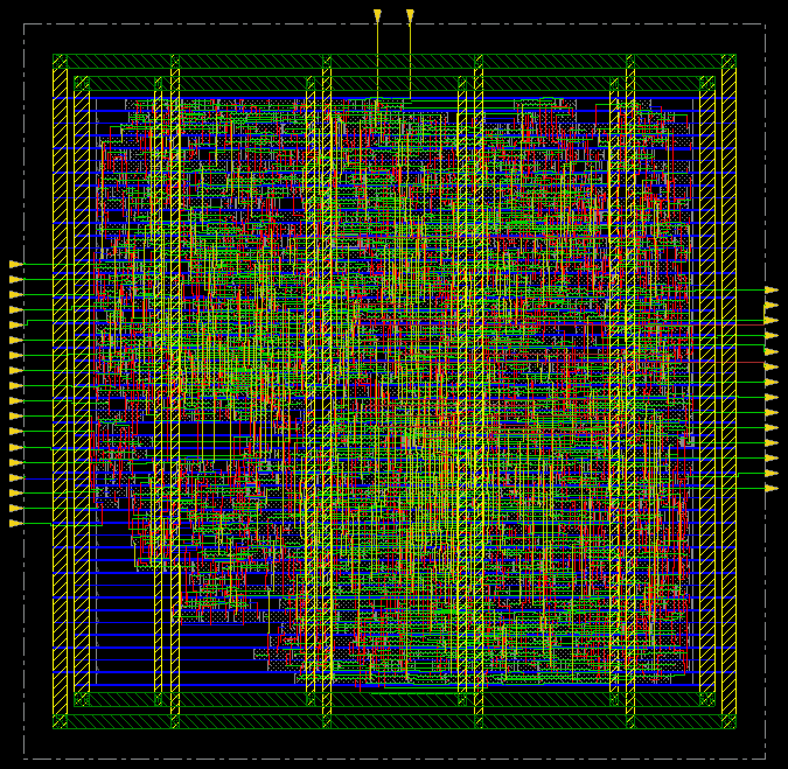
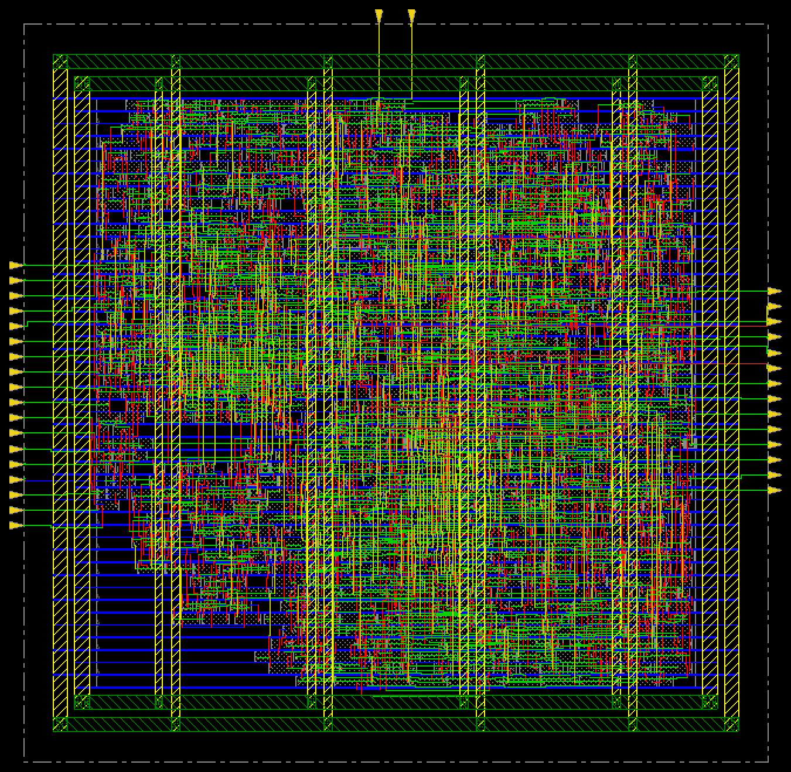
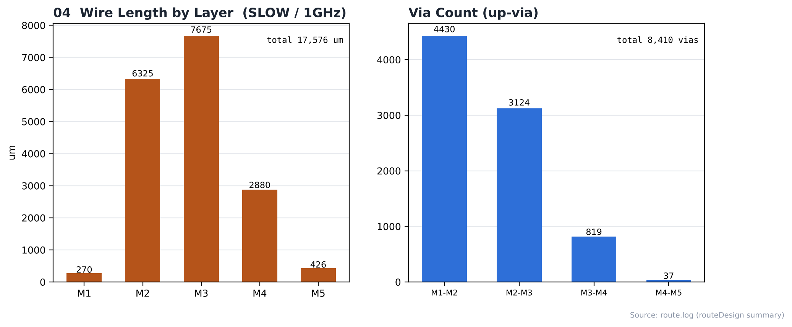
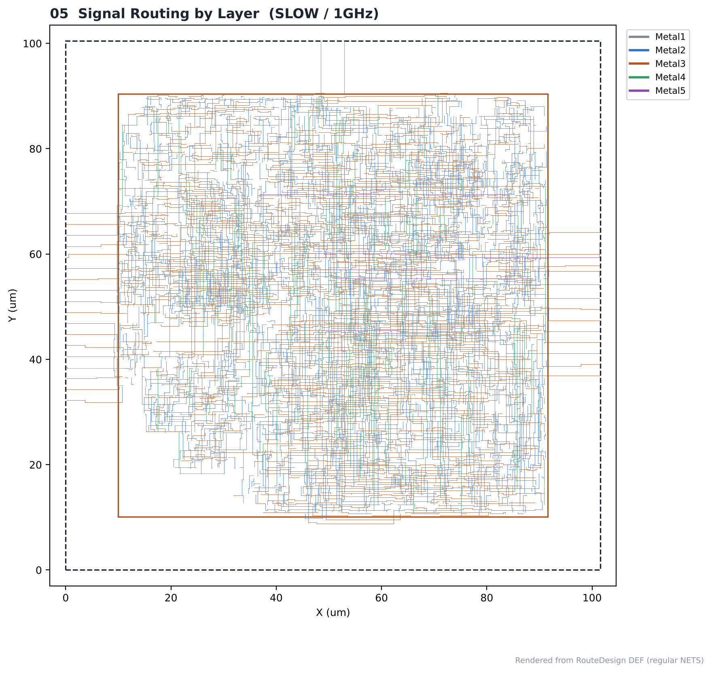

# 12. Routing — SLOW / 1GHz

| Item | Value |
|---|---|
| Corner (synthesis library) | **SLOW** — `slow_vdd1v0 (SS, 0.9 V, 125 °C)` |
| Clock | **ACLK 1 ns (1 GHz)**, SCLK = ACLK ÷ 4 (generated clock) |
| Tool | Cadence Innovus 22.17 (NanoRoute) |
| Script | [`scripts/4_RouteDesign_PowerAnalysis.tcl`](scripts/4_RouteDesign_PowerAnalysis.tcl) |
| DB | `PostCTSopt` → `RouteDesign` |
| Routing layers | Metal1 – Metal11 |

> **비교 실험 설계** — 같은 RTL을 SLOW(`slow_vdd1v0`, SS) / FAST(`fast_vdd1v0`, FF) 라이브러리로 각각 합성하고, PnR은 6개 실행 모두 같은 조건(MMMC setup `FUNC_SS_WORST` SS/125 °C, hold `FUNC_FF_BEST` FF/0 °C, 같은 스크립트)으로 구현했습니다. 차이는 입력 넷리스트의 **합성 코너**뿐이며, 합성 코너가 setup 검사 코너(SS)와 같을 때(SLOW)와 다를 때(FAST)를 비교합니다.

---

## 1. Flow

```text
setNanoRouteMode (timing-driven, SI-driven, antenna fix, end iteration 5) → routeDesign -globalDetail
      ↓
verify_drc → optDesign -postRoute -drv (OCV) → verifyConnectivity -geomConnect
      ↓
extractRC → optDesign -postRoute -setup / -hold      ← 14_RC_Extraction, 16_Timing_Closure
      ↓
timeDesign -postRoute (-hold) → saveDesign -rc RouteDesign      ← 15_Post_STA
```

## 2. Routing Result

| Item | Value |
|---|---|
| Total wire length | **17,576 µm** |
| By layer | M1 270 · M2 6,325 · M3 7,675 · M4 2,880 · M5 426 µm |
| M2 + M3 share | 80 % (14,000 µm) |
| Total vias | **8,410** (M1-M2 4,430 · M2-M3 3,124 · M3-M4 819 · M4-M5 37) |
| Nets with NDR / extra spacing | 32 |
| Detail route DRC (each iteration) | 0, 0, 0, 0, 0, 0 |
| **verify_drc** | **0 violations** → [`reports/route_drc.rpt`](reports/route_drc.rpt) |
| optDesign -postRoute -drv (final) | max_cap 0, max_tran 0; setup WNS -0.415 ns (OCV, extractRC 전) |
| verifyConnectivity | no problems / no warnings |

Metal10/11은 PDN(ring·stripe) 전용입니다.

## Analysis

### A.1 After routeDesign



- **What** — global + detail 라우팅 직후
- **Observe** — wire 17,576 µm, via 8,410

### A.2 DRC Check


- **What** — verify_drc 후 violation browser 표시
- **Observe** — verify_drc **0 violations**

### A.3 After post-route Optimization



- **What** — extractRC 후 setup·hold 최적화까지 끝난 상태
- **Observe** — setup WNS -0.463 ns, hold WNS +0.003 ns

### A.4 Wire Length / Via



- **What** — 레이어별 배선 길이와 via 수
- **Observe** — 가장 많이 쓴 레이어 M3 (7,675 µm), M2+M3 80 %
- **Insight** — 하위 레이어만으로 배선이 끝났고 M6 이상은 거의 쓰지 않았습니다. 작은 블록이라 긴 배선이 적습니다.

### A.5 Routing by Layer



- **What** — 신호 net을 레이어 색으로 표시 (DEF)
- **Observe** — 레이어별 방향(수평/수직)과 배선이 몰린 영역 확인


## 3. Images

| | |
|---|---|
|  | **01 routeDesign** 직후 |
|  | **02 DRC check** — violation browser 표시 상태 |
|  | **03 post-route optimization** 후 |
|  | **04 Wire length / via** — 레이어별 |
|  | **05 Routing by layer** — 신호 net을 레이어 색으로 |

> 01–03은 Innovus 캡처, 04는 `reports/route.log`, 05는 `results/route.def`로 그린 그림입니다.

## Files

```text
12_Routing/SLOW/1GHz/
├── README.md
│
├── scripts/
│   └── 4_RouteDesign_PowerAnalysis.tcl
│
├── reports/
│   ├── route.log
│   └── route_drc.rpt
│
├── images/
│   ├── 01_Route_Innovus.png
│   ├── 02_DRC_Check_Innovus.png
│   ├── 03_PostRoute_Opt_Innovus.png
│   ├── 04_WireLength_Via.png
│   └── 05_Routing_By_Layer.png
│
└── results/
    └── route.def
```
