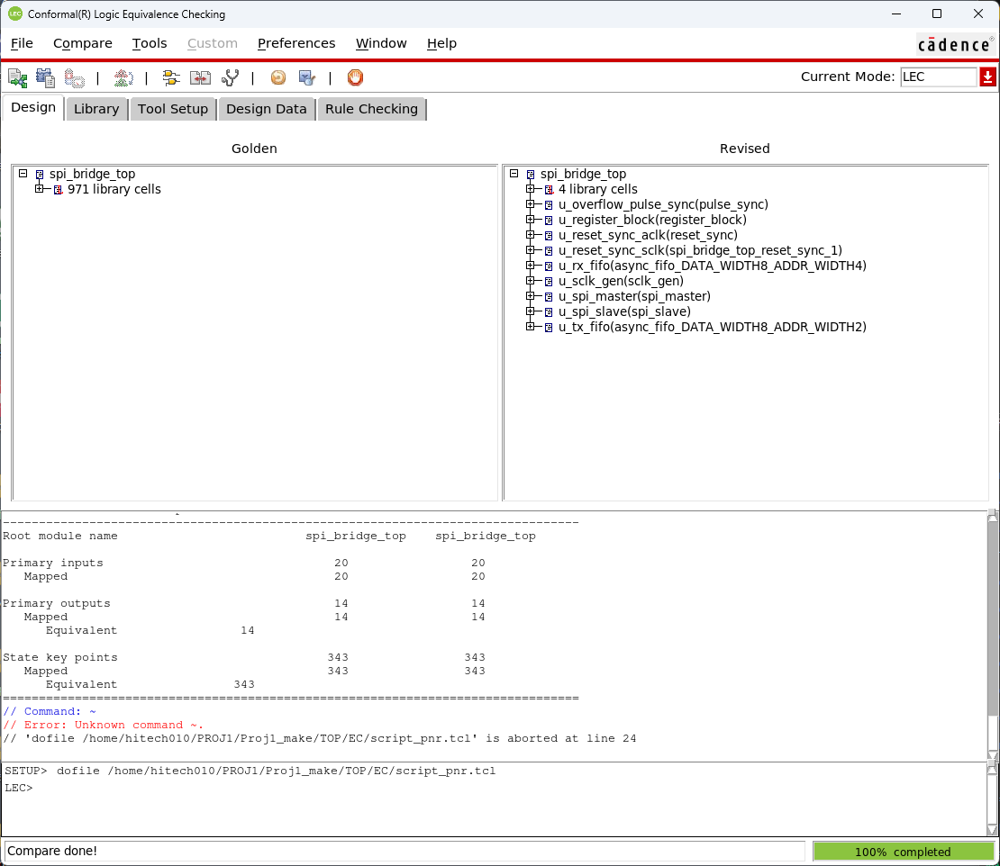

# 13. Post LEC — Synthesized Netlist ↔ PnR Netlist

PnR(CTS 버퍼, hold 버퍼, DRV 수정, 셀 크기 변경)을 거친 넷리스트가 합성 넷리스트와 같은 논리인지 확인했습니다.

| Item | Value |
|---|---|
| Tool | Cadence Conformal LEC 22.10 (batch dofile) |
| Golden | `spi_bridge_top_pnr.v` (PnR 10 ns run, [19_Final_Results/MMMC/100MHz](../19_Final_Results/MMMC/100MHz)) |
| Revised | `spi_bridge_top_syn_final.v` (합성 10 ns run) |
| Library | `slow_vdd1v0_basicCells.v` + `fast_vdd1v0_basicCells.v` |
| Dofile | [`scripts/script_pnr.tcl`](scripts/script_pnr.tcl) |
| Log | [`logs/spi_bridge_PNR_lec.log`](logs/spi_bridge_PNR_lec.log) |
| **결과** | **PASS — Equivalent 357 / 357** |

## Result

| Mapping | PI | PO | DFF | Total |
|---|---|---|---|---|
| Golden (PnR) | 20 | 14 | 343 | 377 |
| Revised (synthesis) | 20 | 14 | 343 | 377 |

| Compare | PO | DFF | Total |
|---|---|---|---|
| **Equivalent** | 14 | 343 | **357** |

Pre LEC와 달리 Unreachable이 없습니다. 두 쪽 모두 이미 합성된 넷리스트라 FF 구성이 같기 때문입니다. PnR이 넣은 버퍼(CTS 22개, hold/DRV 버퍼)는 논리를 바꾸지 않으므로 비교 결과에 영향이 없습니다.



> **Golden / Revised 방향** — 일반적으로 이전 단계(합성)를 Golden, 다음 단계(PnR)를 Revised로 둡니다. 이 run은 반대로 PnR을 Golden으로 읽었습니다. 등가성 검사는 양방향 대칭이므로 PASS 결과 자체는 유효하며, 다음 run부터는 합성 = Golden으로 맞출 예정입니다. 같은 비교용 dofile 예시는 [`scripts/syn2pnr.do`](scripts/syn2pnr.do)에 있습니다.

## Files

```text
13_Post_LEC/
├── README.md
│
├── images/
│   └── 01_LEC_GUI_PASS.png
│
├── logs/
│   └── spi_bridge_PNR_lec.log
│
└── scripts/
    ├── script_pnr.tcl
    └── syn2pnr.do
```
