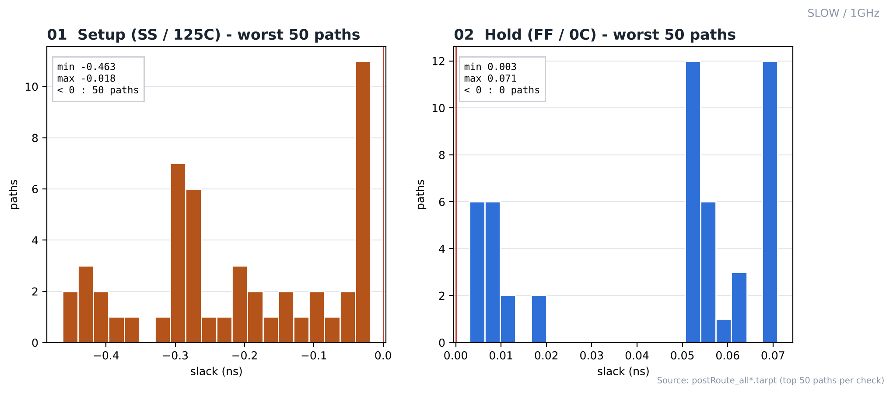
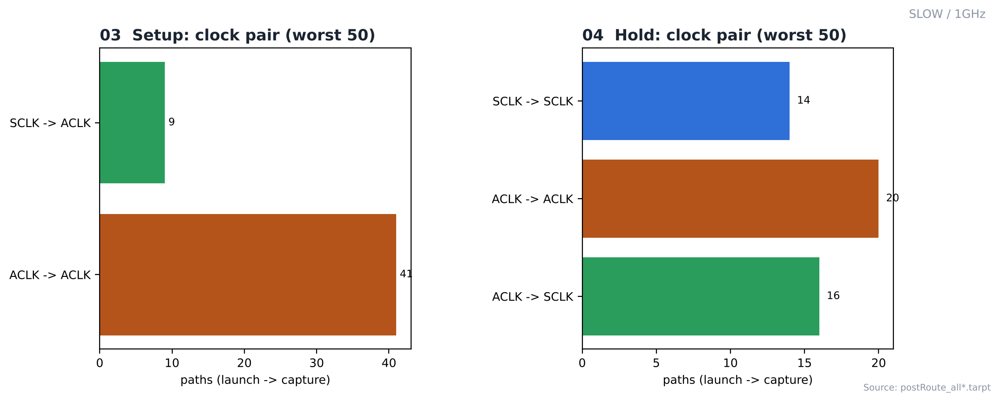

# 13. Post-Route STA — SLOW / 1GHz

| Item | Value |
|---|---|
| Corner (synthesis library) | **SLOW** — `slow_vdd1v0 (SS, 0.9 V, 125 °C)` |
| Clock | **ACLK 1 ns (1 GHz)**, SCLK = ACLK ÷ 4 (generated clock) |
| Tool | Cadence Innovus 22.17 (`timeDesign`) |
| Setup view | `FUNC_SS_WORST` — slow_vdd1v0, RC WORST, 125 °C |
| Hold view | `FUNC_FF_BEST` — fast_vdd1v0, RC BEST, 0 °C |
| Analysis | `single` mode, SI off |
| Parasitics | `extractRC` postRoute / low → [12_RC_Extraction](../../../12_RC_Extraction/SLOW/1GHz) |

> **비교 실험 설계** — 같은 RTL을 SLOW(`slow_vdd1v0`, SS) / FAST(`fast_vdd1v0`, FF) 라이브러리로 각각 합성하고, PnR은 6개 실행 모두 같은 조건(MMMC setup `FUNC_SS_WORST` SS/125 °C, hold `FUNC_FF_BEST` FF/0 °C, 같은 스크립트)으로 구현했습니다. 차이는 입력 넷리스트의 **합성 코너**뿐이며, 합성 코너가 setup signoff 코너(SS)와 같을 때(SLOW)와 다를 때(FAST)를 비교합니다.

---

## 1. Timing Summary

| Check | Group | WNS (ns) | TNS (ns) | Violating / All |
|---|---|---|---|---|
| **Setup** | all | **-0.463** | -10.641 | 64 / 684 |
| | reg2reg | -0.463 | -5.728 | 46 / 674 |
| | default | -0.318 | -4.924 | 21 / 24 |
| **Hold** | all | **+0.003** | 0.000 | 0 / 684 |
| | reg2reg | +0.003 | 0.000 | 0 / 674 |
| | default | +0.064 | 0.000 | 0 / 24 |

| DRV | max_cap | max_tran | max_fanout | Density |
|---|---|---|---|---|
| Result | 0 | 0 | 0 | 80.55 % |

**판정: setup FAIL / hold PASS**

## 2. Worst Setup Path

| Item | Value |
|---|---|
| Begin → End | `u_rx_fifo/r_rd_ptr_bin_reg_1/Q` → `u_rx_fifo/o_rd_data_reg_6/D` (reg2reg) |
| Period / uncertainty / setup | 1.0 / 0.1 / 0.119 ns |
| Arrival / required | 1.077 / 0.614 ns |
| **Slack** | **-0.463 ns** |
| Logic stages | 8 cells |

| # | Setup path (top 3) | Clock | Slack (ns) |
|---|---|---|---|
| 1 | `u_rx_fifo/r_rd_ptr_bin_reg_1/Q` → `u_rx_fifo/o_rd_data_reg_6/D` | ACLK → ACLK | -0.463 |
| 2 | `u_rx_fifo/r_rd_ptr_bin_reg_1/Q` → `u_rx_fifo/o_rd_data_reg_3/D` | ACLK → ACLK | -0.449 |
| 3 | `u_rx_fifo/r_rd_ptr_bin_reg_1/Q` → `u_rx_fifo/o_rd_data_reg_5/D` | ACLK → ACLK | -0.428 |

| # | Hold path (top 3) | Clock | Slack (ns) |
|---|---|---|---|
| 1 | `u_tx_fifo/r_wr_ptr_gray_reg_0/Q` → `u_tx_fifo/r_wr_ptr_gray_meta_r_reg_0/D` | ACLK → SCLK | +0.003 |
| 2 | `u_tx_fifo/r_wr_ptr_gray_reg_1/Q` → `u_tx_fifo/r_wr_ptr_gray_meta_r_reg_1/D` | ACLK → SCLK | +0.003 |
| 3 | `u_tx_fifo/r_wr_ptr_gray_reg_2/Q` → `u_tx_fifo/r_wr_ptr_gray_meta_r_reg_2/D` | ACLK → SCLK | +0.003 |

## 3. Path Distribution (worst 50 per check)

| Check | Slack range (ns) | Negative | Launch → capture |
|---|---|---|---|
| Setup | -0.463 ~ -0.018 | 50 | ACLK→ACLK 41, SCLK→ACLK 9 |
| Hold | +0.003 ~ +0.071 | 0 | ACLK→SCLK 16, ACLK→ACLK 20, SCLK→SCLK 14 |

tarpt에는 check별 상위 50개 경로만 있어 전체 684개 경로의 분포는 아닙니다.

## Analysis

### A.1 Slack Histogram



- **What** — setup / hold 상위 50개 경로의 slack 분포
- **Observe** — setup -0.463 ~ -0.018 ns (음수 50개)
- **Observe** — hold +0.003 ~ +0.071 ns (음수 0개)
- **Insight** — setup 위반이 남았습니다.

### A.2 Clock Pair



- **What** — 상위 경로의 launch → capture 클럭
- **Observe** — setup: ACLK → ACLK 41, SCLK → ACLK 9
- **Observe** — hold: ACLK → SCLK 16, ACLK → ACLK 20, SCLK → SCLK 14
- **Insight** — hold 상위 경로에 ACLK → SCLK가 16개 있습니다. async FIFO 메모리를 SCLK 도메인에서 읽는 경로로, SCLK를 ACLK의 generated clock으로 정의해 동기 경로로 검사되기 때문입니다.


## 4. Images

| | |
|---|---|
|  | **01 Slack histogram** — setup / hold 상위 50개 |
|  | **02 Clock pair** — launch → capture 클럭 |

## Files

```text
13_Post_STA/SLOW/1GHz/
├── README.md
│
├── reports/
│   ├── drv/
│   │   ├── postRoute_cap.rpt
│   │   ├── postRoute_fanout.rpt
│   │   ├── postRoute_length.rpt
│   │   └── postRoute_tran.rpt
│   ├── hold/
│   │   ├── postRoute_all_hold.tarpt
│   │   ├── postRoute_default_hold.tarpt
│   │   ├── postRoute_hold.summary
│   │   └── postRoute_reg2reg_hold.tarpt
│   └── setup/
│       ├── postRoute_all.tarpt
│       ├── postRoute_default.tarpt
│       ├── postRoute_reg2reg.tarpt
│       └── postRoute_setup.summary
│
└── images/
    ├── 01_Slack_Histogram.png
    └── 02_Clock_Domain_Paths.png
```
