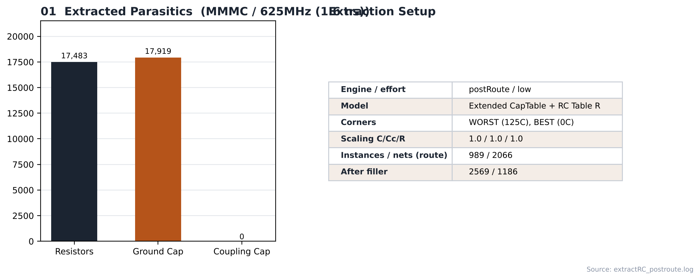

# 14. RC Extraction — MMMC / 625MHz

| Item | Value |
|---|---|
| Clock | **ACLK 1.6 ns (625 MHz)**, SCLK = ACLK ÷ 4 (generated clock) |
| Run | Fmax 실험 — 합성·PnR 모두 닫힌 최고 주파수 (1.6 ns) |
| Engine | Innovus 내장 `extractRC` (postRoute, effort low) — Quantus 없음 |
| RC corner | [`scripts/spi_bridge_top.mmmc.tcl`](scripts/spi_bridge_top.mmmc.tcl) — WORST (125 °C) / BEST (0 °C) |

> **MMMC PnR** — setup view `FUNC_SS_WORST` (slow_vdd1v0, RC WORST, 125 °C), hold view `FUNC_FF_BEST` (fast_vdd1v0, RC BEST, 0 °C). 입력은 [04_Synthesis/MMMC](../../../04_Synthesis/MMMC)의 같은 주파수 넷리스트와 SDC입니다. 전체 흐름은 `all.tcl` 한 번 실행 (BUFX2 사용 금지 가드 포함).

---

## 1. Result (route 후 extractRC)

| Item | Value |
|---|---|
| Resistors | 17,483 |
| Ground caps | 17,919 |
| Coupling caps | 0 (SI off) |
| Extraction scope (route) | 989 instances / 2066 nets |
| Extraction scope (filler 후) | 2569 instances / 1186 nets |

SPEF 출력과 SPEF 기반 Tempus 재현은 기준 run에서만 했습니다 → [MMMC/100MHz](../100MHz).

## Analysis

### A.1 RC Extraction Summary



- **What** — 추출된 R / C 개수와 추출 설정
- **Observe** — R 17,483 / C 17,919, coupling 0 (SI off)

## Files

```text
14_RC_Extraction/MMMC/625MHz/
├── images/
│   └── 01_RC_Extraction_Summary.png
│
└── scripts/
    └── spi_bridge_top.mmmc.tcl
```
