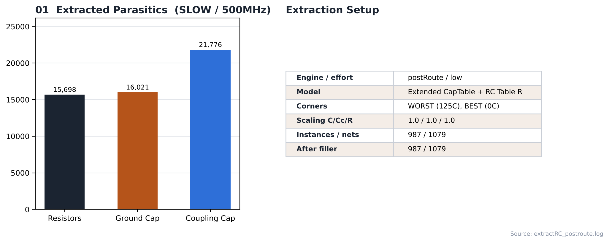

# 14. RC Extraction — SLOW / 500MHz

| Item | Value |
|---|---|
| Corner (synthesis library) | **SLOW** — `slow_vdd1v0 (SS, 0.9 V, 125 °C)` |
| Clock | **ACLK 2 ns (500 MHz)**, SCLK = ACLK ÷ 4 (generated clock) |
| Tool | Cadence Innovus 22.17 (`extractRC`) |
| 실행 위치 | route 후(4번), filler 후(5번) |
| RC corner 정의 | [`scripts/spi_bridge_top.mmmc.tcl`](scripts/spi_bridge_top.mmmc.tcl) |

---

## 1. RC Corner

| RC corner | Temperature | Used by view |
|---|---|---|
| WORST | 125 °C | `FUNC_SS_WORST` (setup) |
| BEST | 0 °C | `FUNC_FF_BEST` (hold) |

captable과 `gpdk045.tch`가 함께 지정되어 있고, effort low 추출은 captable을 씁니다(로그: `Extended CapTable, RC Table Resistances`).

## 2. Result

| Item | Route 후 | Filler 후 |
|---|---|---|
| Instances / nets | 987 / 1079 | 987 / 1079 |
| Resistors | 15,698 | 15,698 |
| Ground cap | 16,021 | 16,021 |
| Coupling cap | 21,776 | 21,776 |

post-route 타이밍([15_Post_STA](../../../15_Post_STA/SLOW/500MHz))은 route 후 추출 결과를 사용합니다. filler 후 추출에서 coupling cap이 21776으로 보고된 원인은 로그에 나와 있지 않아 확인하지 못했습니다.

## 3. Notes

- Innovus 내장 추출(effort low, captable 기반)로 진행했습니다. 근거는 위 로그의 `Extended CapTable` 메시지입니다.
- Quantus(signoff) 추출과 SPEF 저장은 이번 플로우에 포함되지 않았습니다. SPEF가 필요하면 `extractRC` 뒤에 `rcOut -spef <file> -rc_corner WORST`를 추가하면 됩니다.

## Analysis

### A.1 Extracted Parasitics



- **What** — route 후 추출된 R / C 소자 수와 추출 조건
- **Observe** — resistor 15,698, ground cap 16,021, coupling cap 21,776
- **Insight** — coupling cap 항목이 가장 많습니다. 이웃 배선 사이 결합 용량으로, 이번 분석은 SI off라 crosstalk 효과는 보지 않고 지연 계산용 부하로만 반영됩니다.


## 4. Images

| | |
|---|---|
|  | **01 RC Extraction** — 추출된 R / C 개수와 추출 조건 |

## Files

```text
14_RC_Extraction/SLOW/500MHz/
├── README.md
│
├── scripts/
│   └── spi_bridge_top.mmmc.tcl
│
├── reports/
│   ├── extractRC_chipfinish.log
│   └── extractRC_postroute.log
│
└── images/
    └── 01_RC_Extraction_Summary.png
```
