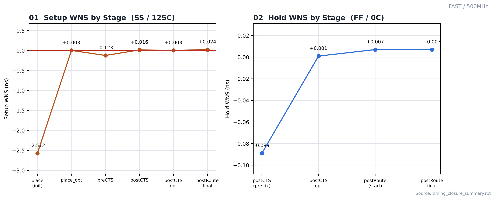
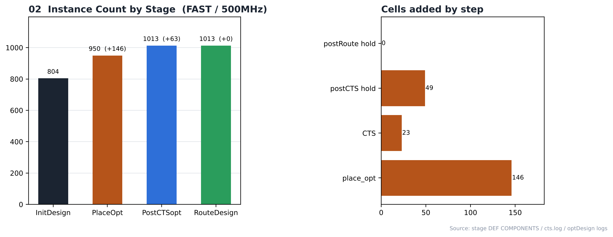

# 14. Timing Closure — FAST / 500MHz

| Item | Value |
|---|---|
| Corner (synthesis library) | **FAST** — `fast_vdd1v0 (FF, 1.1 V, 0 °C)` |
| Clock | **ACLK 2 ns (500 MHz)**, SCLK = ACLK ÷ 4 (generated clock) |
| 최적화 명령 | `place_opt_design`, `ccopt_design`, `optDesign -postCTS (-hold)`, `optDesign -postRoute -drv / -setup / -hold` |
| 요약 리포트 | [`reports/timing_closure_summary.rpt`](reports/timing_closure_summary.rpt) |
| 결과 | **setup PASS / hold PASS** |

> **비교 실험 설계** — 같은 RTL을 SLOW(`slow_vdd1v0`, SS) / FAST(`fast_vdd1v0`, FF) 라이브러리로 각각 합성하고, PnR은 6개 실행 모두 같은 조건(MMMC setup `FUNC_SS_WORST` SS/125 °C, hold `FUNC_FF_BEST` FF/0 °C, 같은 스크립트)으로 구현했습니다. 차이는 입력 넷리스트의 **합성 코너**뿐이며, 합성 코너가 setup signoff 코너(SS)와 같을 때(SLOW)와 다를 때(FAST)를 비교합니다.

---

## 1. Stage-by-Stage

| Stage | Setup WNS | Setup TNS | Setup viol | Hold WNS | Hold TNS | Hold viol | Density |
|---|---|---|---|---|---|---|---|
| place (initial) | -2.572 | -55.216 | 76 | - | - | - | 69.98 % |
| place_opt | 0.003 | 0.000 | 0 | - | - | - | 75.49 % |
| preCTS | -0.123 | -0.321 | 7 | - | - | - | 75.61 % |
| postCTS | 0.016 | 0.000 | 0 | - | - | - | 76.47 % |
| postCTS opt (pre hold fix) | 0.003 | 0.000 | 0 | -0.089 | -1.035 | 16 | — |
| postCTS opt | 0.003 | 0.000 | 0 | 0.001 | 0.000 | 0 | 78.29 % |
| postRoute DRV opt (OCV) | -0.094 | -0.094 | 1 | - | - | - | — |
| postRoute setup opt (start) | 0.024 | 0.000 | 0 | - | - | - | — |
| postRoute hold opt (start) | - | - | - | 0.007 | 0.000 | 0 | — |
| postRoute final | 0.024 | 0.000 | 0 | 0.007 | 0.000 | 0 | 78.29 % |

단위: ns. "postRoute DRV opt"는 OCV 모드·RC 추출 전 값이라 다른 행과 조건이 다릅니다.

## 2. Cells Added

| Step | Cells |
|---|---|
| place_opt_design (instances +) | 146 (804 → 950) |
| ccopt_design (clock tree) | 23 |
| optDesign -postCTS -hold | 49 |
| optDesign -postRoute -hold | 0 |
| Final (RouteDesign) | 1013 instances |

## 3. Observations

- 배치 직후 setup 위반 76개(WNS -2.572 ns)가 있었고, place_opt 후 0개(WNS +0.003 ns)로 줄었습니다.
- CTS 후 hold 위반 16개(WNS -0.089 ns)가 나타났고, 버퍼 49개로 해결했습니다.
- 최종 setup WNS +0.024 ns, hold WNS +0.007 ns로 위반 없이 닫혔습니다. ECO(6_ECO.tcl)는 실행하지 않았습니다.
- **합성 코너 비교 (FAST vs SLOW, 500MHz)** — FAST는 FF 조건 합성 slack 1,109.4 ps였지만, SS로 검사한 배치 직후 setup WNS는 -2.572 ns(76개 위반)였습니다. 같은 주파수 SLOW는 배치 직후 -0.566 ns(11개 위반)였습니다. place_opt에서 늘어난 인스턴스는 FAST +146 / SLOW +18, place_opt 후 density는 FAST 75.49 % / SLOW 69.09 %입니다. 합성 코너가 signoff 코너와 다르면 그만큼을 PnR에서 보정해야 합니다. → [SLOW/500MHz](../../SLOW/500MHz)
- 최종 타이밍은 SI·OCV 미적용 Innovus 결과이며 Tempus/Quantus signoff 결과는 아닙니다.

## Analysis

### A.1 WNS Trend



- **What** — 배치부터 라우팅까지 setup / hold WNS 변화
- **Observe** — setup: -2.572 → +0.003 → -0.123 → +0.016 → +0.003 → +0.024 ns
- **Observe** — hold: -0.089 → +0.001 → +0.007 → +0.007 ns
- **Insight** — 최종적으로 setup·hold가 모두 0 이상입니다.

### A.2 Instance Growth



- **What** — 단계별 인스턴스 수와 추가된 셀
- **Observe** — 804 → 950 → 1013 → 1013
- **Observe** — place_opt +146, CTS 23, hold fix 49 + 0
- **Insight** — place_opt에서 늘어난 셀 수가 합성 넷리스트와 PnR 검사 조건 사이의 차이를 보여줍니다.


## 4. Images

| | |
|---|---|
|  | **01 WNS trend** — 단계별 setup / hold WNS |
|  | **02 Instance growth** — 단계별 인스턴스 수와 추가된 셀 |

## Files

```text
14_Timing_Closure/FAST/500MHz/
├── README.md
│
├── reports/
│   ├── optDesign_postCTS_hold.log
│   ├── optDesign_postRoute.log
│   └── timing_closure_summary.rpt
│
└── images/
    ├── 01_WNS_Trend.png
    └── 02_Instance_Growth.png
```
