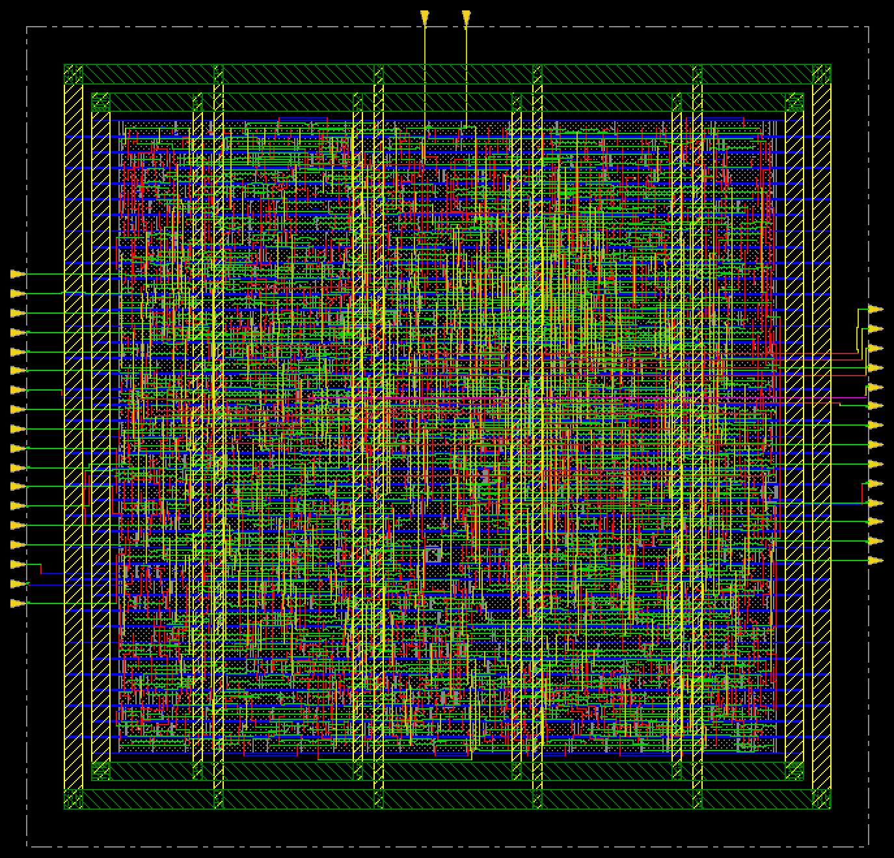
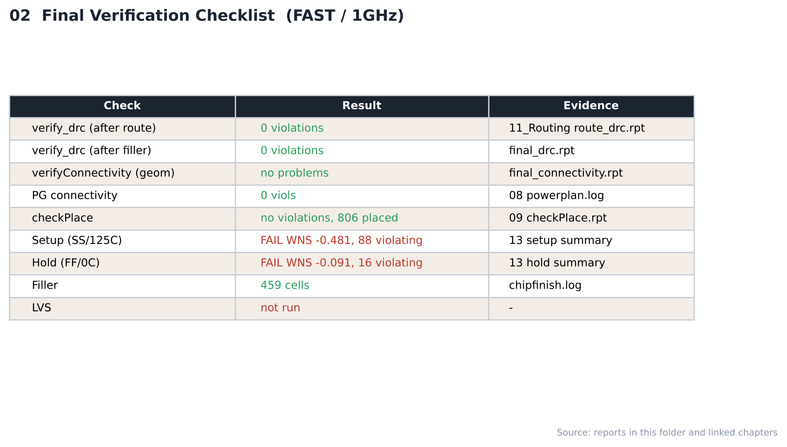

# 15. Final Verification — FAST / 1GHz

| Item | Value |
|---|---|
| Corner (synthesis library) | **FAST** — `fast_vdd1v0 (FF, 1.1 V, 0 °C)` |
| Clock | **ACLK 1 ns (1 GHz)**, SCLK = ACLK ÷ 4 (generated clock) |
| Tool | Cadence Innovus 22.17 (`verify_drc`, `verifyConnectivity`) |
| Script | [`scripts/5_ChipFinish.tcl`](scripts/5_ChipFinish.tcl) |
| DB | `RouteDesign` → `ChipFinish` |

---

## 1. Filler

| Cell | FILL8 | FILL4 | FILL2 | FILL1 | **Total** |
|---|---|---|---|---|---|
| Count | 3 | 27 | 128 | 301 | **459** |

인스턴스: 1198 (route 후) → 1657 (filler 포함)

## 2. Verification

| Check | Result | Evidence |
|---|---|---|
| verify_drc (route 후) | **0 violations** | [11_Routing](../../../11_Routing/FAST/1GHz/reports/route_drc.rpt) |
| verify_drc (filler 후) | **0 violations** | [`reports/final_drc.rpt`](reports/final_drc.rpt) |
| verifyConnectivity -geomConnect | **no problems / no warnings** | [`reports/final_connectivity.rpt`](reports/final_connectivity.rpt) |
| PG connectivity | 0 / 0 | [08_Floorplan](../../../08_Floorplan/FAST/1GHz/reports/powerplan.log) |
| Setup / hold (post-route) | -0.481 / -0.091 ns — **FAIL / FAIL** | [13_Post_STA](../../../13_Post_STA/FAST/1GHz) |
| **LVS** | **미실행** | — |

- 위 DRC는 Innovus `verify_drc`(LEF 기반 routing DRC) 결과이며 foundry rule deck 기반 physical DRC가 아닙니다.
- GDS는 표준 셀 GDS를 merge하지 않고 출력했습니다.

## Analysis

### A.1 Chip Finish



- **What** — filler 삽입 후 최종 레이아웃
- **Observe** — filler 459개로 빈 site를 채움, 인스턴스 1,657개

### A.2 Verification Checklist



- **What** — 검사 항목·결과·근거 파일
- **Observe** — DRC 0 / 0, connectivity clean
- **Observe** — setup FAIL, hold FAIL, LVS 미실행
- **Insight** — 물리 검증은 통과했지만 타이밍이 닫히지 않아 이 주파수에서는 최종 완료로 볼 수 없습니다.


## 3. Images

| | |
|---|---|
|  | **01 Chip Finish** — filler 삽입 후 최종 레이아웃 |
|  | **02 Checklist** — 검사 항목·결과·근거 |

> route 후 DRC 화면은 [11_Routing](../../../11_Routing/FAST/1GHz/images/02_DRC_Check_Innovus.png)에 있습니다.

## Files

```text
15_Final_Verification/FAST/1GHz/
├── README.md
│
├── scripts/
│   └── 5_ChipFinish.tcl
│
├── reports/
│   ├── chipfinish.log
│   ├── final_connectivity.rpt
│   └── final_drc.rpt
│
├── images/
│   ├── 01_ChipFinish_Innovus.png
│   └── 02_Verification_Checklist.png
│
└── results/
    └── chipfinish.def
```
