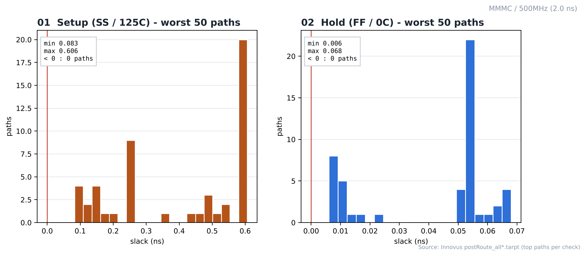
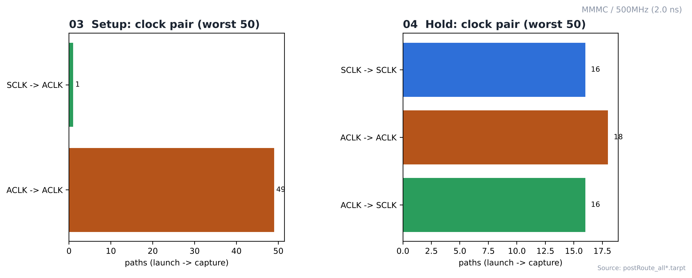

# 15. Post-Route STA — MMMC / 500MHz

| Item | Value |
|---|---|
| Clock | **ACLK 2.0 ns (500 MHz)**, SCLK = ACLK ÷ 4 (generated clock) |
| Run | Fmax 실험 (2.0 ns) |
| Tool | Cadence Innovus 22.17 (`timeDesign`) |
| Setup view | `FUNC_SS_WORST` — slow_vdd1v0, RC WORST, 125 °C |
| Hold view | `FUNC_FF_BEST` — fast_vdd1v0, RC BEST, 0 °C |
| Analysis | single mode, SI off |

> **MMMC PnR** — setup view `FUNC_SS_WORST` (slow_vdd1v0, RC WORST, 125 °C), hold view `FUNC_FF_BEST` (fast_vdd1v0, RC BEST, 0 °C). 입력은 [04_Synthesis/MMMC](../../../04_Synthesis/MMMC)의 같은 주파수 넷리스트와 SDC입니다. 전체 흐름은 `all.tcl` 한 번 실행 (BUFX2 사용 금지 가드 포함).

---

## 1. Timing Summary

| Check | WNS | TNS | 위반 |
|---|---|---|---|
| **Setup** (SS) | **+0.083 ns** | 0.000 | 0 |
| **Hold** (FF) | **+0.006 ns** | 0.000 | 0 |

| Worst setup path | Value |
|---|---|
| Begin → End | `u_register_block/rx_data_buf_valid_reg/Q` → `u_rx_fifo/o_rd_data_reg_4/D` |
| Group | reg2reg |
| Slack | +0.083 ns |

Tempus 독립 분석(coverage, untested, recovery/removal)은 기준 run에서 했습니다 → [MMMC/100MHz](../100MHz).

## Analysis

### A.1 Slack Histogram



- **What** — worst 50 setup / 50 hold 경로의 slack 분포
- **Observe** — setup 0.083 ~ 0.606 ns, hold 0.006 ~ 0.068 ns, 음수 0
- **Insight** — 주기가 2.0 ns로 짧아 setup 여유가 수십 ps 수준까지 줄었습니다. 이 주파수가 이 설계의 한계 근처라는 뜻입니다.

### A.2 Clock Domain Paths



- **What** — worst 경로의 launch → capture 클럭 쌍
- **Observe** — setup: ACLK -> ACLK 49, SCLK -> ACLK 1
- **Observe** — hold: ACLK -> ACLK 18, ACLK -> SCLK 16, SCLK -> SCLK 16

## Files

```text
15_Post_STA/MMMC/500MHz/
├── images/
│   ├── 01_Slack_Histogram.png
│   └── 02_Clock_Domain_Paths.png
│
└── reports/
    ├── hold/
    │   ├── spi_bridge_top_postRoute_all_hold.tarpt
    │   └── spi_bridge_top_postRoute_hold.summary
    └── setup/
        ├── spi_bridge_top_postRoute.summary
        └── spi_bridge_top_postRoute_all.tarpt
```
