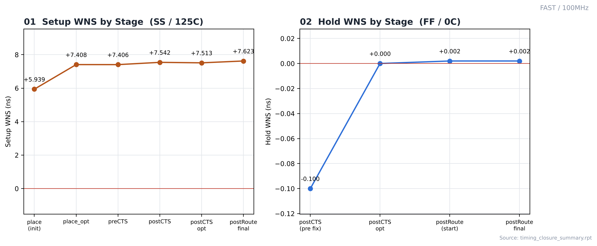
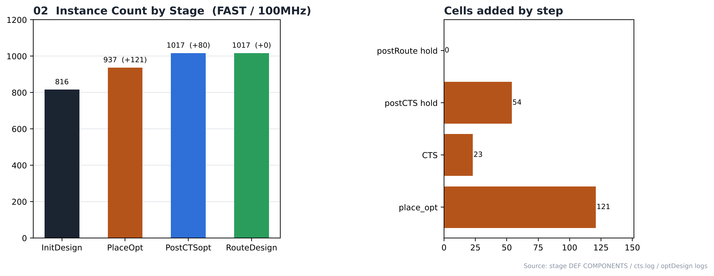

# 16. Timing Closure — FAST / 100MHz

| Item | Value |
|---|---|
| Corner (synthesis library) | **FAST** — `fast_vdd1v0 (FF, 1.1 V, 0 °C)` |
| Clock | **ACLK 10 ns (100 MHz)**, SCLK = ACLK ÷ 4 (generated clock) |
| 최적화 명령 | `place_opt_design`, `ccopt_design`, `optDesign -postCTS (-hold)`, `optDesign -postRoute -drv / -setup / -hold` |
| 요약 리포트 | [`reports/timing_closure_summary.rpt`](reports/timing_closure_summary.rpt) |
| 결과 | **setup PASS / hold PASS** |

> **비교 실험 설계** — 같은 RTL을 SLOW(`slow_vdd1v0`, SS) / FAST(`fast_vdd1v0`, FF) 라이브러리로 각각 합성하고, PnR은 6개 실행 모두 같은 조건(MMMC setup `FUNC_SS_WORST` SS/125 °C, hold `FUNC_FF_BEST` FF/0 °C, 같은 스크립트)으로 구현했습니다. 차이는 입력 넷리스트의 **합성 코너**뿐이며, 합성 코너가 setup 검사 코너(SS)와 같을 때(SLOW)와 다를 때(FAST)를 비교합니다.

---

## 1. Stage-by-Stage

| Stage | Setup WNS | Setup TNS | Setup viol | Hold WNS | Hold TNS | Hold viol | Density |
|---|---|---|---|---|---|---|---|
| place (initial) | 5.939 | 0.000 | 0 | - | - | - | 69.94 % |
| place_opt | 7.408 | 0.000 | 0 | - | - | - | 73.94 % |
| preCTS | 7.406 | 0.000 | 0 | - | - | - | 74.07 % |
| postCTS | 7.542 | 0.000 | 0 | - | - | - | 75.31 % |
| postCTS opt (pre hold fix) | 7.513 | 0.000 | 0 | -0.100 | -1.120 | 16 | — |
| postCTS opt | 7.513 | 0.000 | 0 | 0.000 | 0.000 | 0 | 77.33 % |
| postRoute DRV opt (OCV) | 7.637 | 0.000 | 0 | - | - | - | — |
| postRoute setup opt (start) | 7.621 | 0.000 | 0 | - | - | - | — |
| postRoute hold opt (start) | - | - | - | 0.002 | 0.000 | 0 | — |
| postRoute final | 7.623 | 0.000 | 0 | 0.002 | 0.000 | 0 | 77.33 % |

단위: ns. "postRoute DRV opt"는 OCV 모드·RC 추출 전 값이라 다른 행과 조건이 다릅니다.

## 2. Cells Added

| Step | Cells |
|---|---|
| place_opt_design (instances +) | 121 (816 → 937) |
| ccopt_design (clock tree) | 23 |
| optDesign -postCTS -hold | 54 |
| optDesign -postRoute -hold | 0 |
| Final (RouteDesign) | 1017 instances |

## 3. Observations

- 배치 직후부터 setup 여유가 있었습니다(WNS +5.939 ns).
- CTS 후 hold 위반 16개(WNS -0.100 ns)가 나타났고, 버퍼 54개로 해결했습니다.
- 최종 setup WNS +7.623 ns, hold WNS +0.002 ns로 위반 없이 닫혔습니다. ECO(6_ECO.tcl)는 실행하지 않았습니다.
- **합성 코너 비교 (FAST vs SLOW, 100MHz)** — FAST는 FF 조건 합성 slack 9,074.9 ps였지만, SS로 검사한 배치 직후 setup WNS는 +5.939 ns(0개 위반)였습니다. 같은 주파수 SLOW는 배치 직후 +7.337 ns(0개 위반)였습니다. place_opt에서 늘어난 인스턴스는 FAST +121 / SLOW +52, place_opt 후 density는 FAST 73.94 % / SLOW 71.13 %입니다. 합성 코너가 PnR 검사 코너와 다르면 그만큼을 PnR에서 보정해야 합니다. → [SLOW/100MHz](../../SLOW/100MHz)
- 최종 타이밍은 SI·OCV 미적용 Innovus 결과이며 Tempus/Quantus signoff 결과는 아닙니다.

## Analysis

### A.1 WNS Trend



- **What** — 배치부터 라우팅까지 setup / hold WNS 변화
- **Observe** — setup: +5.939 → +7.408 → +7.406 → +7.542 → +7.513 → +7.623 ns
- **Observe** — hold: -0.100 → +0.000 → +0.002 → +0.002 ns
- **Insight** — 최종적으로 setup·hold가 모두 0 이상입니다.

### A.2 Instance Growth



- **What** — 단계별 인스턴스 수와 추가된 셀
- **Observe** — 816 → 937 → 1017 → 1017
- **Observe** — place_opt +121, CTS 23, hold fix 54 + 0
- **Insight** — place_opt에서 늘어난 셀 수가 합성 넷리스트와 PnR 검사 조건 사이의 차이를 보여줍니다.


## 4. Images

| | |
|---|---|
|  | **01 WNS trend** — 단계별 setup / hold WNS |
|  | **02 Instance growth** — 단계별 인스턴스 수와 추가된 셀 |

## Files

```text
16_Timing_Closure/FAST/100MHz/
├── README.md
│
├── reports/
│   ├── optDesign_postCTS_hold.log
│   ├── optDesign_postRoute.log
│   └── timing_closure_summary.rpt
│
└── images/
    ├── 01_WNS_Trend.png
    └── 02_Instance_Growth.png
```
