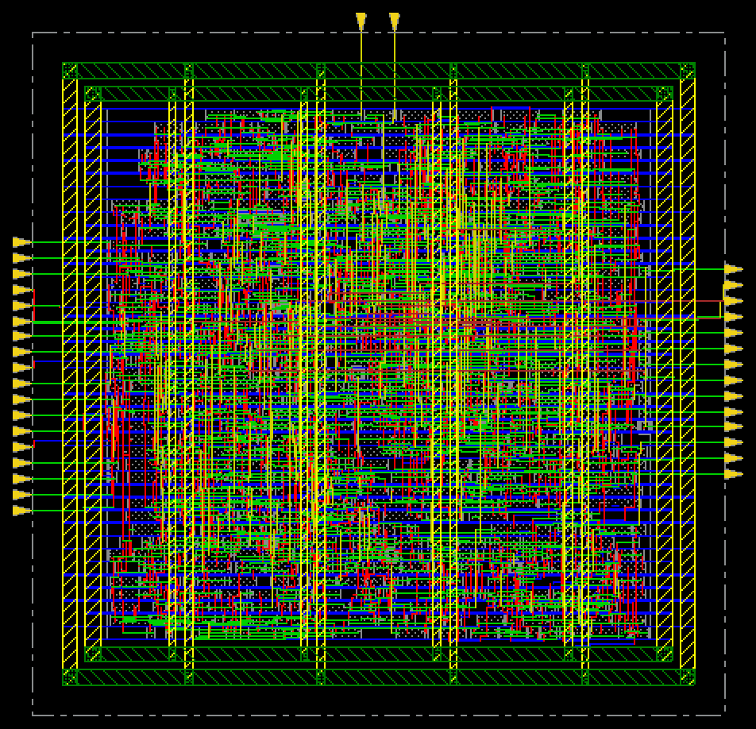
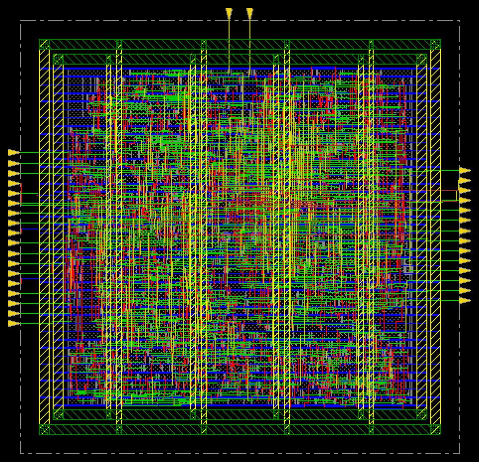
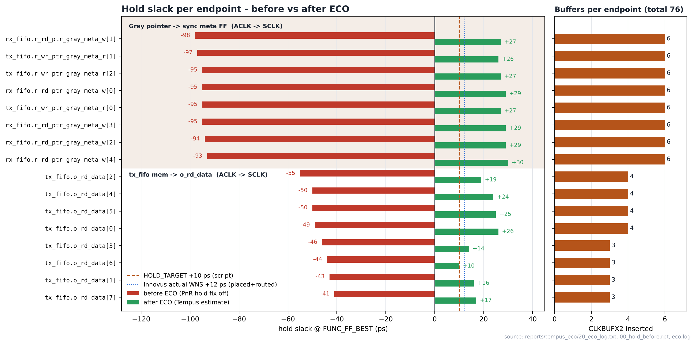
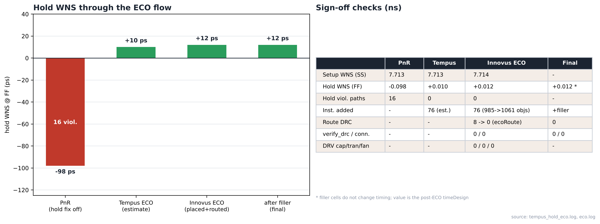
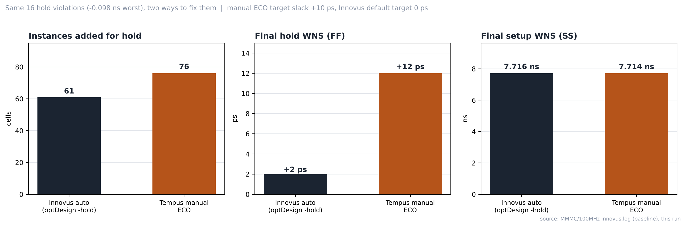

# 16. Timing Closure — MMMC / 100MHz Hold ECO (Tempus → Innovus)

| Item | Value |
|---|---|
| Clock | **ACLK 10 ns (100 MHz)**, SCLK = ACLK ÷ 4 |
| Tool | Cadence Innovus 22.17 (PnR, ECO 적용) / Tempus 22.17 L 라이선스 (분석, ECO 생성) |
| 출발점 | [MMMC/100MHz](../100MHz) 와 같은 넷리스트·SDC·`all.tcl`에서 **hold fix 두 줄만 끈** run |
| 방법 | Tempus `add_repeater -term` → `write_eco -format innovus` → Innovus `source innovus.eco` → `refinePlace` / `ecoRoute` |
| 결과 | **hold −0.098 ns (16 viol.) → +0.012 ns (0)**, setup 7.714 ns 유지, DRC / 연결 / DRV 0 |

> **목적** — Innovus가 자동으로 하던 hold 수정을 끄고, sign-off STA 툴(Tempus)에서 직접 ECO를 만들어 PnR에 되돌려 넣는 **STA ↔ PnR ECO 루프**를 손으로 돌려 봅니다. 실무에서 tape-out 직전에 남은 소수 위반을 고치는 방식과 같습니다.

## Flow

```text
all_holdoff.tcl (Innovus)          optDesign -postCTS -hold / -postRoute -hold 주석 처리
        │  RouteDesign.dat          → hold WNS −0.098 ns, 16 paths
        ▼
tempus_hold_eco.tcl (Tempus)       read_design → 위반 끝점 수집 → 끝점마다 CLKBUFX2 삽입
        │  innovus.eco (76줄)       slack ≥ +10 ps 될 때까지 반복 (끝점당 최대 8개)
        ▼
6_ECO.tcl (Innovus)                restoreDesign → bufx2_guard → source innovus.eco
                                   → refinePlace → ecoRoute → extractRC → timeDesign
                                   → verify_drc / verifyConnectivity → addFiller → GDS·넷리스트·SDF
```

## Results

| 단계 | Setup WNS (SS) | Hold WNS (FF) | Hold 위반 | 비고 |
|---|---|---|---|---|
| PnR (hold fix off) | 7.713 | **−0.098** | 16 | [`00_hold_before.rpt`](reports/tempus_eco/00_hold_before.rpt) |
| Tempus ECO (추정) | 7.713 | +0.010 | 0 | 버퍼 배선 없음, [`30_hold_after.rpt`](reports/tempus_eco/30_hold_after.rpt) |
| **Innovus ECO (배치·배선 후)** | **7.714** | **+0.012** | **0** | [`timeDesign_hold_summary.txt`](reports/innovus_eco/timeDesign_hold_summary.txt) |
| filler 후 (final) | – | – | – | `verify_drc` 0, `verifyConnectivity` 0 |

단위 ns. 최종 밀도 75.078 %. `ecoAddRepeater` 76개 모두 오류 없음, 타이밍 객체 985 → 1061 (+76), ecoRoute 도중 DRC 8 → 0, DRV(cap / tran / fanout) 0. Innovus 메시지 요약 오류 0.

## Analysis

### A.1 ECO 적용 후 레이아웃



- **What** — `source innovus.eco` → `refinePlace` → `ecoRoute` 직후 (`capture/06a_eco_inserted.gif`)
- **Observe** — 다이·전원망·핀 배치는 ECO 전과 같고, 셀 76개만 추가됨
- **Insight** — ECO는 전체 재배치 없이 빈 자리에 셀을 넣고 바뀐 넷만 다시 배선하므로 기존 타이밍·배선이 거의 그대로 유지됩니다.



- **What** — filler 삽입 후 최종 (`capture/06b_chipfinish_eco.gif`)
- **Observe** — filler 후에도 `verify_drc` 0, `verifyConnectivity` 0
- **Insight** — 결과물은 `ChipFinish_after_ECO` DB와 `spi_bridge_top_eco.{gds,v,sdc,sdf}`로 저장됩니다.

### A.2 끝점별 hold slack



- **What** — 위반 끝점 16개의 ECO 전·후 hold slack과 끝점마다 넣은 버퍼 수
- **Observe** — Gray 포인터 → meta FF 8개는 −93 ~ −98 ps라 버퍼 6개씩, `tx_fifo` `mem` → `o_rd_data` 8개는 −41 ~ −55 ps라 3 ~ 4개씩 들어감 (6×8 + 4×4 + 3×4 = 76)
- **Observe** — 16개 모두 ACLK에서 출발해 SCLK에서 잡히는 경로
- **Insight** — SCLK는 ACLK를 4분주한 generated clock이라 두 클럭이 동기로 타이밍됩니다. SCLK 트리가 ACLK보다 늦게 도착하는 만큼 capture 시점이 밀려 hold가 깨집니다. 버퍼 1개가 약 20 ps를 더하므로 위반 크기에 비례해 버퍼 수가 정해졌습니다.

### A.3 ECO 흐름 요약



- **What** — 단계별 hold WNS와 sign-off 검사
- **Observe** — Tempus 추정 +10 ps vs Innovus 실제 +12 ps, 차이 2 ps
- **Observe** — setup은 7.713 → 7.714 ns로 사실상 변화 없음
- **Insight** — 버퍼를 D 핀 바로 앞에 넣어 새 배선이 매우 짧기 때문에 배선 전 추정이 실제와 거의 같았습니다. 수정한 경로들은 setup 여유가 큰 ACLK→SCLK 경로라 setup에 영향이 없습니다.

### A.4 자동 hold fix vs 수동 ECO



- **What** — 같은 위반을 [MMMC/100MHz](../100MHz)의 Innovus 자동 수정(`optDesign -hold`)과 이 run의 수동 ECO로 고친 결과 비교
- **Observe** — 추가 인스턴스 61 vs 76, 최종 hold +0.002 vs +0.012 ns, setup 7.716 vs 7.714 ns
- **Insight** — 자동 수정은 목표 slack 0으로 셀 크기·위치를 골라 최소한만 넣고, 수동 ECO는 목표 +10 ps에 한 종류(CLKBUFX2)만 써서 셀이 더 들어간 대신 여유가 큽니다. 이 DB에서는 DLY 셀이 dont_use로 복원되어 Innovus도 버퍼로 hold를 고칩니다 (`eco.log`: "All delay cells are dont_use. Buffers will be used to fix hold violations.").

## ECO 후 검증 범위

ECO 후 GLS는 생략했습니다. 변경은 데이터 경로 버퍼 76개뿐이라 논리가 같고, 타이밍은 Innovus 배치·배선 후 결과(위 Results)로 확인했습니다. 기능은 ECO 전 넷리스트로 [17_Post_Layout_Sim](../../../17_Post_Layout_Sim)에서 PASS했습니다. GLS에 필요한 계층 넷리스트(`spi_bridge_top_eco_hier.v`, ECO 버퍼 76개 포함)는 생성해 두었습니다.

## 겪은 문제

| 증상 | 원인 | 해결 |
|---|---|---|
| `IMPTCM-67` ×16, `write_eco` "No netlist changes found" | `add_repeater`에 `-net`과 `-term`을 같이 줌 (동시 사용 불가) | `-term`만 사용 → 해당 핀 바로 앞에 버퍼 삽입 |
| `invalid command name "-files"` | Tempus 프롬프트 안에서 `tempus -files ...` 입력 | 셸에서 실행하거나 프롬프트에서는 `source` |
| `IMPSP-5234` / `IMPFP-10172` / `IMPESI-4001` | Innovus DB 속 Innovus 전용 설정을 Tempus가 읽으며 나는 메시지, SI는 원래 off | 타이밍과 무관 (무시) |

## Files

| Path | 내용 |
|---|---|
| [`scripts/all_holdoff.tcl`](scripts/all_holdoff.tcl) | 기준 `all.tcl`에서 `optDesign -postCTS -hold` / `-postRoute -hold` 주석 처리 |
| [`scripts/tempus_hold_eco.tcl`](scripts/tempus_hold_eco.tcl) | Tempus hold ECO 생성 |
| [`scripts/6_ECO.tcl`](scripts/6_ECO.tcl) | Innovus ECO 적용 → 검증 → 최종 출력 |
| [`scripts/bufx2_guard.tcl`](scripts/bufx2_guard.tcl) | BUFX2(CoreSiteDouble) 사용 금지 가드 |
| [`reports/tempus_eco/`](reports/tempus_eco) | before/after 리포트, `20_eco_log.txt`, `innovus.eco`, Tempus 로그 |
| [`reports/innovus_eco/`](reports/innovus_eco) | `eco.log`, ECO 후 setup 리포트(`timing_eco/`), hold 요약 |
