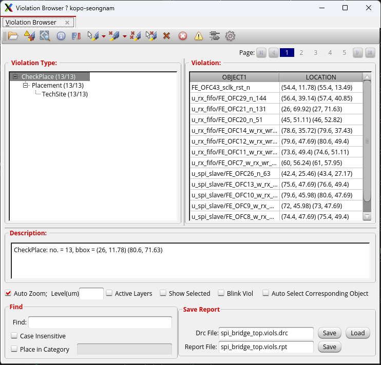
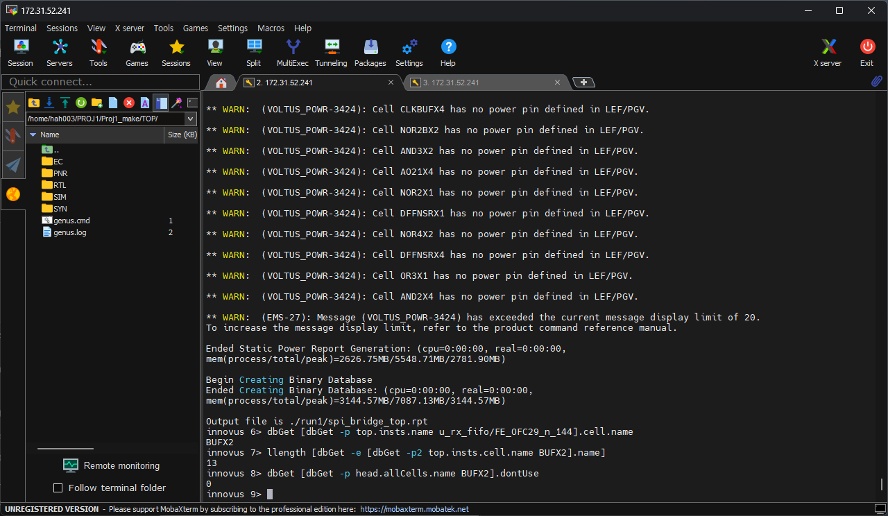

# 16. Timing Closure — BUFX2 TechSite 위반 수정 사례 (500 MHz)

`all.tcl`이 아니라 **단계별 스크립트(0 ~ 4)를 따로 실행한 2.0 ns run**에서 생긴 문제와 수정 과정입니다.

## Problem

| Item | Value |
|---|---|
| 증상 | Violation Browser에 TechSite 위반 13개, `IMPSP-365: Design has inst(s) with SITE 'CoreSiteDouble', but the floorplan has no rows defined for this site` |
| 대상 | `optDesign`이 넣은 `FE_OFC*` 버퍼 13개가 **BUFX2** |
| 확인 | `dbGet [dbGet -p2 top.insts.cell.name BUFX2].name` → 13개, `dontUse` = 0 |




## Why

gsclib045에서 BUFX2만 `CoreSiteDouble`(2배 높이 site) 셀인데, floorplan에는 `CoreSite` row만 있습니다. `all.tcl`에는 BUFX2를 `setDontUse`하는 가드가 있지만, 단계별 스크립트에는 이 가드가 없어 최적화가 BUFX2를 골랐습니다.

## Fix

```tcl
setDontUse BUFX2 true
ecoChangeCell -inst <FE_OFC*> -cell BUFX3     ;# 13개 (rx_fifo 7, spi_slave 5, top 1)
refinePlace
ecoRoute
checkPlace ; verify_drc ; verifyConnectivity -type all -geomConnect
extractRC ; timeDesign -postRoute ; timeDesign -postRoute -hold
saveDesign -rc -def RouteDesign
```

## Result

| Item | Before | After |
|---|---|---|
| BUFX2 instances | 13 | 0 |
| TechSite violations | 13 | **0** |
| checkPlace / verify_drc / verifyConnectivity | — | **0 / 0 / 0** |
| Setup WNS (SS) | +0.080 ns | +0.080 ns |
| Hold WNS (FF) | +0.005 ns | +0.005 ns |
| Density | 72.97 % | 73.06 % |

BUFX3로 바꿔도 타이밍은 그대로이고 면적만 약간 늘었습니다. 재발 방지용 가드 [`scripts/bufx2_guard.tcl`](scripts/bufx2_guard.tcl)는 새 Innovus 세션마다 `restoreDesign` 직후 source합니다.

## Files

```text
16_Timing_Closure/MMMC/500MHz_BUFX2_case/
├── README.md
│
├── images/
│   ├── 01_ViolationBrowser_TechSite13.png
│   └── 02_dbGet_BUFX2_13_dontUse0.png
│
├── reports/
│   ├── bufx2_fix_innovus.log
│   ├── bufx2_fix_summary.txt
│   ├── timing_postRoute/
│   │   └── spi_bridge_top_postRoute.summary
│   ├── timing_postRoute_bufx2fix/
│   │   └── spi_bridge_top_postRoute.summary
│   ├── timing_postRoute_hold/
│   │   └── spi_bridge_top_postRoute_hold.summary
│   └── timing_postRoute_hold_bufx2fix/
│       └── spi_bridge_top_postRoute_hold.summary
│
└── scripts/
    └── bufx2_guard.tcl
```
