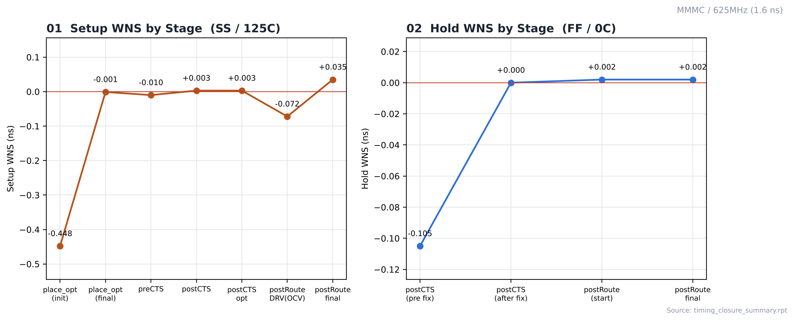
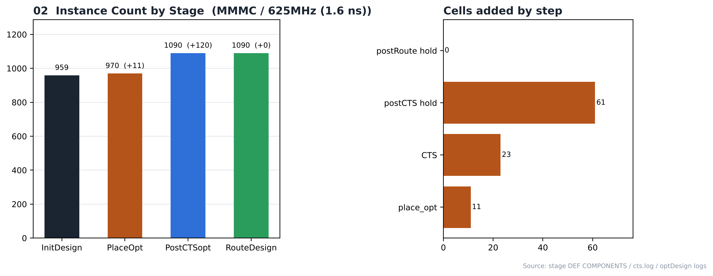

# 16. Timing Closure — MMMC / 625MHz

| Item | Value |
|---|---|
| Clock | **ACLK 1.6 ns (625 MHz)**, SCLK = ACLK ÷ 4 |
| Tool | Cadence Innovus 22.17 |
| 최적화 | `place_opt_design` → `ccopt_design` → `optDesign -postCTS (-hold)` → `optDesign -postRoute -drv / -setup / -hold` |
| 결과 | **setup PASS / hold PASS** |

> **MMMC PnR** — setup view `FUNC_SS_WORST` (slow_vdd1v0, RC WORST, 125 °C), hold view `FUNC_FF_BEST` (fast_vdd1v0, RC BEST, 0 °C). 입력은 [04_Synthesis/MMMC](../../../04_Synthesis/MMMC)의 같은 주파수 넷리스트와 SDC입니다. 전체 흐름은 `all.tcl` 한 번 실행 (BUFX2 사용 금지 가드 포함).

## Stage-by-Stage (innovus.log)

| Stage | Setup WNS (SS) | Hold WNS (FF) |
|---|---|---|
| 합성 (Genus, ideal clock) | 0 ns | — |
| place_opt 시작 → 끝 | −0.448 (9) → −0.001 (1) | — |
| preCTS | −0.010 (4) | — |
| ccopt_design 중간 → postCTS | −0.402 (22) → +0.003 | — |
| postCTS opt / hold fix 전 | +0.003 | −0.105 (16) |
| postCTS hold fix 후 | +0.003 | +0.000 |
| postRoute DRV opt (OCV) | −0.072 (7) | — |
| postRoute setup opt | +0.035 | — |
| **postRoute final** | **+0.035** | **+0.002** |

단위 ns, 괄호는 위반 경로 수. 최종 밀도 68.223 %. 리포트: [`reports/timing_postRoute`](reports/timing_postRoute), [`reports/timing_postRoute_hold`](reports/timing_postRoute_hold).

**Fmax run.** 합성 slack 0 ps, preCTS에서 −10 ps였지만 CTS 후 실제 클럭 트리 기준 최적화와 post-route 최적화로 +35 ps에 닫혔습니다.

> hold +0.002 ns가 빠듯한 것은 Innovus hold fix의 기본 목표 slack이 0이라 최소한의 버퍼만 넣기 때문입니다. 여유가 필요하면 `setOptMode -holdTargetSlack`으로 목표를 올립니다.

## Analysis

### A.1 WNS by Stage



- **What** — 단계별 setup(SS) / hold(FF) WNS 변화
- **Observe** — setup -0.448 → +0.035 ns
- **Observe** — hold -0.105 (CTS 직후) → +0.002 ns
- **Insight** — setup은 배치·CTS 단계에서, hold는 CTS 직후 한 번에 닫힙니다. post-route의 DRV 단계 값은 OCV 모드·RC 추출 전 값이라 일시적으로 낮게 보입니다.

### A.2 Instance Growth



- **What** — 단계별 인스턴스 수와 단계별로 추가된 셀
- **Observe** — 959 → 970 → 1090 → 1090
- **Observe** — place_opt +11, CTS +23, postCTS hold +61, postRoute hold +0

요약 리포트: [`reports/timing_closure_summary.rpt`](reports/timing_closure_summary.rpt)

## Files

```text
16_Timing_Closure/MMMC/625MHz/
├── README.md
│
├── images/
│   ├── 01_WNS_Trend.png
│   └── 02_Instance_Growth.png
│
├── reports/
│   ├── timing_closure_summary.rpt
│   ├── timing_postRoute/
│   │   ├── spi_bridge_top_postRoute.summary
│   │   └── spi_bridge_top_postRoute_all.tarpt
│   └── timing_postRoute_hold/
│       ├── spi_bridge_top_postRoute_all_hold.tarpt
│       └── spi_bridge_top_postRoute_hold.summary
│
└── scripts/
    └── 4_RouteDesign_PowerAnalysis.tcl
```
