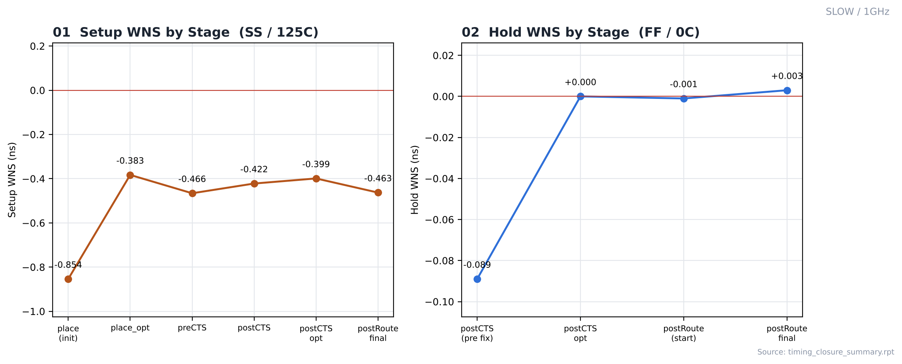
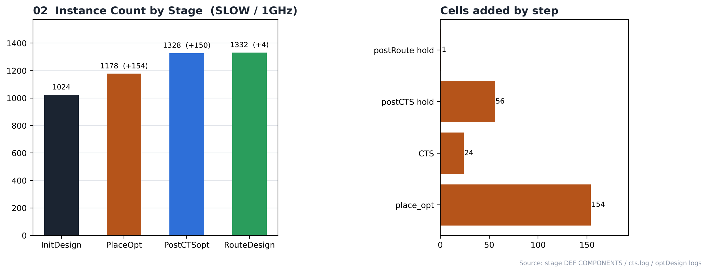

# 16. Timing Closure — SLOW / 1GHz

| Item | Value |
|---|---|
| Corner (synthesis library) | **SLOW** — `slow_vdd1v0 (SS, 0.9 V, 125 °C)` |
| Clock | **ACLK 1 ns (1 GHz)**, SCLK = ACLK ÷ 4 (generated clock) |
| 최적화 명령 | `place_opt_design`, `ccopt_design`, `optDesign -postCTS (-hold)`, `optDesign -postRoute -drv / -setup / -hold` |
| 요약 리포트 | [`reports/timing_closure_summary.rpt`](reports/timing_closure_summary.rpt) |
| 결과 | **setup FAIL / hold PASS** |

> **비교 실험 설계** — 같은 RTL을 SLOW(`slow_vdd1v0`, SS) / FAST(`fast_vdd1v0`, FF) 라이브러리로 각각 합성하고, PnR은 6개 실행 모두 같은 조건(MMMC setup `FUNC_SS_WORST` SS/125 °C, hold `FUNC_FF_BEST` FF/0 °C, 같은 스크립트)으로 구현했습니다. 차이는 입력 넷리스트의 **합성 코너**뿐이며, 합성 코너가 setup 검사 코너(SS)와 같을 때(SLOW)와 다를 때(FAST)를 비교합니다.

---

## 1. Stage-by-Stage

| Stage | Setup WNS | Setup TNS | Setup viol | Hold WNS | Hold TNS | Hold viol | Density |
|---|---|---|---|---|---|---|---|
| place (initial) | -0.854 | -23.332 | 92 | - | - | - | 68.60 % |
| place_opt | -0.383 | -6.633 | 50 | - | - | - | 74.23 % |
| preCTS | -0.466 | -7.923 | 56 | - | - | - | 74.32 % |
| postCTS | -0.422 | -10.922 | 60 | - | - | - | 76.50 % |
| postCTS opt (pre hold fix) | -0.399 | -10.847 | 51 | -0.089 | -1.111 | 16 | — |
| postCTS opt | -0.399 | -10.847 | 51 | 0.000 | 0.000 | 0 | 79.72 % |
| postRoute DRV opt (OCV) | -0.415 | -6.362 | 34 | - | - | - | — |
| postRoute setup opt (start) | -0.377 | -9.985 | 52 | - | - | - | — |
| postRoute hold opt (start) | - | - | - | -0.001 | -0.001 | 1 | — |
| postRoute final | -0.463 | -10.641 | 64 | 0.003 | 0.000 | 0 | 80.55 % |

단위: ns. "postRoute DRV opt"는 OCV 모드·RC 추출 전 값이라 다른 행과 조건이 다릅니다.

## 2. Cells Added

| Step | Cells |
|---|---|
| place_opt_design (instances +) | 154 (1024 → 1178) |
| ccopt_design (clock tree) | 24 |
| optDesign -postCTS -hold | 56 |
| optDesign -postRoute -hold | 1 |
| Final (RouteDesign) | 1332 instances |

## 3. Observations

- 배치 직후 setup 위반 92개(WNS -0.854 ns)가 있었고, place_opt 후 50개(WNS -0.383 ns)로 줄었습니다.
- CTS 후 hold 위반 16개(WNS -0.089 ns)가 나타났고, 버퍼 56개로 해결했습니다.
- 최종적으로 setup 위반 64개(WNS -0.463 ns), hold 위반 0개가 남아 **이 주파수에서는 타이밍이 닫히지 않았습니다.** RTL 파이프라인 추가, 합성 제약 강화, floorplan utilization 조정 등이 필요합니다.
- 최종 타이밍은 SI·OCV 미적용 Innovus 결과이며 Tempus/Quantus signoff 결과는 아닙니다.

## Analysis

### A.1 WNS Trend



- **What** — 배치부터 라우팅까지 setup / hold WNS 변화
- **Observe** — setup: -0.854 → -0.383 → -0.466 → -0.422 → -0.399 → -0.463 ns
- **Observe** — hold: -0.089 → +0.000 → -0.001 → +0.003 ns
- **Insight** — 최종 값이 음수로 남아 이 주파수에서는 닫히지 않았습니다.

### A.2 Instance Growth



- **What** — 단계별 인스턴스 수와 추가된 셀
- **Observe** — 1024 → 1178 → 1328 → 1332
- **Observe** — place_opt +154, CTS 24, hold fix 56 + 1
- **Insight** — place_opt에서 늘어난 셀 수가 합성 넷리스트와 PnR 검사 조건 사이의 차이를 보여줍니다.


## 4. Images

| | |
|---|---|
|  | **01 WNS trend** — 단계별 setup / hold WNS |
|  | **02 Instance growth** — 단계별 인스턴스 수와 추가된 셀 |

## Files

```text
16_Timing_Closure/SLOW/1GHz/
├── README.md
│
├── reports/
│   ├── optDesign_postCTS_hold.log
│   ├── optDesign_postRoute.log
│   └── timing_closure_summary.rpt
│
└── images/
    ├── 01_WNS_Trend.png
    └── 02_Instance_Growth.png
```
