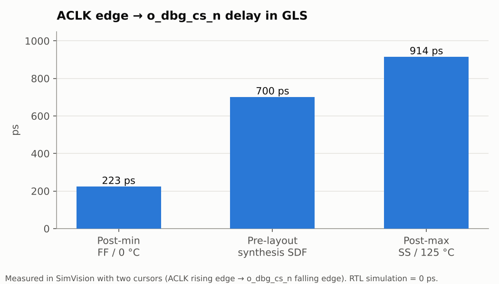
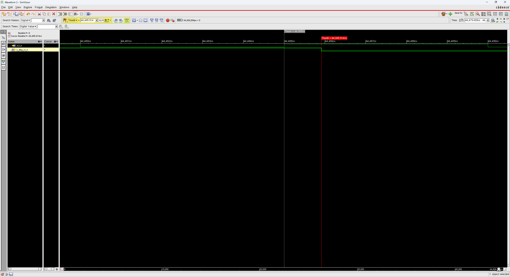
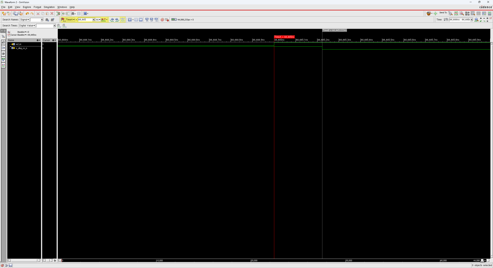
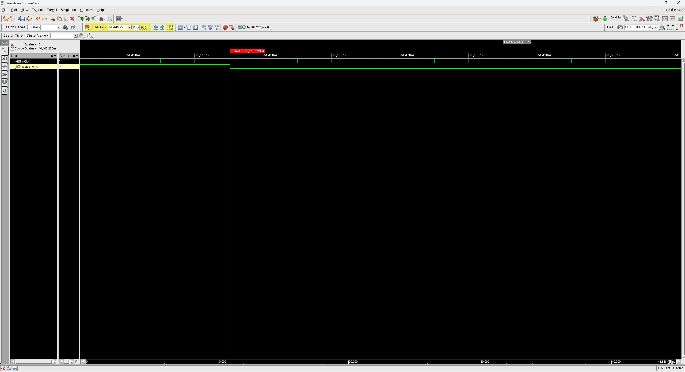

# 17. Post-Layout Simulation — PnR Netlist + Tempus SDF

PnR 넷리스트에 Tempus가 만든 코너별 SDF(배선 RC + 클럭 트리 포함)를 붙여, setup 코너(max)와 hold 코너(min) 두 번 돌렸습니다.

| Item | Post-max | Post-min |
|---|---|---|
| Netlist | [`results/spi_bridge_top_pnr_hier.v`](results/spi_bridge_top_pnr_hier.v) (10 ns PnR, `saveNetlist` 계층 유지, 모듈 10개) | 같음 |
| SDF | `spi_bridge_top_post_wst.sdf` — `FUNC_SS_WORST` | `spi_bridge_top_post_bst.sdf` — `FUNC_FF_BEST` |
| MTM | `MAXIMUM` | `MINIMUM` |
| Cell model | `slow_vdd1v0_basicCells.v` | `fast_vdd1v0_basicCells.v` |
| Script | [`scripts/run_post_max.tcl`](scripts/run_post_max.tcl) | [`scripts/run_post_min.tcl`](scripts/run_post_min.tcl) |
| **결과** | **ALL TESTS PASSED** | **ALL TESTS PASSED** |

SDF는 [15_Post_STA/MMMC/100MHz/results](../15_Post_STA/MMMC/100MHz/results)에, TB는 08과 같은 SDF 블록 추가 버전([`TESTBENCH/tb_spi_bridge_top.v`](TESTBENCH/tb_spi_bridge_top.v))입니다. PnR 기본 출력(`saveNetlist -flat`)은 계층이 없어 TB의 내부 신호 참조가 깨지므로, `saveNetlist` 를 계층 유지로 다시 뽑았습니다.

## Pre / Post 비교

| Item | Pre (08) | Post-max | Post-min |
|---|---|---|---|
| Tests | ALL PASSED | ALL PASSED | ALL PASSED |
| SDF annotation | 0 Err / 143 Warn | 0 Err / 149 Warn | 0 Err / 149 Warn |
| Timing check 위반 | 10 | 3 | **0** |
| ACLK → `o_dbg_cs_n` | 700 ps | **914 ps** | **223 ps** |
| 종료 시간 | 44,926,680 ps | 44,926,894 ps | 44,886,233 ps |



- 같은 경로의 지연이 FF 코너 223 ps ~ SS 코너 914 ps로 약 4배 차이 납니다. setup을 SS로, hold를 FF로 따로 검사하는 이유가 이 차이입니다.
- Post-max가 Pre보다 214 ps 큰 것은 PnR 뒤에 생긴 클럭 트리 지연과 실제 배선 RC 때문입니다. 종료 시간도 정확히 214 ps 늦어졌습니다.
- min에서 위반이 0건입니다. FF 코너는 hold가 가장 위험한 조건이므로, Tempus의 hold +0.002 ns MET와 일치합니다.

## Warning / Violation 분석

**SDFNET 149건** — Tempus SDF는 recovery·removal을 `RECREM` 한 줄로 냅니다. 셀 모델에 이 체크가 없어서 붙일 곳이 없다는 경고로, Pre의 143건과 원인이 같습니다. SN·RN이 둘 다 있는 `DFFNSRX` FF(`r_empty` ×2, `o_cs_n`, `o_mosi`, `o_miso`)는 핀마다 한 줄씩 나와 6건 많습니다. recovery/removal은 Tempus에서 +9.291 / +0.038 ns로 확인했습니다.

**Post-max 위반 3건**

| # | FF | Check | 시점 | 원인 |
|---|---|---|---|---|
| 1 | `u_tx_fifo/r_wr_ptr_gray_meta_r_reg_0` | hold | 5,535,649 ps (TEST 3) | CDC 동기화기 첫 단 (Pre와 같은 이유) |
| 2 | `u_tx_fifo/r_wr_ptr_gray_meta_r_reg_1` | hold | 26,055,609 ps (TEST 5) | 같음 |
| 3 | `u_spi_slave/o_miso_reg` | setup | 32,620,770 ps (TEST 6) | 전송 중 비동기 리셋을 건 순간 |

3번은 TEST 6이 SPI 전송 도중(`BIT=3`) ARESETn을 일부러 내리는 테스트라서 생겼습니다. 리셋이 32,620.00 ns에 걸리고 그 영향으로 MISO FF의 D가 32,620.66 ns에 바뀌었는데, 110 ps 뒤(32,620.77 ns)에 SCLK 하강 엣지가 왔습니다(setup 요구 130 ps). 정상 동기 경로가 아니라 **비동기 리셋 이벤트가 클럭 엣지 근처에 떨어진 경우**이고, 이 FF는 곧바로 리셋됩니다. 뒤이은 TEST 6 검사(CS 비활성, FIFO empty)는 모두 PASS입니다. Pre에서 안 나온 것은 Post에서 클럭 트리 지연으로 SCLK 엣지 위치가 바뀌어 우연히 겹쳤기 때문입니다. CDC 위반이 10건 → 2건으로 줄어든 것도 같은 이유입니다.

## Post-min이 40 ns 먼저 끝난 이유

max와 min 로그의 TB 메시지 344줄을 시간 순으로 비교하면 TEST 1~5는 0~1 ns 차이였다가, **TEST 6 리셋 시점에서 40 ns(ACLK 4클럭 = SCLK 1주기)** 벌어지고 끝까지 그대로 유지됩니다.

```text
MAX [32620000] TEST6 ASSERT RESET mid-frame CS=0 BIT=3
MIN [32580000] TEST6 ASSERT RESET mid-frame CS=0 BIT=2
```

TEST 6은 `wait (o_dbg_cs_n == 0 && dut.u_spi_master.state == 2 && dut.u_spi_master.bit_cnt >= 3)`으로 기다리는데, min에서는 `BIT=2`에서 통과했습니다. 게이트 넷리스트에서 `bit_cnt`는 FF 3개이고 각 비트의 CK→Q 지연이 달라, 값이 바뀌는 순간 잠깐 3(011)처럼 보이는 **글리치**에 `wait`가 반응한 것으로 보입니다. RTL에는 지연이 없어 생기지 않는 **GLS 전용 TB 현상**이며, 이후 동작과 모든 검사는 정상입니다. TB에서 내부 멀티비트 신호를 기다릴 때는 클럭 엣지에서 샘플링하는 편이 안전합니다.

## Images

| | |
|---|---|
|  | **01** Post-max — ACLK 44,485.0 ns → `o_dbg_cs_n` 44,485.914 ns = **914 ps** |
|  | **02** Post-min — ACLK 44,445.0 ns → 44,445.223 ns = **223 ps** |
|  | **03** Post-min — 같은 이벤트가 44,445 ns에서 일어남 (max보다 40 ns 앞) |
|  | **04** 세 run의 지연 비교 |

## Files

```text
17_Post_Layout_Sim/
├── README.md
│
├── TESTBENCH/
│   └── tb_spi_bridge_top.v
│
├── images/
│   ├── 01_Max_ClkToQ_914ps.png
│   ├── 02_Min_ClkToQ_223ps.png
│   ├── 03_Min_Shift_40ns.png
│   └── 04_Delay_Comparison.png
│
├── logs/
│   ├── post_sim_max.log
│   ├── post_sim_min.log
│   ├── sdf_annotate_post_max.log
│   └── sdf_annotate_post_min.log
│
├── results/
│   └── spi_bridge_top_pnr_hier.v
│
└── scripts/
    ├── run_post_max.tcl
    └── run_post_min.tcl
```
