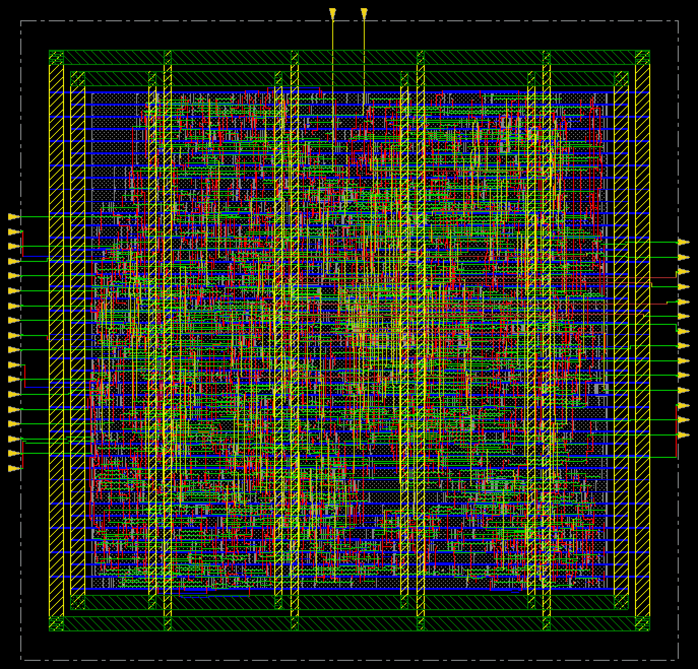
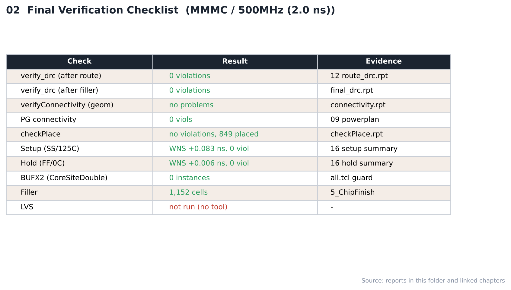

# 18. Final Verification — MMMC / 500MHz

| Item | Value |
|---|---|
| Clock | **ACLK 2.0 ns (500 MHz)**, SCLK = ACLK ÷ 4 (generated clock) |
| Run | Fmax 실험 (2.0 ns) |
| Tool | Cadence Innovus 22.17 (`verify_drc`, `verifyConnectivity`) |
| Script | [`scripts/5_ChipFinish.tcl`](scripts/5_ChipFinish.tcl) — addFiller 후 검증 |
| DB | `RouteDesign` → `ChipFinish` |

> **MMMC PnR** — setup view `FUNC_SS_WORST` (slow_vdd1v0, RC WORST, 125 °C), hold view `FUNC_FF_BEST` (fast_vdd1v0, RC BEST, 0 °C). 입력은 [04_Synthesis/MMMC](../../../04_Synthesis/MMMC)의 같은 주파수 넷리스트와 SDC입니다. 전체 흐름은 `all.tcl` 한 번 실행 (BUFX2 사용 금지 가드 포함).

---

## 1. Result

| Check | Result |
|---|---|
| verify_drc (Innovus) | **0 violations** → [`reports/final_drc.rpt`](reports/final_drc.rpt) |
| verifyConnectivity | **no problems / no warnings** → [`reports/connectivity.rpt`](reports/connectivity.rpt) |
| checkPlace | 0 violations, 849 placed → [`reports/checkPlace.rpt`](reports/checkPlace.rpt) |
| BUFX2 (CoreSiteDouble) | 0 |
| Filler | 1,152 cells |
| LVS | 미실행 (툴 없음) |

> Innovus 내장 DRC / connectivity 기준입니다. foundry rule deck DRC와 LVS는 사용할 수 없는 툴이라 실행하지 않았습니다.

## Analysis

### A.1 Chip Finish



- **What** — filler 삽입 후 최종 레이아웃
- **Observe** — filler 1,152개로 빈 site를 모두 채움

### A.2 Verification Checklist



- **What** — 최종 검증 항목과 결과
- **Observe** — DRC 0, connectivity clean, setup/hold 위반 0, LVS만 미실행

## Files

```text
18_Final_Verification/MMMC/500MHz/
├── README.md
│
├── images/
│   ├── 01_ChipFinish_Innovus.png
│   └── 02_Verification_Checklist.png
│
├── reports/
│   ├── checkPlace.rpt
│   ├── connectivity.rpt
│   └── final_drc.rpt
│
└── scripts/
    └── 5_ChipFinish.tcl
```
