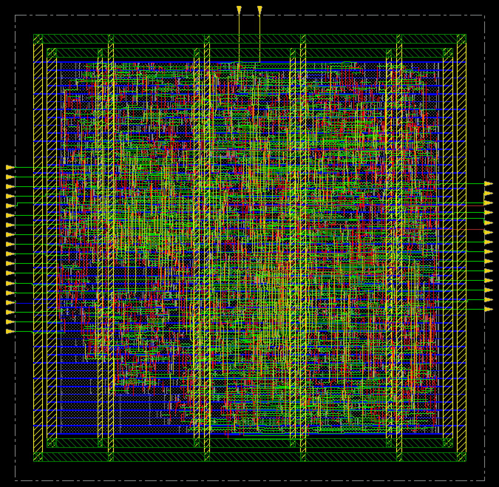
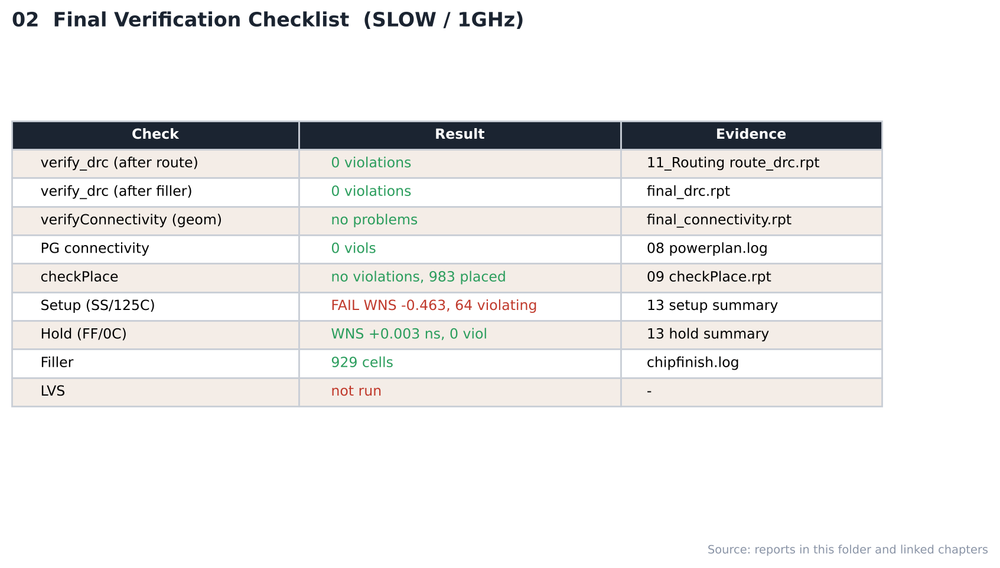

# 18. Final Verification — SLOW / 1GHz

| Item | Value |
|---|---|
| Corner (synthesis library) | **SLOW** — `slow_vdd1v0 (SS, 0.9 V, 125 °C)` |
| Clock | **ACLK 1 ns (1 GHz)**, SCLK = ACLK ÷ 4 (generated clock) |
| Tool | Cadence Innovus 22.17 (`verify_drc`, `verifyConnectivity`) |
| Script | [`scripts/5_ChipFinish.tcl`](scripts/5_ChipFinish.tcl) |
| DB | `RouteDesign` → `ChipFinish` |

---

## 1. Filler

| Cell | FILL64 | FILL32 | FILL16 | FILL8 | FILL4 | FILL2 | FILL1 | **Total** |
|---|---|---|---|---|---|---|---|---|
| Count | 12 | 9 | 29 | 76 | 170 | 289 | 344 | **929** |

인스턴스: 1332 (route 후) → 2261 (filler 포함)

## 2. Verification

| Check | Result | Evidence |
|---|---|---|
| verify_drc (route 후) | **0 violations** | [12_Routing](../../../12_Routing/SLOW/1GHz/reports/route_drc.rpt) |
| verify_drc (filler 후) | **0 violations** | [`reports/final_drc.rpt`](reports/final_drc.rpt) |
| verifyConnectivity -geomConnect | **no problems / no warnings** | [`reports/final_connectivity.rpt`](reports/final_connectivity.rpt) |
| PG connectivity | 0 / 0 | [09_Floorplan](../../../09_Floorplan/SLOW/1GHz/reports/powerplan.log) |
| Setup / hold (post-route) | -0.463 / +0.003 ns — **FAIL / PASS** | [15_Post_STA](../../../15_Post_STA/SLOW/1GHz) |
| **LVS** | **미실행** | — |

- 위 DRC는 Innovus `verify_drc`(LEF 기반 routing DRC) 결과이며 foundry rule deck 기반 physical DRC가 아닙니다.
- GDS는 표준 셀 GDS를 merge하지 않고 출력했습니다.

## Analysis

### A.1 Chip Finish



- **What** — filler 삽입 후 최종 레이아웃
- **Observe** — filler 929개로 빈 site를 채움, 인스턴스 2,261개

### A.2 Verification Checklist



- **What** — 검사 항목·결과·근거 파일
- **Observe** — DRC 0 / 0, connectivity clean
- **Observe** — setup FAIL, hold PASS, LVS 미실행
- **Insight** — 물리 검증은 통과했지만 타이밍이 닫히지 않아 이 주파수에서는 최종 완료로 볼 수 없습니다.


## 3. Images

| | |
|---|---|
|  | **01 Chip Finish** — filler 삽입 후 최종 레이아웃 |
|  | **02 Checklist** — 검사 항목·결과·근거 |

> route 후 DRC 화면은 [12_Routing](../../../12_Routing/SLOW/1GHz/images/02_DRC_Check_Innovus.png)에 있습니다.

## Files

```text
18_Final_Verification/SLOW/1GHz/
├── README.md
│
├── scripts/
│   └── 5_ChipFinish.tcl
│
├── reports/
│   ├── chipfinish.log
│   ├── final_connectivity.rpt
│   └── final_drc.rpt
│
├── images/
│   ├── 01_ChipFinish_Innovus.png
│   └── 02_Verification_Checklist.png
│
└── results/
    └── chipfinish.def
```
