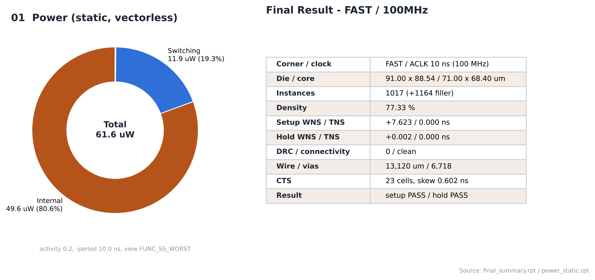
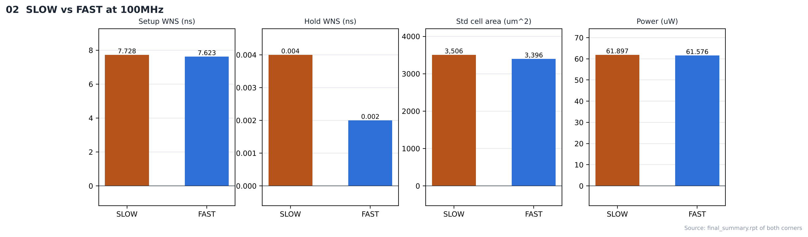

# 19. Final Results — FAST / 100MHz

| Item | Value |
|---|---|
| Corner (synthesis library) | **FAST** — `fast_vdd1v0 (FF, 1.1 V, 0 °C)` |
| Clock | **ACLK 10 ns (100 MHz)**, SCLK = ACLK ÷ 4 (generated clock) |
| Flow | Genus 22.17 → Innovus 22.17 (GPDK045 `gsclib045`) |
| Final DB | `ChipFinish` |
| 요약 | [`reports/final_summary.rpt`](reports/final_summary.rpt) |

---

## 1. Result at a Glance

| Category | Item | Result |
|---|---|---|
| Synthesis | Cell area / instances | 3,396.402 µm² / 816 |
| Physical | Die / core | 91.00 × 88.54 / 71.00 × 68.40 µm |
| | Instances | 1017 (filler 제외) / 2181 (filler 1,164 포함) |
| | Density | 69.94 % (초기) → 77.33 % (최종) |
| Clock tree | CTS cells / skew | 23 / 0.602 ns |
| Routing | Wire / vias | 13,120 µm / 6,718 |
| **Timing** | **Setup WNS / TNS** (SS) | **+7.623 ns / 0.000** (0 viol) |
| | **Hold WNS / TNS** (FF) | **+0.002 ns / 0.000** (0 viol) |
| | 판정 | **setup PASS / hold PASS** |
| Verification | DRC / connectivity / LVS | 0 / clean / 미실행 |
| Power | Total (static, vectorless) | 61.6 µW (internal 80.6 %, switching 19.3 %) |

## 2. SLOW vs FAST (100MHz)

| Item | FAST (this) | SLOW |
|---|---|---|
| Synthesis lib | `PVT_1P1V_0C` | `PVT_0P9V_125C` |
| Synthesis ACLK slack | 9,074.9 ps | 7,101.2 ps |
| Cell area (synthesis) | 3,396.4 µm² | 3,506.2 µm² |
| Final instances | 1017 | 981 |
| Final density | 77.33 % | 74.88 % |
| Setup WNS (PnR, SS) | +7.623 ns | +7.728 ns |
| Hold WNS (PnR, FF) | +0.002 ns | +0.004 ns |
| Power | 61.6 µW | 61.9 µW |

**비교 실험: 합성 코너 vs PnR 검사 코너** — PnR 조건(setup SS / hold FF, 같은 스크립트)은 같고 입력 넷리스트의 합성 코너만 다릅니다. SLOW는 합성 코너 = setup 검사 코너(SS)인 기준 실행이고, FAST는 FF로 합성해 두 코너가 다른 실행입니다.

- 합성 단계: FAST가 셀 면적 3,396.4 µm²로 SLOW(3,506.2 µm²)보다 작고, ACLK slack도 9,074.9 ps로 SLOW(7,101.2 ps)보다 크게 보고됩니다. 다만 FAST의 값은 FF 조건 기준입니다.
- PnR 단계(SS 검사): place_opt에서 늘어난 인스턴스 FAST +121 / SLOW +52, 최종 setup WNS FAST +7.623 / SLOW +7.728 ns.
- 최종 판정: SLOW **PASS**, FAST **PASS**.

합성 단계 결과가 좋아 보여도 PnR 검사 코너와 다른 조건이면 PnR에서 그 차이를 보정해야 하며, 합성 제약은 setup 검사 코너에 맞추는 것이 기본입니다.

## 3. Output Files (`results/`)

| File | 생성 명령 | 용도 |
|---|---|---|
| `spi_bridge_top.gds` | `streamOut -mode ALL -units 2000` | 레이아웃 (표준 셀 GDS 미병합) |
| `spi_bridge_top_pnr.v` | `saveNetlist -flat` | gate-level simulation / STA |
| `spi_bridge_top_pnr_pg.v` | `saveNetlist -flat -includePowerGround` | LVS용 |
| `spi_bridge_top.sdf` / `.sdf_2.1` | `write_sdf` | back-annotated simulation |
| `spi_bridge_top_pnr.sdc` | `writeTimingCon` | P&R 후 constraint |

## 4. Notes

- 타이밍: Innovus `extractRC`(effort low) + single 모드, SI off. Tempus/Quantus signoff 결과는 아닙니다.
- 전력: VCD 없이 input activity 0.2, period 10.0 ns(스크립트가 SDC에서 읽은 ACLK 주기)로 계산한 static 추정값입니다.
- ECO(6_ECO.tcl)는 실행하지 않았습니다.

## Analysis

### A.1 Final Summary / Power



- **What** — 최종 지표와 전력 구성
- **Observe** — setup +7.623 / hold +0.002 ns, density 77.33 %
- **Observe** — power 61.6 µW (internal 80.6 %)

### A.2 SLOW vs FAST



- **What** — 같은 주파수에서 합성 코너만 다른 두 실행 비교
- **Observe** — setup WNS SLOW +7.728 / FAST +7.623 ns
- **Observe** — 합성 면적 SLOW 3,506 / FAST 3,396 µm²
- **Insight** — FAST는 합성 면적이 작지만 PnR(SS 검사)에서 보정할 양이 더 큽니다. 합성 코너를 PnR 검사 코너에 맞추는 것이 기본입니다.


## 5. Images

| | |
|---|---|
|  | **01 Final summary / power** |
|  | **02 SLOW vs FAST** — 같은 주파수의 두 코너 비교 |

> 최종 레이아웃 캡처는 [18_Final_Verification](../../../18_Final_Verification/FAST/100MHz/images/01_ChipFinish_Innovus.png)에 있습니다.

## Files

```text
19_Final_Results/FAST/100MHz/
├── README.md
│
├── reports/
│   ├── final_summary.rpt
│   ├── power_analysis.log
│   └── power_static.rpt
│
├── images/
│   ├── 01_Final_Summary_Power.png
│   └── 02_SLOW_vs_FAST.png
│
└── results/
    ├── spi_bridge_top.gds
    ├── spi_bridge_top.sdf
    ├── spi_bridge_top.sdf_2.1
    ├── spi_bridge_top_pnr.sdc
    ├── spi_bridge_top_pnr.v
    └── spi_bridge_top_pnr_pg.v
```
