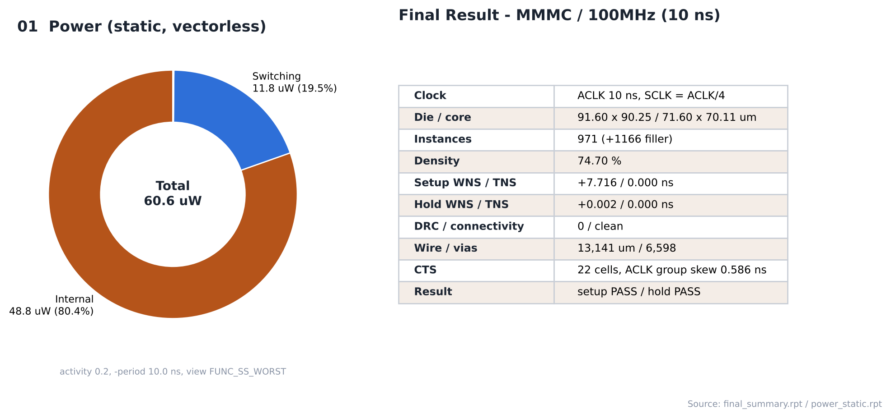
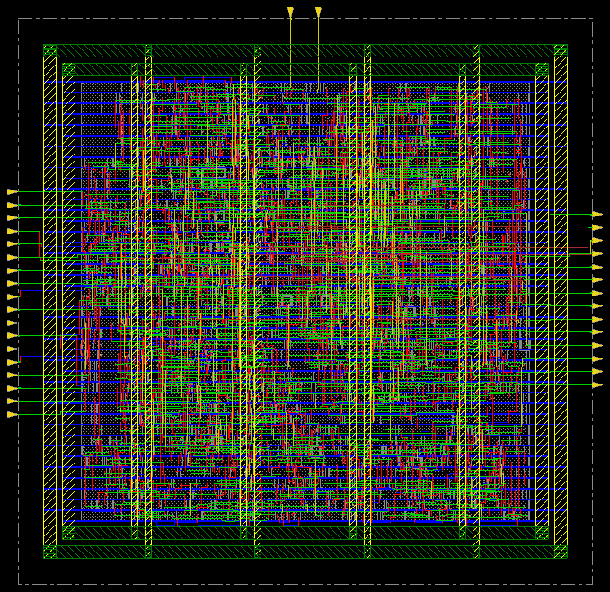

# 19. Final Results — MMMC / 100MHz

| Item | Value |
|---|---|
| Clock | **ACLK 10 ns (100 MHz)**, SCLK = ACLK ÷ 4 (generated clock) |
| Run | 사양 주파수 기준 run |
| Setup WNS (SS) | **+7.716 ns** |
| Hold WNS (FF) | **+0.002 ns** |
| DRC / connectivity | 0 / 0 |
| Instances | 971 (+1,166 filler) |
| Die / core | 91.60 × 90.25 / 71.60 × 70.11 µm |
| Final density | 74.70 % |
| Power (vectorless, activity 0.2) | **60.63 µW** (internal 48.75 · switching 11.80 · leakage 0.079) |

> **MMMC PnR** — setup view `FUNC_SS_WORST` (slow_vdd1v0, RC WORST, 125 °C), hold view `FUNC_FF_BEST` (fast_vdd1v0, RC BEST, 0 °C). 입력은 [04_Synthesis/MMMC](../../../04_Synthesis/MMMC)의 같은 주파수 넷리스트와 SDC입니다. 전체 흐름은 `all.tcl` 한 번 실행 (BUFX2 사용 금지 가드 포함).

---

## Analysis

### A.1 Final Summary / Power



- **What** — 최종 PPA 표와 파워 구성 (`set_default_switching_activity -input_activity 0.2 -period 10.0`)
- **Observe** — internal 80.4 % / switching 19.5 % / leakage 0.13 %
- **Insight** — 파워의 약 80 %가 셀 내부(internal) 전력입니다. 주파수가 오를수록 전체 파워가 함께 커집니다 (100 MHz 60.6 → 500 MHz 331.2 → 625 MHz 422.2 µW).

### A.2 Chip Finish Layout



- **What** — 최종 레이아웃 (filler 포함)
- **Observe** — die 91.60 × 90.25 µm

> 파워 리포트는 `-period 10.0`으로 다시 실행한 결과입니다. 처음 `all.tcl`에 남아 있던 `-period 2.0`으로 돌린 값과 같았습니다 (period 옵션은 클럭이 없는 net에만 적용되기 때문으로 보입니다).

## Outputs

| File | 용도 |
|---|---|
| [`results/spi_bridge_top.gds`](results/spi_bridge_top.gds) | 레이아웃 (표준셀은 이름 참조만, 셀 레이아웃 merge 안 함) |
| [`results/spi_bridge_top_pnr.v`](results/spi_bridge_top_pnr.v) | PnR 넷리스트 (flat) → Post LEC, SPEF STA |
| [`results/spi_bridge_top_pnr.sdc`](results/spi_bridge_top_pnr.sdc) | PnR SDC (`writeTimingCon`) |
| [`results/spi_bridge_top.sdf`](results/spi_bridge_top.sdf) | Innovus SDF |
| [`results/chipfinish.def`](results/chipfinish.def) | 최종 DEF |

## Files

```text
19_Final_Results/MMMC/100MHz/
├── README.md
│
├── images/
│   ├── 01_Final_Summary_Power.png
│   └── 02_ChipFinish_Innovus.png
│
├── reports/
│   ├── innovus.log
│   └── power.rpt
│
└── results/
    ├── chipfinish.def
    ├── spi_bridge_top.gds
    ├── spi_bridge_top.sdf
    ├── spi_bridge_top_pnr.sdc
    └── spi_bridge_top_pnr.v
```
