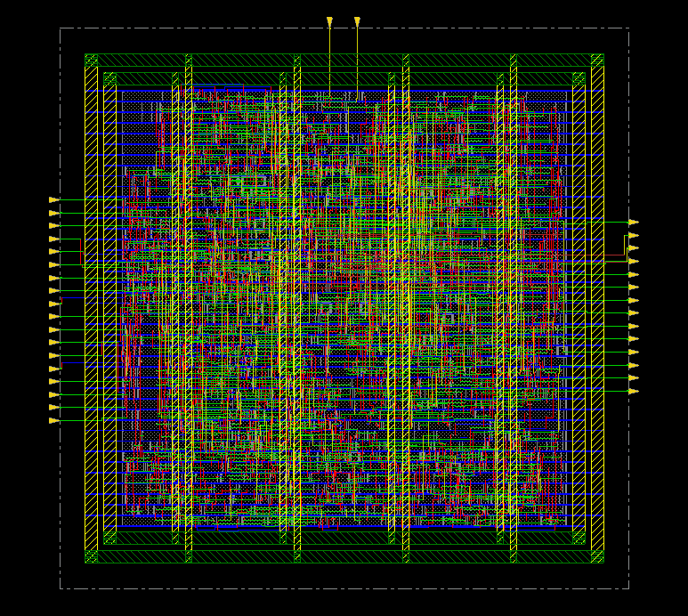

# 19. Final Results — MMMC / 100MHz

| Item | Value |
|---|---|
| Clock | **ACLK 10 ns (100 MHz)**, SCLK = ACLK ÷ 4 |
| Tool | Cadence Innovus 22.17 |
| Setup WNS (SS) | **+7.716 ns** |
| Hold WNS (FF) | **+0.002 ns** |
| DRC / connectivity | 0 / 0 |
| Instances | 971 (filler 제외) |
| Die | 91.6 × 90.25 µm |
| Final density | 74.704 % |
| Power (vectorless, input activity 0.2) | **60.63 µW** (internal 48.75 · switching 11.8 · leakage 0.079 µW) |

> 파워 리포트는 `set_default_switching_activity -input_activity 0.2 -period 10.0`으로 다시 실행한 결과입니다. 처음 `all.tcl`에 남아 있던 `-period 2.0`으로 돌린 값과 같았습니다 (period 옵션은 클럭이 없는 net에만 적용되기 때문으로 보입니다).



| Output | 용도 |
|---|---|
| [`results/spi_bridge_top.gds`](results/spi_bridge_top.gds) | 레이아웃 (표준셀은 이름 참조만, 셀 레이아웃 merge 안 함) |
| [`results/spi_bridge_top_pnr.v`](results/spi_bridge_top_pnr.v) | PnR 넷리스트 (flat) → Post LEC |
| [`results/spi_bridge_top_pnr.sdc`](results/spi_bridge_top_pnr.sdc) | PnR SDC |
| [`results/spi_bridge_top.sdf`](results/spi_bridge_top.sdf) | Innovus SDF |
| [`results/chipfinish.def`](results/chipfinish.def) | 최종 DEF |

## Files

```text
19_Final_Results/MMMC/100MHz/
├── README.md
│
├── images/
│   └── 01_ChipFinish_Innovus.png
│
├── reports/
│   ├── innovus.log
│   └── power.rpt
│
└── results/
    ├── chipfinish.def
    ├── spi_bridge_top.gds
    ├── spi_bridge_top.sdf
    ├── spi_bridge_top_pnr.sdc
    └── spi_bridge_top_pnr.v
```
