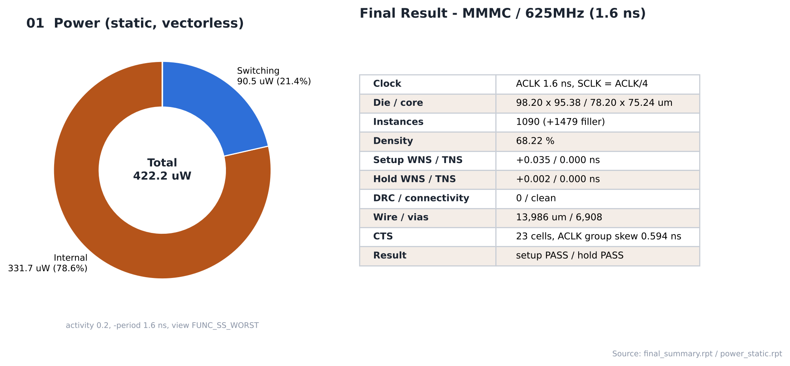
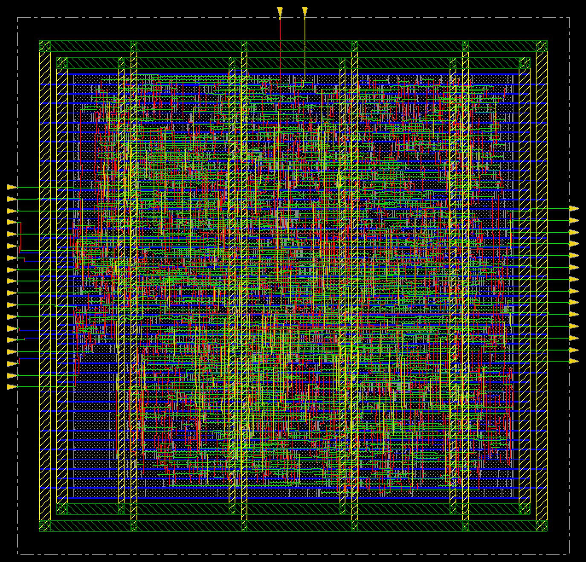

# 19. Final Results — MMMC / 625MHz

| Item | Value |
|---|---|
| Clock | **ACLK 1.6 ns (625 MHz)**, SCLK = ACLK ÷ 4 (generated clock) |
| Run | Fmax 실험 — 합성·PnR 모두 닫힌 최고 주파수 (1.6 ns) |
| Setup WNS (SS) | **+0.035 ns** |
| Hold WNS (FF) | **+0.002 ns** |
| DRC / connectivity | 0 / 0 |
| Instances | 1090 (+1,479 filler) |
| Die / core | 98.20 × 95.38 / 78.20 × 75.24 µm |
| Final density | 68.22 % |
| Power (vectorless, activity 0.2) | **422.21 µW** (internal 331.67 · switching 90.46 · leakage 0.091) |

> **MMMC PnR** — setup view `FUNC_SS_WORST` (slow_vdd1v0, RC WORST, 125 °C), hold view `FUNC_FF_BEST` (fast_vdd1v0, RC BEST, 0 °C). 입력은 [04_Synthesis/MMMC](../../../04_Synthesis/MMMC)의 같은 주파수 넷리스트와 SDC입니다. 전체 흐름은 `all.tcl` 한 번 실행 (BUFX2 사용 금지 가드 포함).

---

## Analysis

### A.1 Final Summary / Power



- **What** — 최종 PPA 표와 파워 구성 (`set_default_switching_activity -input_activity 0.2 -period 1.6`)
- **Observe** — internal 78.6 % / switching 21.4 % / leakage 0.02 %
- **Insight** — 파워의 약 80 %가 셀 내부(internal) 전력입니다. 주파수가 오를수록 전체 파워가 함께 커집니다 (100 MHz 60.6 → 500 MHz 331.2 → 625 MHz 422.2 µW).

### A.2 Chip Finish Layout



- **What** — 최종 레이아웃 (filler 포함)
- **Observe** — die 98.20 × 95.38 µm

## Outputs

| File | 용도 |
|---|---|
| [`results/spi_bridge_top.gds`](results/spi_bridge_top.gds) | 레이아웃 (표준셀은 이름 참조만, 셀 레이아웃 merge 안 함) |
| [`results/spi_bridge_top_pnr.v`](results/spi_bridge_top_pnr.v) | PnR 넷리스트 (flat) → Post LEC, SPEF STA |
| [`results/spi_bridge_top_pnr.sdc`](results/spi_bridge_top_pnr.sdc) | PnR SDC (`writeTimingCon`) |
| [`results/spi_bridge_top.sdf`](results/spi_bridge_top.sdf) | Innovus SDF |
| [`results/chipfinish.def`](results/chipfinish.def) | 최종 DEF |

## Files

```text
19_Final_Results/MMMC/625MHz/
├── README.md
│
├── images/
│   ├── 01_Final_Summary_Power.png
│   └── 02_ChipFinish_Innovus.png
│
├── reports/
│   ├── innovus.log
│   └── power.rpt
│
└── results/
    ├── chipfinish.def
    ├── spi_bridge_top.gds
    ├── spi_bridge_top.sdf
    ├── spi_bridge_top_pnr.sdc
    └── spi_bridge_top_pnr.v
```
