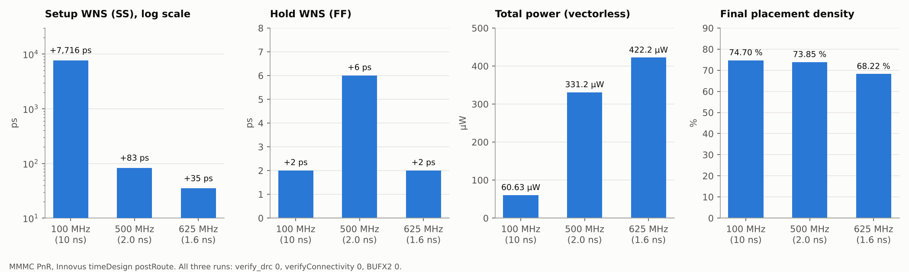

# 19. Final Results

run별 최종 결과(GDS, 넷리스트, SDF, SDC)와 PPA 요약입니다.

> **폴더 구성** — `SLOW` / `FAST`는 slow(SS) / fast(FF) 라이브러리 하나로 합성한 넷리스트를 같은 PnR 조건으로 구현한 **비교 실험**입니다. `MMMC`는 합성도 SS·FF MMMC로 바꾼 **최종 방식**이며, `MMMC/100MHz`가 사양 주파수 기준 run, `500MHz`·`625MHz`는 Fmax 실험입니다.

## Runs

| Run | Setup WNS | Hold WNS | Power (Innovus, vectorless) | 합성 cell area |
|---|---|---|---|---|
| [SLOW / 100MHz](SLOW/100MHz) | +7.728 ns | +0.004 ns | 61.9 µW | 3,506 µm² |
| [SLOW / 500MHz](SLOW/500MHz) | +0.054 ns | +0.003 ns | 302.1 µW | 3,621 µm² |
| [SLOW / 1GHz](SLOW/1GHz) | -0.463 ns | +0.003 ns | 882.4 µW | 4,580 µm² |
| [FAST / 100MHz](FAST/100MHz) | +7.623 ns | +0.002 ns | 61.6 µW | 3,396 µm² |
| [FAST / 500MHz](FAST/500MHz) | +0.024 ns | +0.007 ns | 317.4 µW | 3,398 µm² |
| [FAST / 1GHz](FAST/1GHz) | -0.481 ns | -0.091 ns | 746.5 µW | 3,397 µm² |
| **[MMMC / 100MHz](MMMC/100MHz)** | **+7.716 ns** | **+0.002 ns** | **60.6 µW** | 3,513 µm² |
| [MMMC / 500MHz](MMMC/500MHz) | +0.083 ns | +0.006 ns | 331.2 µW | 3,571 µm² |
| [MMMC / 625MHz](MMMC/625MHz) | +0.035 ns | +0.002 ns | 422.2 µW | 4,117 µm² |
