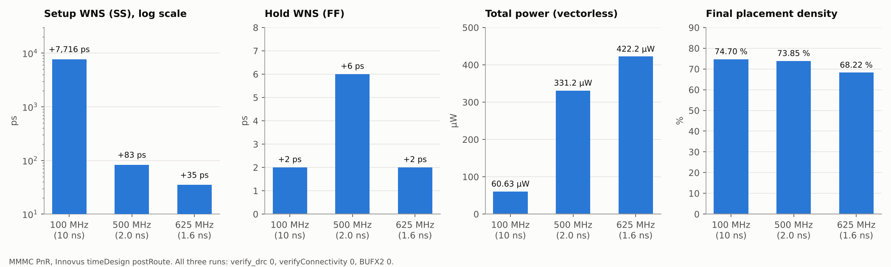

# 8-bit SPI Master/Slave + Async FIFO CDC Bridge — RTL to GDS

`spi_bridge_top`은 칩 내부 SPI Master가 만든 8-bit SPI(Mode 0) 프레임을 SPI Slave가 받고, ACLK ÷ 4로 만든 SCLK 도메인과 ACLK 도메인 사이를 Async FIFO(Gray pointer + 2-FF 동기화)로 넘겨 8-bit register bus로 접근하는 블록입니다. FPGA(XC7Z010)용으로 설계한 RTL을 GPDK045 ASIC 플로우로 구현했습니다.

| Item | Value |
|---|---|
| Top | `spi_bridge_top` (core-only block, IO pad 없음) |
| Clocks | ACLK 100 MHz (사양), SCLK = ACLK ÷ 4 (generated clock) |
| FIFO | RX 8-bit × 16 (SCLK → ACLK), TX 8-bit × 4 (ACLK → SCLK) |
| Technology | GPDK045 `gsclib045` — setup SS (`slow_vdd1v0`, 125 °C), hold FF (`fast_vdd1v0`, 0 °C) |
| Tools | Xcelium 22.03, Genus 22.17, Conformal 22.10, Innovus 22.17, Tempus 22.17 |

## Sign-off Summary — 기준 run (MMMC, 100 MHz)

| Stage | Check | Result |
|---|---|---|
| 03 Functional Verification | RTL self-checking TB (TEST 1 ~ 10) | ALL TESTS PASSED |
| 04 Synthesis | Genus MMMC, setup SS | slack **+7,097 ps**, area 3,513 µm², 828 cells |
| 06 Pre LEC | RTL ↔ synthesis netlist | **PASS** 357 / 357 |
| 07 Pre STA | Tempus, ideal clock (SS) | setup **+7.315 ns** (Genus +7.097 ns, 같은 worst path) |
| 08 Pre-Layout GLS | netlist + Genus SDF | ALL TESTS PASSED |
| 09 ~ 12 PnR | Innovus MMMC | setup **+7.716 ns** / hold **+0.002 ns**, DRC 0 |
| 13 Post LEC | synthesis ↔ PnR netlist | **PASS** 357 / 357 |
| 14 RC / SPEF | netlist + SDC + SPEF → Tempus | setup +7.716 / hold +0.002 ns (DB 결과와 동일), annotation 100 % |
| 15 Post STA | Tempus (SS / FF) | setup +7.716 / hold +0.002 / recovery +9.291 / removal +0.038 ns, RC 100 % |
| 16 Timing Closure | Tempus hold ECO (hold fix 끈 run) | hold **−0.098 → +0.012 ns**, CLKBUFX2 76개, setup 7.714 ns 유지, DRC 0 |
| 17 Post-Layout GLS | PnR netlist + Tempus SDF (max / min) | ALL TESTS PASSED ×2 |
| 18 Final Verification | verify_drc / verifyConnectivity | 0 / 0 |
| 19 Final Results | power (vectorless) | 60.6 µW, 971 instances, die 91.6 × 90.25 µm |

## Fmax 실험 (MMMC)

| ACLK | 합성 slack (SS) | PnR setup | PnR hold | Power | 판정 |
|---|---|---|---|---|---|
| 10 ns (100 MHz) | +7,097 ps | +7.716 ns | +0.002 ns | 60.6 µW | PASS (사양) |
| 2.0 ns (500 MHz) | +11 ps | +0.083 ns | +0.006 ns | 331.2 µW | PASS |
| **1.6 ns (625 MHz)** | **0 ps** | **+0.035 ns** | +0.002 ns | 422.2 µW | **PASS — Fmax** |
| 1.5 ns (667 MHz) | −25 ps | — | — | — | 합성 FAIL |
| 1.4 ns (714 MHz) | −124 ps | — | — | — | 합성 FAIL |

## Chapters

| # | Chapter | Content | Status |
|---|---|---|---|
| 00 | [Specification](00_Specification) | 설계 사양서 v1.1 | 완료 |
| 01 | [Architecture](01_Architecture) | 블록 구조, 연결·포트 표 | 완료 |
| 02 | [RTL](02_RTL) | Verilog-2001 RTL 8개 모듈 | 완료 |
| 03 | [Functional Verification](03_Functional_Verification) | Xcelium self-checking TB | 완료 |
| 04 | [Synthesis](04_Synthesis) | Genus — SLOW/FAST 비교 → MMMC, 주파수 스윕 | 완료 |
| 05 | [DFT](05_DFT) | scan 삽입 (ATPG 툴 없음) | 예정 |
| 06 | [Pre LEC](06_Pre_LEC) | Conformal, RTL ↔ 합성 넷리스트 | 완료 (PASS) |
| 07 | [Pre STA](07_Pre_STA) | 합성 후 STA (Genus + Tempus) | 완료 |
| 08 | [Pre Layout Sim](08_Pre_Layout_Sim) | 합성 넷리스트 + SDF GLS | 완료 (PASS) |
| 09 | [Floorplan](09_Floorplan) | floorplan, power plan | 완료 |
| 10 | [Placement](10_Placement) | place_opt | 완료 |
| 11 | [CTS](11_CTS) | CCOpt | 완료 |
| 12 | [Routing](12_Routing) | NanoRoute | 완료 |
| 13 | [Post LEC](13_Post_LEC) | Conformal, 합성 ↔ PnR 넷리스트 | 완료 (PASS) |
| 14 | [RC Extraction](14_RC_Extraction) | Innovus extractRC, SPEF + Tempus 재현 | 완료 |
| 15 | [Post STA](15_Post_STA) | Tempus signoff STA | 완료 (100 MHz) |
| 16 | [Timing Closure](16_Timing_Closure) | optDesign, BUFX2 ECO 사례, Tempus hold ECO | 완료 |
| 17 | [Post Layout Sim](17_Post_Layout_Sim) | PnR 넷리스트 + SDF GLS (max/min) | 완료 (PASS) |
| 18 | [Final Verification](18_Final_Verification) | DRC, connectivity | 완료 (LVS 없음) |
| 19 | [Final Results](19_Final_Results) | GDS, 넷리스트, SDF, PPA | 완료 |

## SLOW / FAST 비교 실험 (MMMC 전환 근거)

같은 RTL을 slow(SS) / fast(FF) 라이브러리 하나로 합성하고, PnR은 같은 조건(setup SS, hold FF)으로 구현했습니다.

| Run | 합성 ACLK slack | PnR setup WNS | PnR hold WNS | DRC | 판정 |
|---|---|---|---|---|---|
| SLOW 100 MHz | +7,101 ps | +7.728 ns | +0.004 ns | 0 | PASS |
| SLOW 500 MHz | +1.8 ps | +0.054 ns | +0.003 ns | 0 | PASS |
| SLOW 1 GHz | −608 ps | −0.463 ns | +0.003 ns | 0 | setup FAIL |
| FAST 100 MHz | +9,075 ps | +7.623 ns | +0.002 ns | 0 | PASS |
| FAST 500 MHz | +1,109 ps | +0.024 ns | +0.007 ns | 0 | PASS |
| FAST 1 GHz | +109 ps | −0.481 ns | −0.091 ns | 0 | setup·hold FAIL |

FAST 1 GHz는 합성에서 +109 ps로 통과했지만 SS 조건의 PnR에서 −0.481 ns로 깨졌습니다. 합성 코너가 PnR 검사 코너와 다르면 합성 결과를 믿을 수 없으므로, 합성도 SS·FF MMMC로 바꿨습니다 ([04_Synthesis](04_Synthesis#mmmc-스크립트-vs-slowfast-스크립트)).

## Prerequisites

- **PDK**: Cadence GPDK045 (`gsclib045` v4.4) — **라이선스 자료라 이 저장소에 포함하지 않습니다.** 스크립트의 경로(`../../../GPDK045/...`)를 각자 PDK 위치로 맞추면 됩니다.
- **Tools**: Xcelium, Genus, Conformal, Innovus, Tempus

## Notes

- PnR 타이밍은 Innovus `timeDesign`, 기준 run은 Tempus로 다시 확인했습니다. RC는 Innovus 내장 추출(captable 기반)이며 Quantus signoff 추출이 아닙니다.
- 물리 검증은 Innovus `verify_drc` / `verifyConnectivity` 기준이며, foundry rule deck DRC와 LVS는 실행하지 않았습니다.
- 사양 목표는 ACLK 100 MHz / SCLK 25 MHz이고, 500 MHz · 625 MHz · 1 GHz는 타이밍 여유를 보기 위한 실험 조건입니다.
