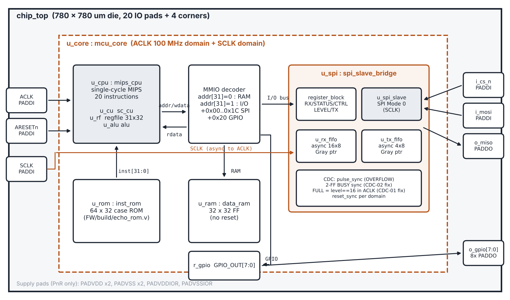
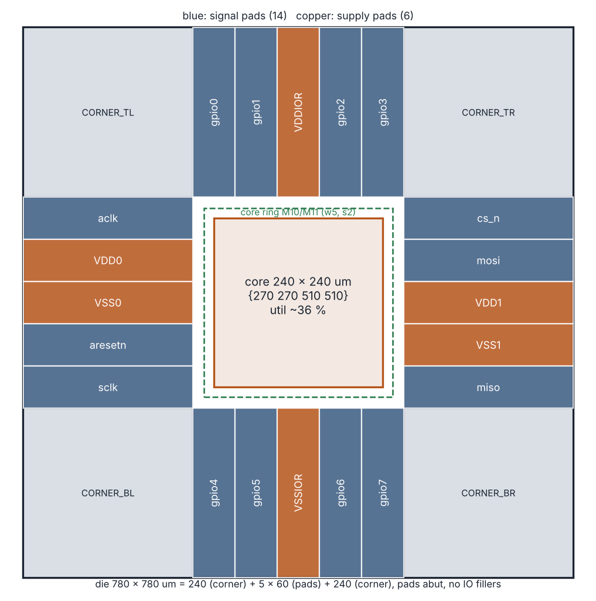

# 01. Architecture

## 블록 다이어그램



- **What** — `chip_top` = IO 패드 14개 + `mcu_core`. `mcu_core`는 CPU, 명령어 ROM, 데이터 RAM,
  MMIO 디코더, SPI 브릿지, GPIO 레지스터로 구성됩니다.
- **Observe** — SCLK는 외부 호스트가 주는 클럭이라 ACLK와 비동기입니다. 두 도메인은
  SPI 브릿지 안의 Async FIFO(Gray 포인터)와 동기화기로만 연결됩니다.
- **Insight** — CPU 쪽은 전부 ACLK 단일 도메인이라 STA가 단순하고, CDC는 브릿지 한 곳에
  모여 있어 검증과 SDC(`set_clock_groups -asynchronous`)를 그 경계에만 집중할 수 있습니다.

## 계층

```
chip_top
├── u_pad_*  (PADDI ×5, PADDO ×9)               ── 전원 패드 6개는 PnR 넷리스트에서 추가
└── u_core : mcu_core
    ├── u_reset_sync_core   reset_sync           ACLK 리셋 (CPU / GPIO)
    ├── u_cpu               mips_cpu             싱글 사이클 MIPS
    │   ├── u_cu            sc_cu                디코더 / 제어 신호
    │   ├── u_rf            regfile              31 × 32 FF (r0 없음)
    │   └── u_alu           alu                  add/sub/and/or/xor/lui/shift
    ├── u_rom               inst_rom             64 × 32 case ROM (FW/build/echo_rom.v)
    ├── u_ram               data_ram             32 × 32 FF, 리셋 없음
    ├── u_spi               spi_slave_bridge     SPI Mode 0 slave + CDC
    │   ├── u_reset_sync_aclk / u_reset_sync_sclk
    │   ├── u_spi_slave     spi_slave            SCLK 도메인 시프트 레지스터
    │   ├── u_rx_fifo       async_fifo (16 × 8)  SCLK → ACLK
    │   ├── u_tx_fifo       async_fifo (4 × 8)   ACLK → SCLK
    │   ├── u_overflow_pulse_sync  pulse_sync    SCLK → ACLK
    │   └── u_register_block register_block      ACLK, CPU 버스 인터페이스
    └── r_gpio              GPIO_OUT[7:0]
```

## 클럭 / 리셋 도메인

| 도메인 | 클럭 | 블록 | 리셋 |
|---|---|---|---|
| ACLK | 10 ns | CPU, ROM, RAM, GPIO, register_block, FIFO 읽기/쓰기 ACLK 쪽 | `u_reset_sync_core`, `u_reset_sync_aclk` |
| SCLK | 41 ns (TB) / SDC 40 ns | spi_slave, FIFO SCLK 쪽, busy 플롭 | `u_reset_sync_sclk` |

| CDC 경로 | 방향 | 방법 |
|---|---|---|
| RX 데이터 | SCLK → ACLK | Async FIFO 16 × 8, Gray 포인터 2-FF |
| TX 데이터 | ACLK → SCLK | Async FIFO 4 × 8, Gray 포인터 2-FF |
| OVERFLOW | SCLK → ACLK | pulse_sync (toggle + 2-FF) |
| SPI_BUSY | SCLK → ACLK | **SCLK 플롭 → 2-FF** (CDC-02 수정: 예전엔 조합 신호를 바로 동기화) |
| STATUS.FULL | – | **ACLK 도메인 level==16** (CDC-01 수정: 예전엔 SCLK 쪽 full을 그대로 사용) |

## 칩 평면 (패드 링)



- **What** — 다이 780 × 780 µm, 변마다 패드 5개 + 코너 4개. 패드와 코너가 맞붙어 IO 필러가 없습니다.
- **Observe** — 코어는 240 × 240 µm(사용률 약 36 %)로, 다이 면적의 9 %입니다.
- **Insight** — 패드 개수가 다이 크기를 정하는 **pad-limited** 칩입니다
  (한 변 = 코너 240 × 2 + 패드 60 × 5). 클럭/리셋은 왼쪽, SPI는 오른쪽, GPIO는 위아래로 묶었고,
  코어 전원 패드(VDD/VSS)는 좌우, IO 링 전원 패드(VDDIOR/VSSIOR)는 위아래에 두었습니다.

## 파일

```
01_Architecture/
├── README.md
│
└── images/
    ├── 01_block_diagram.png
    └── 01_pad_ring_floorplan.png
```
