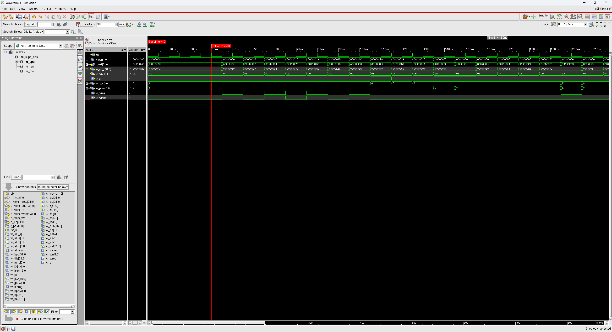
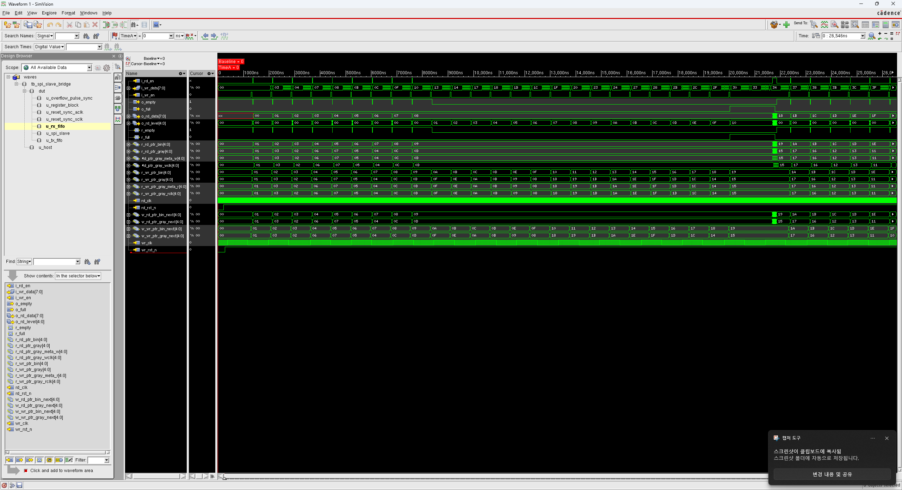
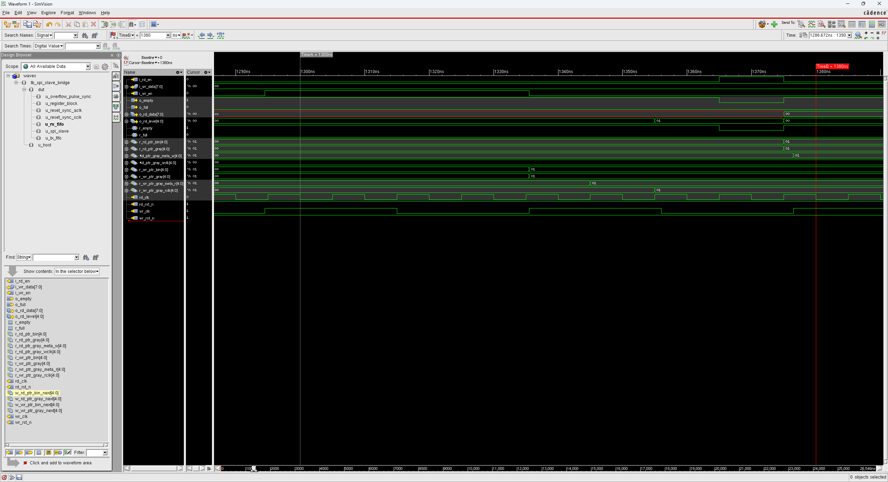
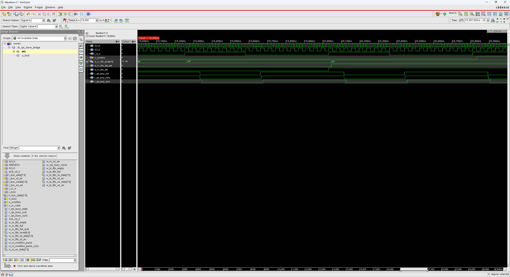
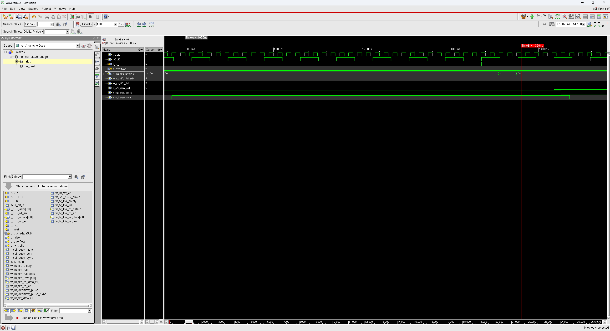
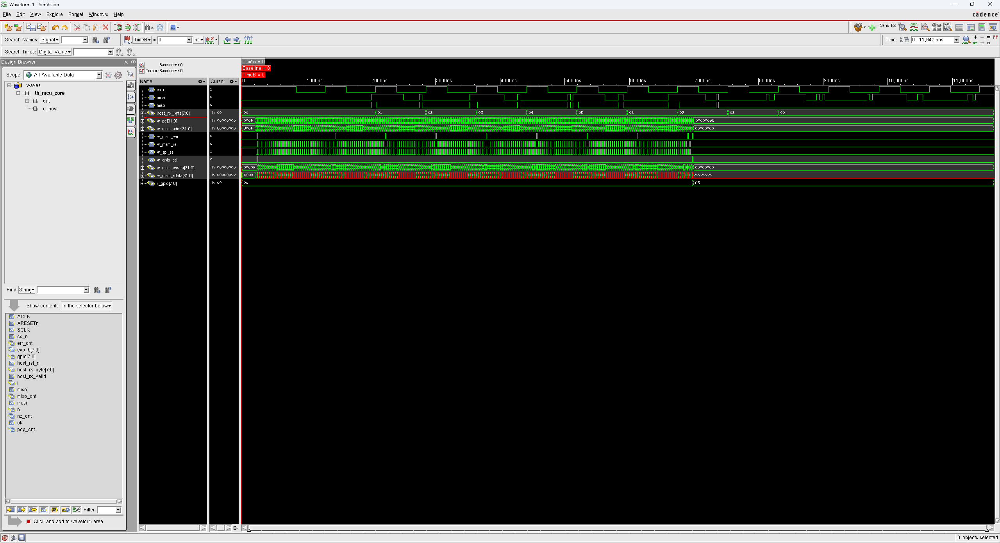
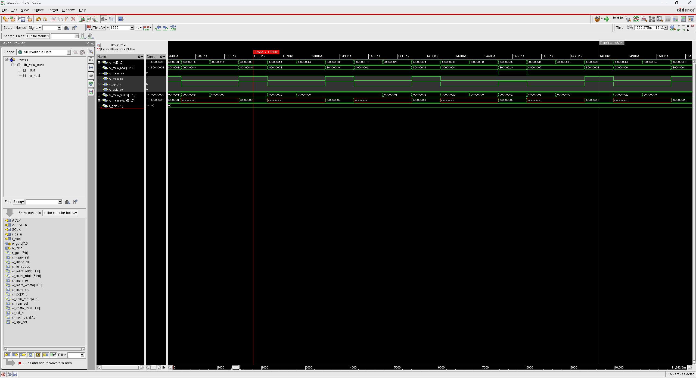

# 03. Functional Verification (RTL, Xcelium)

## 시뮬레이션 4종

| 폴더 | Top | 대상 | 결과 |
|---|---|---|---|
| `SIM/FUNCTION` | `tb_spi_slave_bridge` | SPI 브릿지 단독, TEST0~5 (CDC-01/02 포함) | 24 checks, ALL PASSED |
| `SIM/CPU` | `tb_mips_cpu` | CPU + ROM + RAM, booktest (ISS 기대값 비교) | ALL PASSED |
| `SIM/MCU` | `tb_mcu_core` | MCU 전체 + SPI 호스트 모델, echo 펌웨어 | ALL PASSED |
| `SIM/CHIP` | `tb_chip_top` | 패드 포함 칩, echo 펌웨어 | ALL PASSED |

로그는 `reports/`, 각 그림의 시점·신호 해설은 `results/waveform_notes.md`.

## 파형

### ① CPU 명령 실행 (`SIM/CPU`)

- **What** — 리셋 직후 30~210 ns, booktest 앞부분.
- **Observe** — `sw`(AC01xxxx)에서 `wmem=1, wreg=0`, `lui/ori`에서 `aluc 6/5`,
  PC 0x2C의 `jal 0x80`에서 `pcsrc=3, wn=$31`, PC 0x94의 `bne`에서 `pcsrc=1`로 0x84 복귀.
- **Insight** — 다음 PC 선택(`pcsrc`: PC+4 / branch / jr / jump)이 한 사이클 안에서 정해지는
  싱글 사이클 구조가 그대로 보입니다.

### ② RX Async FIFO (`SIM/FUNCTION`)


- **What** — 위: TEST1(8바이트 쓰고 바로 읽기) → TEST4(16개까지 채움 → FULL → 비우기).
  아래: 첫 바이트 1,290~1,380 ns 확대.
- **Observe** — `r_wr_ptr_gray` 00→01 @1,329 ns (SCLK) → `meta_r` @1,338 → `rclk` @1,348 (ACLK 2사이클)
  → level 01 → empty 0 → 읽기 @1,374 → 읽기 포인터가 SCLK 쪽으로 @1,376.
- **Insight** — 쓰기가 읽기 쪽에 보이기까지 ACLK 2사이클(≈20 ns). Gray 코드라 한 번에
  1비트만 바뀌어, 동기화 중간값이 섞여도 틀린 포인터가 나오지 않습니다.

### ③ CDC-01 / CDC-02 수정 확인 (`SIM/FUNCTION`)


- **What** — 위: TEST4 FULL 순간(19~21 µs). 아래: 첫 프레임 끝(1,000~1,480 ns).
- **Observe** — SCLK 쪽 `w_rx_fifo_full` @20,035 ns, ACLK 쪽 `w_rx_fifo_full_aclk`는
  level 0F→10과 **같은 ACLK 엣지** @20,048 ns, 17번째 바이트에서 `o_overflow` @20,810 ns.
  busy는 `cs_n`↑ @1,355 → `r_spi_busy_sclk` @1,392 (SCLK 플롭) → `meta` @1,400 → `sync` @1,410.
- **Insight** — CPU가 읽는 FULL은 이미 동기화된 포인터로 만든 level에서 나오므로 CDC 경로가
  없고(CDC-01), busy는 SCLK에서 글리치 없는 플롭 출력으로 만든 뒤 넘겨서(CDC-02)
  2-FF 동기화의 전제가 지켜집니다.

### ④ MCU 에코 (`SIM/MCU`)


- **What** — 위: 전체 11.6 µs. 아래: 첫 바이트 처리 1,330~1,510 ns.
- **Observe** — 프레임 8개, `host_rx_byte` 01..08, 바이트마다 `w_mem_we` 1회, 약 7.0 µs에
  `r_gpio` 00→A5, 이후 PC 0x5C(halt). 아래 그림: `lw STATUS`(0x0D = RX_VALID|BUSY|EMPTY)
  → `lw RX_DATA`(0x00, pop) → `+1` → `lw STATUS`(TX_FULL=0) → `sw TX_DATA`(0x01).
- **Insight** — 펌웨어 · CPU · MMIO 디코더 · 레지스터 블록 · FIFO · SPI가 한 경로로 동작함을
  버스 레벨에서 확인했습니다. `w_mem_rdata`의 X는 메모리 접근이 아닌 사이클에서 리셋 없는
  RAM 주소를 가리켜 생기는 값이며 사용되지 않습니다.

## 파일

```
03_Functional_Verification/
├── README.md
│
├── scripts/
│   ├── tb_spi_slave_bridge.v, tb_mips_cpu.v, tb_mcu_core.v, tb_chip_top.v, Spi_master.v
│   └── FUNCTION/ CPU/ MCU/ CHIP/   filelist + run_sim.sh
│
├── reports/   func_sim.log, cpu_sim.log, mcu_sim.log, chip_sim.log
│
├── images/    03_1 ~ 03_4b (7장)
│
└── results/   waveform_notes.md
```
