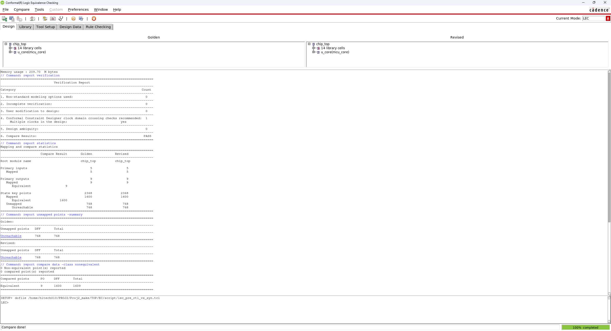

# 06. Pre-LEC — RTL ↔ 합성 넷리스트 (Conformal LEC 22.1)

## 실행

```
cd TOP/EC
lec            (GUI, SETUP> 프롬프트)
dofile ./script/lec_pre_rtl_vs_syn.tcl
```

`lec -nogui`로 띄우면 이 서버에서는 Tcl 모드(`TCL_SETUP>`)로 시작해 `set log file`에서 멈춥니다.
GUI의 일반 모드에서 실행하세요.

| 항목 | 값 |
|---|---|
| Golden | RTL 14개 (Genus가 읽은 목록 그대로, `FW/build/echo_rom.v` 포함) |
| Revised | `SYN/mapped/chip_top_syn_final.v` |
| 라이브러리 | `slow_vdd1v0_basicCells.v` + `pads_SS_s1vg.v` (slow/fast 둘 다 읽으면 duplicate module) |

## 결과 (`reports/chip_top_lec_pre.log`)



| 항목 | Golden | Revised | 결과 |
|---|---|---|---|
| Primary inputs | 5 | 5 | 모두 매핑 |
| Primary outputs | 9 | 9 | **9 Equivalent** |
| State key points | 2,368 | 2,368 | **1,600 Equivalent** |
| Unmapped (Unreachable) | 768 | 768 | 양쪽 같음 |
| Non-equivalent | | | **0** |
| Design ambiguity | | | 0 |
| **Compare Results** | | | **PASS** (1,609 Equivalent) |

- **Observe** — Unreachable 768개는 RTL에도 합성 넷리스트에도 똑같이 있습니다.
  합성이 만든 차이가 아니라, RTL 단계부터 비교 포인트로 이어지지 않는 상태 소자입니다.
- **확인 필요** — 768개의 인스턴스 목록은 아직 뽑지 않았습니다. 펌웨어가 쓰는 레지스터 수
  (`$1`~`$5`, 5개)나 RAM 크기(1,024비트)로는 768이 설명되지 않아 추정하지 않았습니다.
  스크립트 끝에 `report unmapped points -unreachable -golden`을 추가해 두었습니다.
- Verification Report 4번(CDC 검사 권고 1)은 클럭이 둘이라 나오는 안내입니다.

## 파일

```
06_Pre_LEC/
├── README.md
├── scripts/   lec_pre_rtl_vs_syn.tcl, README_HowtoRun_chip_top
├── reports/   chip_top_lec_pre.log
├── images/    06_lec_rtl_vs_syn_PASS.png
└── results/   genus_fv_chip_top/  (Genus가 만든 LEC 매핑 파일)
```
