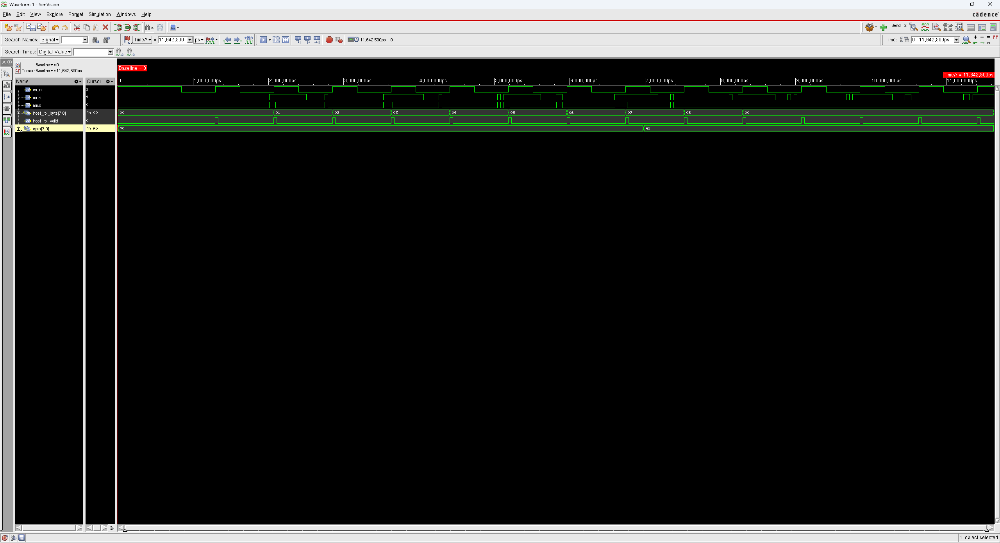

# 08. Pre-layout GLS (합성 넷리스트 + Genus SDF, Xcelium)

## 실행

```
cd TOP/SIM/PRE
source run_pre.tcl          (SimVision이 뜨면 run)
```

| 항목 | 값 |
|---|---|
| 넷리스트 | `SYN/mapped/chip_top_syn_final.v` (계층, Genus) |
| SDF | `SYN/mapped/chip_top_delays.sdf` (Genus, slow 0.9 V 125 °C, 이상적 클럭) |
| 셀 모델 | `slow_vdd1v0_basicCells.v` + `pads_SS_s1vg.v` |
| TB | `tb_chip_top.v`, `+define+GLS +define+SDF_PRE` — 칩 핀만 검사 (GPIO 판정 + MISO 에코) |
| 타이밍 체크 | `cdc_tcheck_off.tfile` — 동기화기 첫 단(Gray 포인터, pulse_sync, busy, reset_sync)만 off |

## 결과



| 항목 | 결과 |
|---|---|
| GPIO = 0xA5 | PASS @ 6,995 ns |
| MISO 에코 0x01..0x08 | PASS @ 10,643 ns |
| 최종 | **ALL TESTS PASSED** |
| Timing violation | **0** |
| SDF path delay 적용 | 16,827 / 19,443 (86.55 %) |
| `$setuphold` / `$recovery` 적용 | 99.99 % / 99.73 % |

- **Observe** — `host_rx_byte` 01..08, `gpio` 00 → A5 @≈7.0 µs, `miso`에 X 없음.
- **Insight** — RTL(03)과 같은 6,995 ns에 판정. 펌웨어가 정해진 ACLK 사이클 수만큼 돌기 때문에
  지연이 붙어도 판정 시각은 같고 엣지 위치만 ps 단위로 움직입니다.
- 경고 해석(SDFNET REMOVAL, tfile 4줄 수정)은 `results/gls_pre_summary.md`.

## TB 보드 지연 (17번에서 발견, 처음부터 반영)

호스트 모델이 SCLK 엣지와 같은 순간(지연 0)에 CS_n을 바꾸면, 칩 안에서 데이터가 클럭보다
32 ps 늦게 도착해 hold 경고가 납니다. SDC는 `set_input_delay -min 0.5`(엣지 후 최소 0.5 ns)를
가정하므로 TB가 약속을 어긴 것입니다. 호스트 → 칩 핀에 1.0 ns 보드 지연을 넣었습니다
(`HOST_IO_DLY`, SDC 범위 0.5~2.0 ns 안).

## 파일

```
08_Pre_Layout_Sim/
├── README.md
├── scripts/   run_pre.tcl, cdc_tcheck_off.tfile, tb_chip_top.v (GLS판)
├── reports/   pre_sim.log, sdf_pre.log
├── images/    08_gls_pre_SS_full.png
└── results/   gls_pre_summary.md
```
