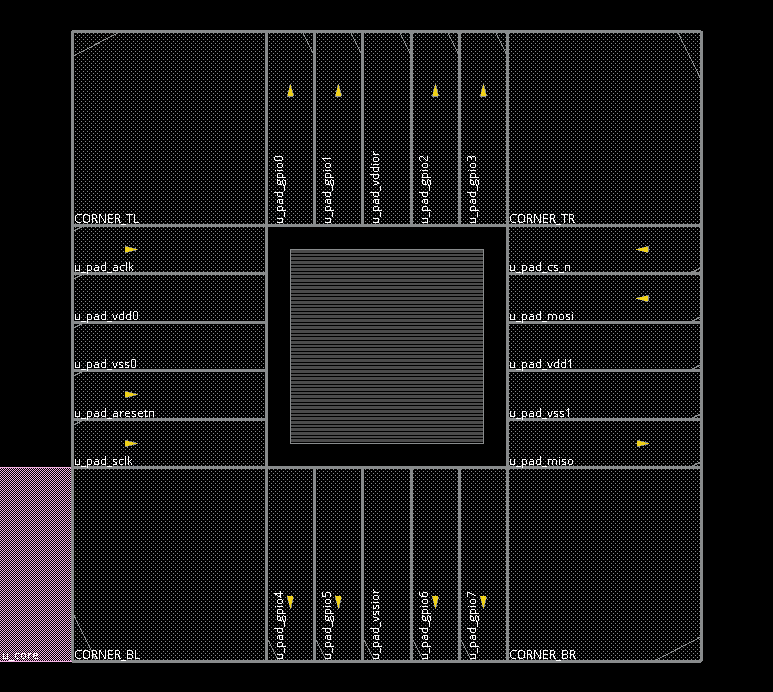
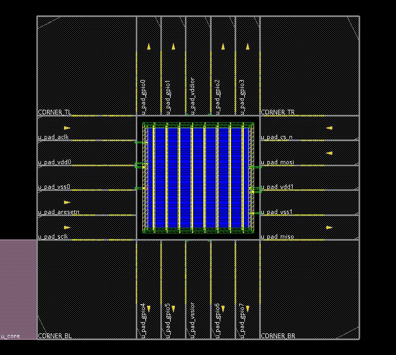
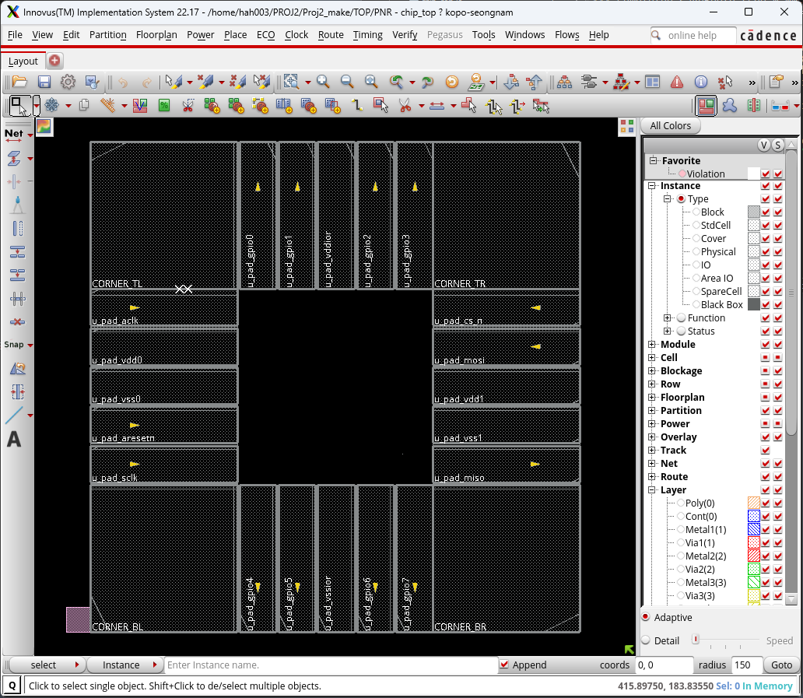
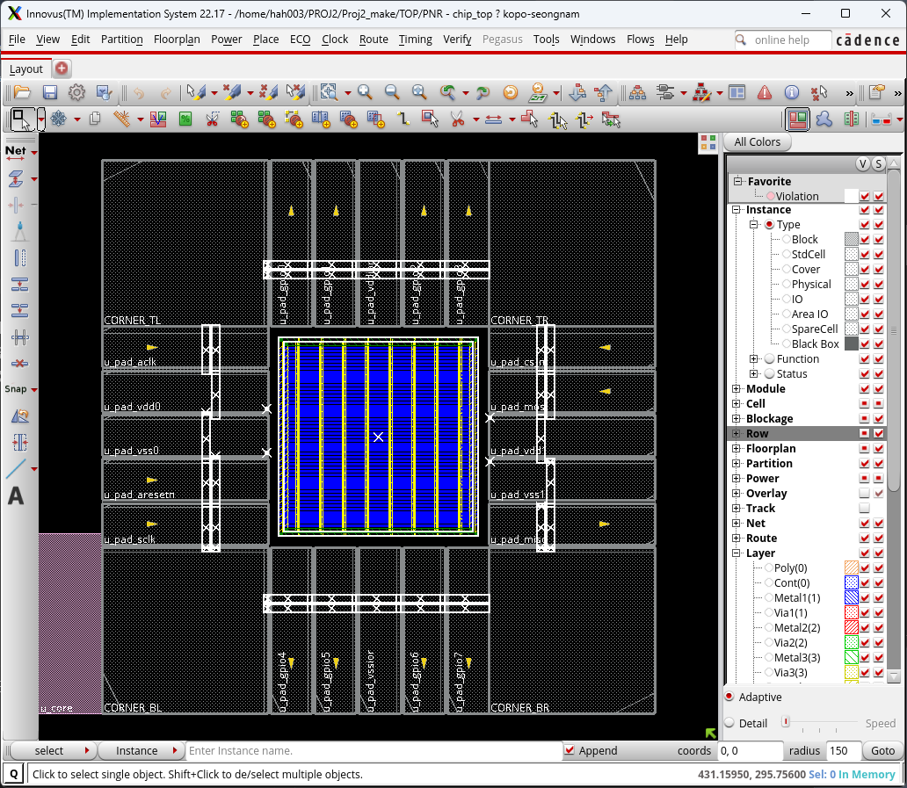
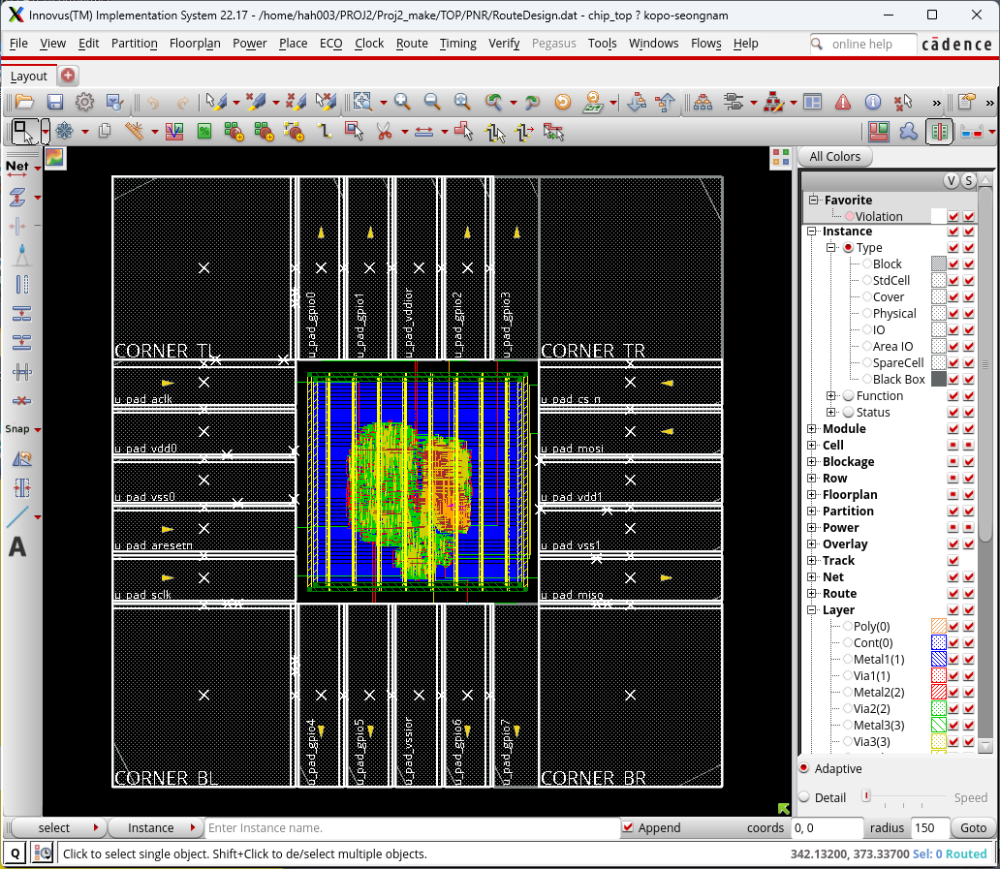

# 09. Floorplan + Power Plan (Innovus 22.17, IO 패드 포함)

## 흐름

```
SYN 넷리스트 (신호 패드 14) ─┐
add_pad_chip (전원 패드 6) ──┼─ make_pnr_netlist.sh ─→ chip_top_pnr_in.v
SYN SDC ─────────────────────┘   (set_ideal_network 제거) → chip_top_pnr_in.sdc
                                         ↓
0_InitDesign.tcl : init_design, floorPlan -coreMarginsBy die -d 780 780 270 270 270 270, loadIoFile
1_PowerPlan.tcl  : core ring M10/M11 → sroute padRing → pad_connect.tcl → corePin → M10 stripes ×8
```

| 항목 | 값 |
|---|---|
| 다이 | 780 × 780 µm (코너 240 × 2 + 패드 60 × 5, 맞붙임, IO 필러 없음) |
| 코어 | {270 270 510 510}, 240 × 240 µm, 합성 셀 기준 사용률 ≈ 36 % |
| 패드 | 신호 14 (PADDI 5, PADDO 9) + 전원 6 + 코너 4 |
| 코어 링 | M10 (수직) / M11 (수평), 폭 5 · 간격 2 · offset 2 |
| 스트라이프 | M10 VDD/VSS 8세트, 폭 2 |
| 전원 패드 → 링 | `pad_connect.tcl` (M3 링크 8개) |
| IO 링 레일 | `sroute -connect padRing` (VDD / VSS / VDDIOR / VSSIOR) |

## 결과




- **What** — 위: 패드 20 + 코너 4 배치 직후. 아래: 링 · 스트라이프 · 패드 연결 후.
- **Observe** — 패드 링이 다이 면적의 대부분이고 코어는 가운데 240 µm 정사각형입니다.
- **Insight** — pad-limited 칩. 패드 수를 줄여도 코너 2개(480 µm)가 남아 다이를 크게 줄일 수 없습니다.

## 문제 해결 기록 (이번 프로젝트의 핵심)

### ① 코어 영역이 0 → `-coreMarginsBy die`

- **증상** — 패드는 제자리인데 코어에 row가 없고 정중앙에 점 하나. 1번 실행 후
  `verifyConnectivity`: `Net VDD: no routing`.
- **원인** — IO가 있으면 `floorPlan -d`의 여백이 패드 안쪽 경계부터 계산됨 (240 + 270 = 510 → 폭 음수).
- **해결** — `floorPlan -coreMarginsBy die`로 다이 끝 기준 명시.

### ② 전원 패드가 코어 링에 안 붙음 → `pad_connect.tcl`

- **증상** — 링과 스트라이프는 생겼지만 전원 패드 안쪽에 흰 X(끊김), `IMPVFC-200`.
- **원인** — `sroute -connect padPin` → `IMPSR-1256: Unable to find any CORE class pad pin`,
  `IO ports routed: 0, open: 23`. giolib045 PADVDD/PADVSS의 코어 쪽 핀(M2/M3, 3.35 µm, 패드 양 끝)에
  `CLASS CORE`가 없고, 셀 전체가 M1~M11 OBS라 sroute가 연결 대상을 찾지 못함.
- **해결** — 패드 위치를 읽어 핀에서 코어 링까지 M3 링크를 직접 긋는 `pad_connect.tcl`
  (`addStripe -area`, 링과 만나는 곳에 스택 비아 자동). 핀 위치가 패드 양 끝에서 대칭이라 방향과 무관.

### ③ 다이 800 / IO 필러 겹침 → 다이 780, 패드 맞붙임

- **증상** — padRing 후 `IMPVFC-200` 131개, 패드 위 마커 다수.
- **원인** — 4 µm 틈에 `addIoFiller -fillAnyGap`이 10 µm 필러를 넣어 패드와 6 µm씩 겹침,
  다이 높이 800.09로 코너 옆 0.09 µm 틈에 필러 2개 중복. 게다가 필러의 IO 링 핀
  (`VDDPAD25`/`VSSPAD`)은 LEF에 `USE SIGNAL`이라 `globalNetConnect`가 안 됨(IMPDB-1221),
  `attachTerm`은 Innovus SEGV.
- **해결** — 다이 780으로 패드와 코너를 맞붙여 필러 제거 → 131 → 26 (나머지는 18 참고).

### ④ PnR 넷리스트 자동 생성 — `make_pnr_netlist.sh`
- 합성 넷리스트에는 전원 패드가 없음(신호 핀이 없어 RTL/합성에 넣을 이유가 없음).
- awk로 `module chip_top` 안의 `endmodule` 바로 앞에 `add_pad_chip` 6줄을 넣고, grep으로
  신호 패드 14 / 전원 패드 6을 검증. 같은 스크립트가 PnR용 SDC(`set_ideal_network` 제거, 11 참고)도 생성.
- 이전 프로젝트에서 손으로 붙여 넣던 단계를 재현 가능한 스크립트로 바꿈. `clean.tcl`은 입력 넷리스트를 지우지 않음.

## 파일

```
09_Floorplan/
├── README.md
│
├── scripts/
│   ├── 0_InitDesign.tcl, 1_PowerPlan.tcl, pad_connect.tcl
│   ├── make_pnr_netlist.sh, add_pad_chip, chip_top.io, chip_top.mmmc.view
│   └── all.tcl, run_pnr.csh, clean.tcl, capture.tcl, README_chip_top.md
│
└── images/
    ├── 00_floorplan.gif, 01_powerplan.gif
    └── debug1 ~ debug3 (문제 해결 과정 캡처)
```
