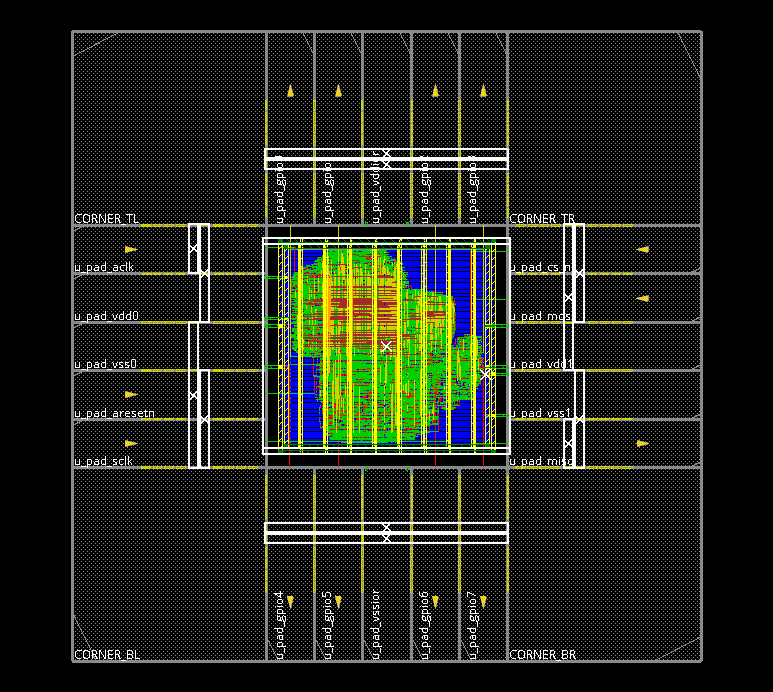
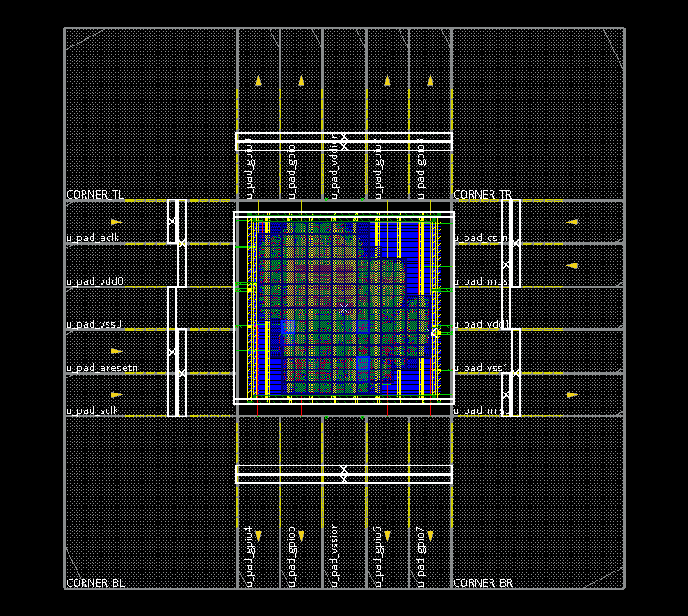
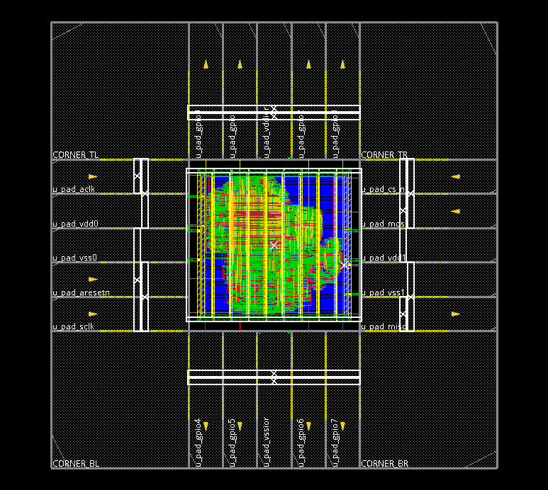
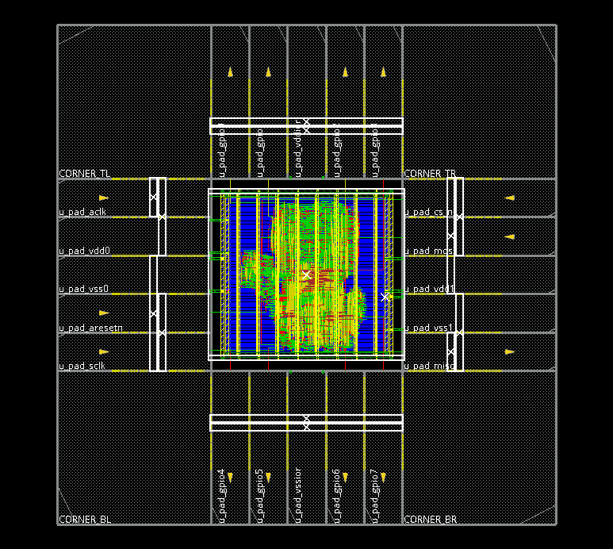
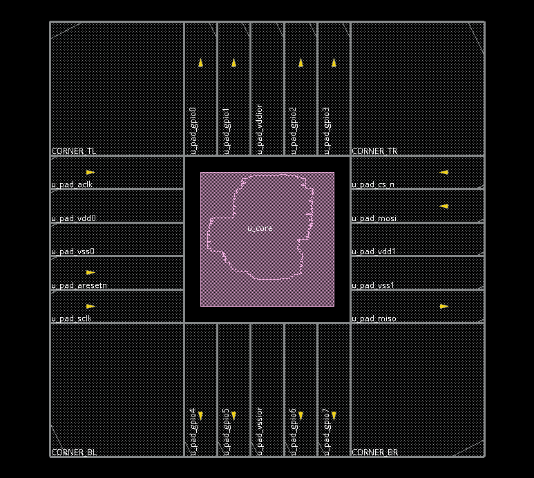

# 10. Placement (Innovus `place_opt_design`)

## 결과 (`reports/preCTS/`, SS, 이상적 클럭)

| 항목 | 값 |
|---|---|
| Setup WNS / TNS | **+0.351 ns** / 0 |
| 위반 경로 | 0 |
| DRV (max_cap / max_tran / fanout / length) | 0 |
| 밀도 | 35.4 % |
| 배선 오버플로 (trial route) | 0.00 % H / 0.00 % V |

임계 경로: `r_pc_reg_3` → ROM 디코드 → CU → ALU → regfile 쓰기 (도착 9.85 ns).
합성 때 최악이던 `sw → TX 레지스터` 경로는 Innovus 최적화(`FE_OFC*` 버퍼, `FE_RC*` 재구성)로 앞섬.

## 캡처







- **What** — 초기 배치 → 셀 밀도 → 핀 밀도 → 최적화 후 → 모듈 영역.
- **Observe** — 셀이 코어 가운데·위쪽에 모이고 왼쪽 아래가 비어 있음. 밀도 맵에 과밀(빨강) 영역 없음.
  좌우 전원 패드에서 코어 링으로 들어가는 `pad_connect` 링크가 보임.
- **Insight** — 밀도 36 %라 배치·배선 여유가 충분합니다. amoeba 뷰는 최상위가 `chip_top`이라
  `u_core` 하나로 보이며, CPU / RAM / SPI를 나누어 보려면 계층 깊이를 내려 캡처해야 합니다.

## 파일

```
10_Placement/
├── README.md
├── scripts/   2_PlaceOpt.tcl
├── reports/   preCTS/ (summary, tarpt, cap, tran, fanout, length)
└── images/    02a ~ 02e
```
