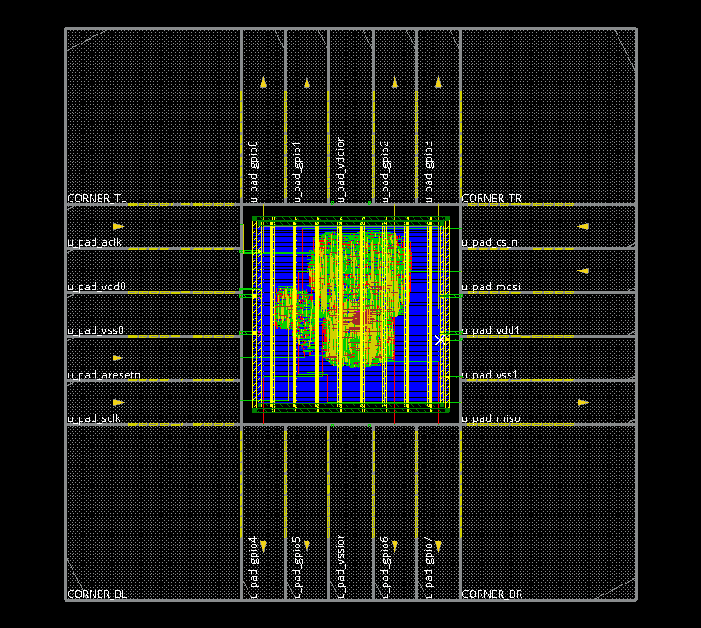
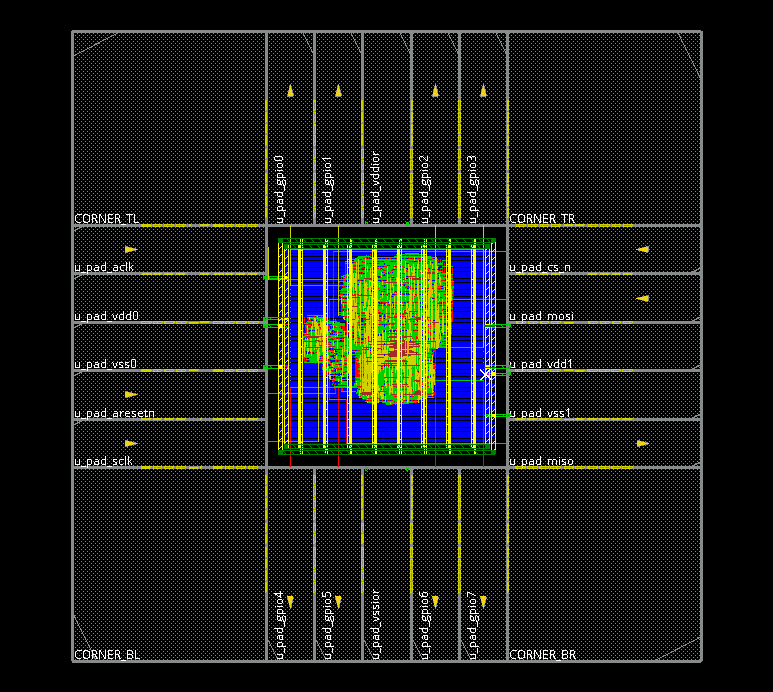

# 11. CTS (Innovus CCOpt)

## 결과

| 항목 | 값 |
|---|---|
| 클럭 버퍼 | **117** (CLKBUFX4 94, X3 20, X2 3) + 인버터 2 |
| ACLK skew / latency | **83 ps** / 0.335 ~ 0.418 ns |
| SCLK skew / latency | **61 ps** / 0.342 ~ 0.404 ns |
| Setup WNS (postCTS → postCTS opt) | +0.268 → **+0.293 ns** |
| Hold WNS (FF, postCTS) | +0.051 ns |
| 밀도 | 35.9 % |

skew 최대값은 상승 엣지 플롭과 하강 엣지 플롭(`CKN`, 예: `r_empty_reg`, `o_miso_reg`) 사이에서 나옵니다.
상승 엣지 플롭끼리는 0.403 ~ 0.418 ns로 15 ps 안쪽입니다.

## 캡처




- **What** — CTS 직후 / CTS 후 최적화.
- **Observe** — ACLK(패드 `u_pad_aclk`)와 SCLK(`u_pad_sclk`)가 각자 패드에서 시작하는 독립 트리 두 개.
- **Insight** — ACLK 트리는 regfile + RAM 플롭 약 2,000개를 구동해 버퍼 102개, SCLK 트리는 15개.

## 문제 해결: CTS를 했는데 클럭 버퍼 0개 (16번과 연결)

| | 수정 전 | 수정 후 |
|---|---|---|
| Buffers / Inverters | **0** / 2 | **117** / 2 |
| skew.rpt | 모든 플롭 skew 0.000, latency 0.400 (SDC의 source 0.2 + network 0.2) | 플롭마다 다른 실제 지연 |
| clock_trees.rpt | `8 nets marked ideal_network, which will not have been buffered` | 경고 사라짐 |

- **원인** — 합성 SDC의 `set_ideal_network [get_ports {ACLK SCLK ARESETn}]`가 PnR까지 넘어와 CCOpt가 트리를 만들지 않음.
  스크립트의 `set_propagated_clock`이 있어도 효과 없음.
- **해결** — `make_pnr_netlist.sh`가 합성 SDC에서 `set_ideal_network`만 뺀 `chip_top_pnr_in.sdc`를 만들고 MMMC가 이를 읽게 함.
  합성 단계에서는 클럭/리셋에 버퍼를 넣지 않도록 이상적 넷이 맞고, PnR에서는 빼야 함.
- 남은 경고 2줄(dont_touch 2, ideal 2)은 클럭 루트가 칩 포트라 **칩 핀 → 패드 PAD 핀** 구간으로, 원래 버퍼를 넣을 수 없는 곳입니다.

## 파일

```
11_CTS/
├── README.md
├── scripts/   3_PostCTSopt.tcl
├── reports/   postCTS/, postCTS_opt/, clock/ (clock_trees, skew, skew_groups)
└── images/    03a_cts.gif, 03b_postcts_opt.gif
```
