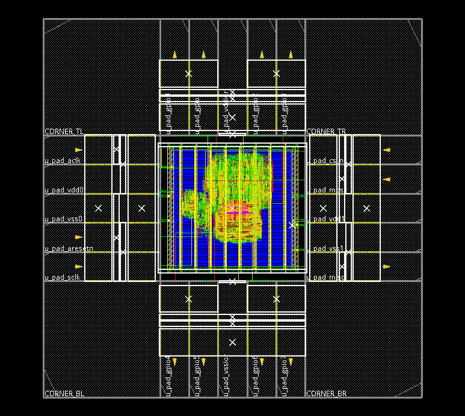
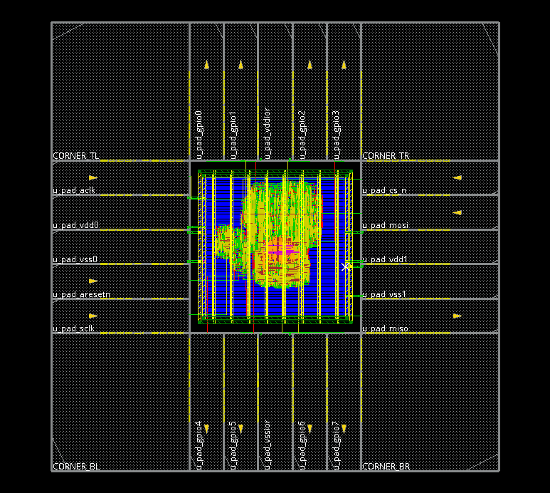
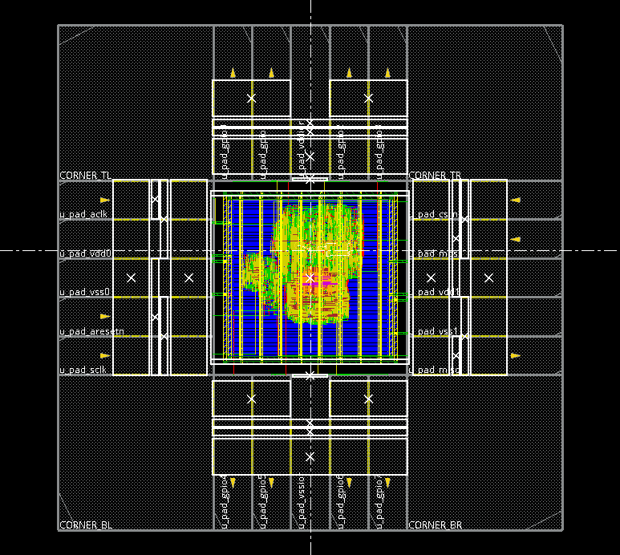

# 12. Routing + Chip Finish (Innovus)

## 결과

| 항목 | 값 |
|---|---|
| Setup WNS (SS, postRoute opt) | **+0.677 ns**, TNS 0 |
| Hold WNS (FF) | **+0.051 ns**, TNS 0 |
| verify_drc | **0** (route 후, chip finish 후 모두) |
| verifyConnectivity | 신호 넷 전부 연결. IO 링 `IMPVFC-200` 26 + VSS 길이 0 M3 조각 1 (18 참고) |
| 정적 전력 (SS, 입력 activity 0.2) | 4.79 mW — internal 3.759 / switching 0.343 / leakage 0.688, 패드 14개가 4.02 mW (84 %) |
| 출력 | `chip_top.gds` (8.7 MB), `chip_top_pnr.v`, `chip_top_pnr_pg.v`, `chip_top_pnr.sdc`, SDF WC/BC |

postRoute에서 setup이 오히려 좋아진 것은 postRoute 최적화가 실제 배선 RC를 보고 경로를 다시 다듬었기 때문입니다.

## 캡처






- **What** — 배선 → DRC 마커 → postRoute 최적화 → 필러 · 메탈 필 후 최종.
- **Observe** — DRC 마커 없음. 패드 위에 남은 흰 마커는 IO 링 레일 연결 검사(26개) 표시입니다.
- **Insight** — 신호 배선은 코어 안에서 끝나고 패드 연결은 패드 핀까지 짧게 나가, 배선 혼잡 없이 마무리되었습니다.

## 스크립트 메모

- `5_ChipFinish.tcl`이 SDF를 `chip_top_wc.sdf`(FUNC_SS_WORST) / `chip_top_bc.sdf`(FUNC_FF_BEST)로 나눠 출력.
  GLS에는 Tempus 사인오프 SDF(15)를 사용.
- `6_ECO.tcl`은 같은 세션에서 `source`하면 `restoreDesign` 중복(IMPIMEX-7031)으로 멈춥니다.
  Tempus ECO 파일이 있을 때 **새 Innovus 세션**에서 실행하는 단계입니다 (16 참고).

## 파일

```
12_Routing/
├── README.md
├── scripts/   4_RouteDesign_PowerAnalysis.tcl, 5_ChipFinish.tcl
├── reports/   postRoute/, postRoute_hold/, chip_top.drc.rpt, chip_top.conn.rpt, power_static_SS.rpt
├── images/    04a ~ 04c, 05_chipfinish
└── results/   chip_top_pnr.v, chip_top_pnr.sdc
```
