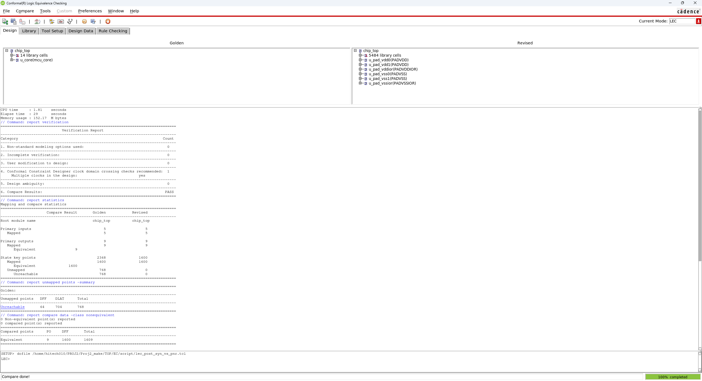

# 13. Post-LEC — 합성 넷리스트 ↔ PnR 넷리스트 (Conformal LEC 22.1)

## 실행

```
cd TOP/EC
lec
dofile ./script/lec_post_syn_vs_pnr.tcl
```

| 항목 | 값 |
|---|---|
| Golden | `SYN/mapped/chip_top_syn_final.v` (계층) |
| Revised | `PNR/chip_top_pnr.v` (ChipFinish, flat) + `pad_supply_stubs.v` |
| 전원 패드 | PnR 넷리스트의 PADVDD/PADVSS/PADVDDIOR/PADVSSIOR 6개는 신호 핀이 없어 빈 모듈로 읽음 (비교 포인트 없음) |

처음에는 stub 파일을 `SIM/POST`에서 찾다가 다른 계정 경로라 실패했습니다.
`EC/script/` 안에 같은 파일을 두어 스크립트가 스스로 완결되게 했습니다.

## 결과 (`reports/chip_top_lec_post.log`)



| 항목 | Golden | Revised | 결과 |
|---|---|---|---|
| Primary inputs / outputs | 5 / 9 | 5 / 9 | **9 Equivalent** |
| State key points | 2,368 | 1,600 | **1,600 Equivalent** |
| Unmapped (Golden, Unreachable) | 768 (DFF 64 + DLAT 704) | 0 | – |
| Non-equivalent | | | **0** |
| **Compare Results** | | | **PASS** (1,609 Equivalent) |

- **Observe** — 06번과 같은 768개가 Golden에서 Unreachable이고, Revised에는 없습니다.
  Innovus 최적화가 출력이 어디에도 연결되지 않은 셀을 지운 것으로 보입니다 (`optDesign` 기본 동작).
- **Observe** — 로그의 `(F13) Converted 704 DFF(s) to DLAT(s) due to direct feedback`: Golden 쪽 플롭 704개가
  Q → D 직접 피드백(값을 계속 유지하는 구조)으로 모델링되어 래치로 바뀌었고, 이 704개가 Unreachable 768에 들어갑니다.
  key point 수도 Golden 2,382 vs Revised 1,614로, PnR 넷리스트에는 이 플롭들이 없습니다.
- **확인 필요** — 어떤 플롭인지는 `report unmapped points -unreachable -golden` 목록으로 봐야 합니다.
  펌웨어가 쓰는 레지스터는 `$1`~`$5`라 미사용 레지스터 26개 × 32 = 832로 768과 맞지 않아 추정하지 않았습니다.
- **Insight** — CTS 버퍼 117개, `FE_OFC*`/`FE_RC*` 최적화, 레이아웃 변경 후에도 기능이 같음을 확인.
  ECO를 하지 않았으므로(16) 최종 넷리스트 = 이 비교의 Revised입니다.

## 파일

```
13_Post_LEC/
├── README.md
├── scripts/   lec_post_syn_vs_pnr.tcl, pad_supply_stubs.v, README_HowtoRun_chip_top
├── reports/   chip_top_lec_post.log
└── images/    13_lec_syn_vs_pnr_PASS.png
```
